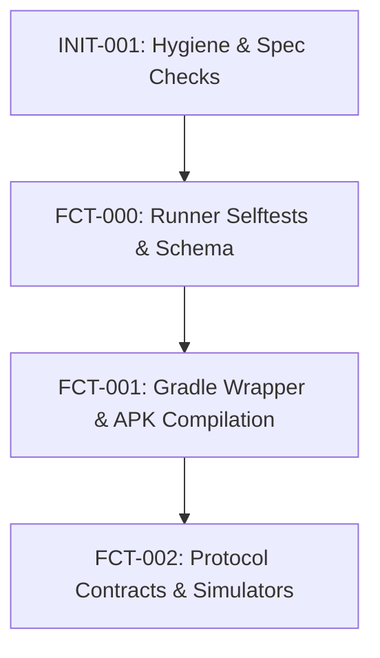

# FCT-000 — Verification Harness Bootstrap Proposal

**Document ID:** PROP-HARN-01  
**Target Milestone:** FCT-000  
**Status:** PROPOSED BOOTSTRAP DESIGN  
**Date:** 2026-11-24  
**Author:** Verification Architect  

---

## 1. Context and Problem Statement

A naive verification harness design for an Android project introduces an immediate **deadlock**:
- The project constitution requires all candidate commits to pass automated checks via `verification/run.py`.
- If `policies/checks.json` requires `./gradlew test` before a Gradle project or Android SDK exists, the harness will fail with exit code 2 (`Harness ERROR`).
- Conversely, creating Gradle modules before establishing the verification harness violates the **Verification-First** principle (building code before knowing how to verify).

**Solution:** An **Incremental, Progressive Check Activation Model** decoupled across early milestones.

---

## 2. Progressive Check Activation Matrix



| Milestone | Active Checks in `policies/checks.json` | Technology | Failure Condition |
| :--- | :--- | :--- | :--- |
| **INIT-001** | Documentation presence, markdown hygiene, RE checksum verification. | Python 3 standard library | Missing required document, broken link, invalid hash. |
| **FCT-000** | Runner selftests (intentional fail, timeout, dirty checkout, invalid report). | Python 3 standard library (zero Android dependencies) | Runner fails to catch fault injection or crashes. |
| **FCT-001** | Gradle build check, Android lint, APK artifact validation. | Gradle 8.10.2 + AGP 8.7.2 + JDK 21 | Build failure, lint error, missing APK. |
| **FCT-002** | Protocol contract tests, state machine tests, MockWebServer simulated WebSocket. | JUnit 5 + MockWebServer + Coroutines Test | Protocol schema mismatch, state violation. |
| **FCT-003+** | SLAM map matrix golden tests, coordinate transform precision, UI tests. | Compose UI Test + AssertK | Canvas rendering drift, memory leak. |

---

## 3. Harness Architecture (`verification/run.py`)

The runner is implemented in pure Python (standard library only) following the reference implementation in Section 7.5 of the SDD 2.0 Playbook.

### 3.1 Key Architectural Responsibilities
1. **Clean Checkout Enforcement:** Executes `git status --porcelain --untracked-files=all`. Must be completely clean before and after execution.
2. **Policy Integrity Verification:** Computes SHA-256 digest of `policies/checks.json` and embeds it in the execution report.
3. **Subprocess Isolation:** Executes commands directly via `subprocess.run(c["argv"], shell=False)` with explicit timeout enforcement.
4. **Evidence Collection:** Captures combined stdout/stderr for each check into `artifacts/verification/<run_id>/<check_id>.log` and computes its cryptographic hash.
5. **Fail-Closed Verdict:** Any non-zero exit code, timeout, missing required check, or post-run repository mutation results in a strict `FAIL` verdict and exit code 1.

### 3.2 Evidence Report Schema (`report.json`)
```json
{
  "$schema": "https://json-schema.org/draft/2020-12/schema",
  "schema_version": 1,
  "run_id": "4a7f9b8c2e1d4a0b8f1c3e5d7a9b0c2e",
  "tested_sha": "a1b2c3d4e5f6a1b2c3d4e5f6a1b2c3d4e5f6a1b2",
  "policy_sha256": "e3b0c44298fc1c149afbf4c8996fb92427ae41e4649b934ca495991b7852b855",
  "started_at": "2026-11-24T12:00:00.000Z",
  "finished_at": "2026-11-24T12:01:30.000Z",
  "environment": {
    "python": "3.12.3",
    "platform": "linux",
    "os": "Ubuntu 24.04 LTS (WSL2)"
  },
  "ci_run_id": null,
  "checkout_unchanged": true,
  "verdict": "PASS",
  "checks": [
    {
      "id": "spec-hygiene",
      "required": true,
      "status": "PASS",
      "exit_code": 0,
      "duration_seconds": 0.42,
      "log": "spec-hygiene.log",
      "log_sha256": "9f83c60517b4d0ad720ac976e390134440090ff8bc89452729a194c82e16675e"
    }
  ]
}
```

---

## 4. Selftest Suite Design for FCT-000

The integrity of the verification harness itself must be verified before relying on it for application code:

1. **Selftest 1 (Clean Repository Enforcement):** Creates an untracked dummy file and asserts the runner exits with code 2.
2. **Selftest 2 (Intentional Failure Injection):** Runs a registered check that invokes `exit 1` and asserts the verdict is `FAIL` with exit code 1.
3. **Selftest 3 (Timeout Handling):** Runs a command that sleeps beyond its configured timeout and asserts the status is recorded as `TIMEOUT` and the process tree is cleanly terminated.
4. **Selftest 4 (Missing Executable):** Registers a non-existent binary and asserts the status is recorded as `ERROR`.
5. **Selftest 5 (Policy Tampering Detection):** Mutates `checks.json` during execution and asserts checkout unchanged check fails.
6. **Selftest 6 (Empty / Malformed Registry):** Asserts runner refuses to execute with exit code 2.

---

## 5. Harness Trust Boundaries & Governance Limitations

> [!WARNING]
> **CRITICAL SECURITY NOTICE ON RUNNER LIMITATIONS**
> 
> The local `verification/run.py` script executes with the same user privileges as candidate test code. It does NOT:
> 1. Sandbox arbitrary bash commands executed within tests.
> 2. Prevent a malicious test from tampering with files in `/tmp` or altering git metadata if granted filesystem access.
> 3. Provide cryptographic signing of reports.
> 
> **Required Enforcement:**
> Real verification integrity must be guaranteed at the **CI and Git Host level** via:
> - Protected branches requiring pull requests.
> - CODEOWNERS file restricting edits to `policies/` and `verification/`.
> - Isolated GitHub Actions runners executing in clean virtual environments with read-only tokens.
