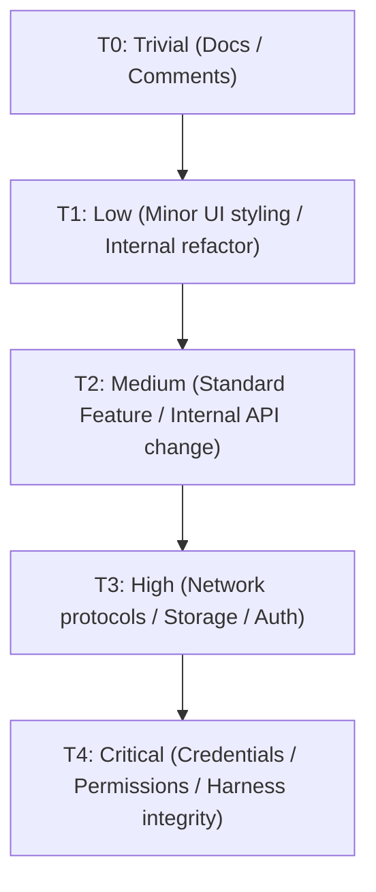

# Risk Classification Policy — WeBack Android Project

**Document ID:** POL-RISK-01  
**Version:** 1.0.0 (Proposed Baseline)  
**Effective Date:** 2026-11-24  
**Author:** Verification Architect & Engineering Governance Advisor  
**Playbook Reference:** SDD 2.0 Playbook, Section 3  

---

## 1. Risk Tier Framework (T0 through T4)

Every proposed change in the WeBack Android repository must be assigned an explicit **Risk Tier** during discovery (Gate G0). The tier dictates the minimum verification rigor, required reviews, and approval thresholds.

| Tier | Classification | Definition & Scope Examples | Minimum Required Verification Controls |
| :--- | :--- | :--- | :--- |
| **T0** | **Trivial** | Markdown documentation typos, code comment clarification, `.gitignore` maintenance. | Self-check, format/lint check, diff review. |
| **T1** | **Low** | Non-functional UI color tweaks, localized refactoring with zero contract or model changes. | Mini-spec, localized unit tests, baseline CI build. |
| **T2** | **Medium** | Standard feature additions, internal ViewModel refactoring, UI composables, new domain use cases. | Full Feature Spec (`specs/changes/`), unit & contract tests, traceability mapping, independent review, required CI. |
| **T3** | **High** | Network protocol serializers, WebSocket/REST clients, binary map decoders, local database schema migrations. | T2 requirements + Threat Model, negative regression tests, fault injection tests, independent security review, maintainer approval. |
| **T4** | **Critical** | Authentication token management, Android Keystore cryptography, Wi-Fi provisioning, hardware pilot testing, modifications to `policies/` or `verification/run.py`. | T3 requirements + Strict verification integrity review, manual UAT sign-off, dual approval (Product Owner + Lead Maintainer). |

---

## 2. Risk Determination Rules

1. **Impact Over Diff Size:** Risk tier is determined by the **potential failure impact and security blast radius**, never by the number of modified lines of code. A 2-line change to Keystore encryption or verification policies is strictly **T4**.
2. **Elevated Default:** If ambiguity exists regarding whether a change is T2 or T3, the change must be classified as **T3** until justified otherwise.
3. **Anti-Downgrading Prohibition:** The Implementation Agent is strictly forbidden from self-downgrading a change's risk tier to evade required checks.
