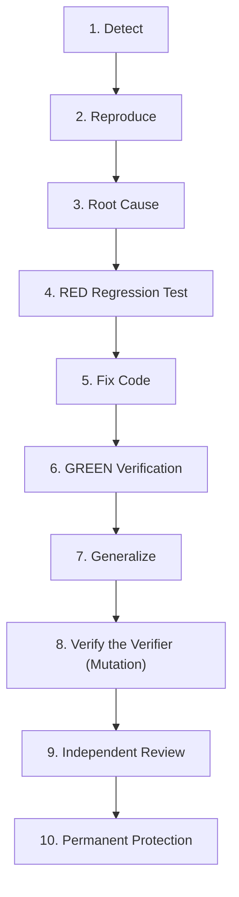

# Verification Integrity & Anti-Tampering Policy

**Document ID:** POL-INT-01  
**Version:** 1.0.0 (Proposed Baseline)  
**Effective Date:** 2026-11-24  
**Author:** Verification Architect & Engineering Governance Advisor  
**Playbook Reference:** SDD 2.0 Playbook, Section 8  

---

## 1. Prime Directive

When autonomous AI agents write both production code and test suites, inherent incentives exist to weaken test assertions, loosen validation thresholds, or alter golden fixtures to achieve a green build.
**This policy establishes strict engineering controls preventing verification tampering and test erosion.**

---

## 2. Protected Verification Assets

The following repository paths and assets are classified as **Protected Verification Assets**:

- `policies/checks.json` (Check registry)
- `policies/` (All governance and gate policies)
- `verification/run.py` (Verification runner)
- `verification/selftests/` (Runner self-checks)
- `verification/fixtures/` and golden test data
- Existing regression test files (`*RegressionTest.kt`, `*ConsistencyTest.kt`)
- `.github/workflows/` (CI pipelines)

### 2.1 Restricted Modification Rule
Any modification, deletion, or renaming of a Protected Verification Asset:
1. **MUST NOT** be combined with ordinary application feature code.
2. Requires a dedicated, isolated Pull Request.
3. Requires explicit technical review and written approval from the Lead Maintainer.

---

## 3. Prohibited Test-Weakening Behaviors & Legitimate Corrections

### 3.1 Prohibited Test-Weakening Behaviors
The following actions are strictly prohibited and classified as severe integrity violations:

1. **Assertion Removal:** Deleting or commenting out assertions (`assert`, `assertEquals`, `assertThat`) in existing tests to bypass failures.
2. **Test Disabling:** Annotating tests with `@Ignore`, `@Disabled`, or skipping test methods without an approved, time-bounded waiver.
3. **Threshold Loosening:** Increasing timeout limits, lowering coverage thresholds, or widening numeric tolerance bands solely to allow failing code to pass.
4. **Silent Golden Mutation:** Overwriting golden fixture files (`golden/*.json`, expected map matrices) without a documented schema change and review.
5. **Exception Swallowing in Tests:** Wrapping failing assertions in empty `try-catch` blocks.
6. **Self-Referential Oracles:** Computing expected test results by calling the implementation class under test.

### 3.2 Legitimate Corrections
Existing tests, golden fixtures, and policies are not immutable in the face of legitimate defects in the tests themselves or authorized contract changes. They **may be corrected** when:
1. The underlying specification or canonical schema has been formally amended via an approved PR.
2. The existing test contained a confirmed defect or inaccurate oracle, accompanied by root-cause evidence.
3. The correction undergoes independent review and is approved by the Lead Maintainer.
*Crucially, tests and policies must never be weakened or modified merely to achieve a PASS verdict.*

---

## 4. The 10-Step Defect-to-Regression Lifecycle

Every bug, unexpected failure, or specification gap discovered must be permanently institutionalized through the 10-step lifecycle:

1. **Detect:** Record observable failure with timestamp, inputs, and environment.
2. **Reproduce:** Author a minimal standalone script or isolated unit test triggering the bug.
3. **Root Cause:** Identify exact faulty assumption, logic error, or contract mismatch.
4. **RED Regression Test:** Commit a test asserting correct behavior that **fails deterministically** on the unpatched codebase.
5. **Fix Code:** Implement the minimal correct fix addressing the root cause.
6. **GREEN Verification:** Verify the regression test passes on the patched code.
7. **Generalize:** Identify if similar classes, protocols, or edge cases share this vulnerability.
8. **Verify the Verifier:** Temporarily inject a fault or mutation to prove the regression test actually catches the defect and is not a tautology.
9. **Independent Review:** Reviewer confirms root-cause fix and test adequacy.
10. **Permanent Protection:** Register test in the regression suite under continuous CI enforcement.

---

## 5. Initial Seed Regression Backlog

The following historical discrepancies discovered during reverse-engineering analysis are permanently registered in the initial regression backlog:

| Regression ID | Discrepancy Description | Prevention Contract |
| :--- | :--- | :--- |
| `REG-01` | WebSocket vs REST Shadow wire format duality | Outbound WebSocket commands must transmit flat `state`; REST countdowns must wrap in `thing_shadow.state.desired`. |
| `REG-02` | SoftAP Gateway IP claims (`192.168.200.1`, `192.168.10.1`) | SoftAP provisioning must target verified `192.168.4.1`, `192.168.99.1`, or dynamic DHCP discovery; speculative IPs rejected. |
| `REG-03` | BLE Fixed Chunking Capacity ($86$ characters) | Fragmentation must use fixed 86-char slices derived from `buffer(128) - envelope(42)`. Ignored MTU 500 must not alter chunk size. |
| `REG-04` | Map Decompression ZLIB vs GZIP | Decompression must strictly use ZLIB `Inflater`; GZIP stream expectations rejected. |
| `REG-05` | Legacy HTTP Port 8000 claim | Port 8000 rejected as unsupported assumption; no code shall assume port 8000 exists on robot. |
