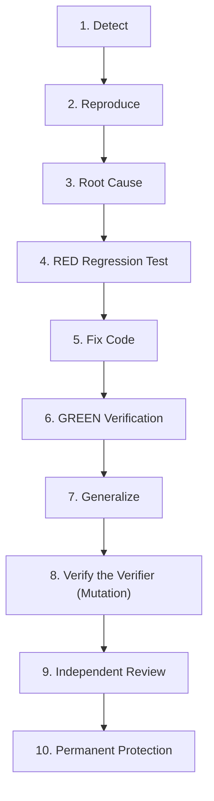

# Defect-to-Regression Skill & Governance Workflow

## 1. Overview & Prime Directive

When autonomous agents or human engineers identify a defect in code, contracts, or specifications, fixing the code alone is insufficient. 
**A bug without an independent, permanent regression test is an open invitation for future regressions.**

This skill governs the mandatory 10-step lifecycle to permanently institutionalize defect prevention in the WeBack Android codebase.

---

## 2. The 10-Step Lifecycle

### Step 1: Detect
- Record the exact observable failure, timestamp, environment, inputs, and observed vs. expected behavior.
- Assign a unique Defect ID (`DEF-YYYY-NNN`).

### Step 2: Reproduce
- Create a minimal, standalone reproduction case (unit test, isolated script, or synthetic fixture) that reliably triggers the failure.
- Ensure the reproduction does not depend on uncommitted local state or live external network services.

### Step 3: Root Cause Analysis
- Identify the exact mechanism of failure:
  - Faulty assumption (e.g., assuming GZIP instead of ZLIB).
  - Unhandled edge case (e.g., process group termination on timeout).
  - Contract violation (e.g., missing wrapper in Shadow REST API).
- Document why the defect was not caught by existing verification gates.

### Step 4: RED Regression Test
- Author the permanent regression test asserting the correct behavior.
- **Mandatory Oracle:** Run the test against the unpatched codebase.
- **Proof Requirement:** Prove that the test fails deterministically (Exit Code non-zero / Assertion Failure) with an error matching the observed defect.

### Step 5: Fix Code
- Implement the minimal, clean fix directly addressing the root cause.
- Adhere strictly to clean-room and architectural guidelines. Do not bundle unrelated refactoring into the bug fix.

### Step 6: GREEN Verification
- Execute the regression test against the patched codebase.
- Verify that the test passes cleanly (`PASS`).

### Step 7: Generalize
- Ask: "Where else in the codebase or protocol suite could this class of error occur?"
- Determine whether this defect represents an isolated implementation bug or a reusable **Anti-Pattern Rule**.
- If generalizable, formulate a rule for `verification/antipatterns.json`.

### Step 8: Verify the Verifier (Controlled Mutation)
- To prevent writing tautological tests that pass regardless of bugs, temporarily introduce a deliberate fault (mutation) into the patched code.
- Verify that the regression test immediately detects the fault and turns RED.
- Revert the mutation and verify the test returns to GREEN.

### Step 9: Independent Review
- Submit the Defect Record (`verification/defects.jsonl`), regression test, and fix for independent code review.
- Confirm that the test oracle is truly independent and not self-referential.

### Step 10: Permanent Protection
- Register the regression test in the permanent test suite under active CI enforcement (`policies/checks.json`).
- Commit the defect record to `verification/defects.jsonl` with status `APPROVED`.

---

## 3. Selecting the Protection Mechanism

Not every defect should become a global regex rule or unit test. Select the most focused, lowest-cost layer:

| Defect Nature | Approved Protection Mechanism | Example |
| :--- | :--- | :--- |
| **Logic / Computation Error** | JVM Unit Regression Test | Coordinate affine transform inversion bug. |
| **Protocol / Serialization Mismatch** | Schema Validation / Contract Test | Shadow wire format flat `state` vs `desired` wrapper. |
| **State Machine Illegal Transition** | FSM Transition Test | Robot accepting `Clean` command while in `Fault` state. |
| **Forbidden Technology / Dependency** | Static Architecture / Lint Rule | Attempting to import ThroughTek `.so` or `Gson`. |
| **Spec / Documentation Inconsistency** | Spec Hygiene Checker (`spec-hygiene`) | Broken relative markdown link or untraced requirement. |
| **Timing / Concurrency Race** | Virtual-Time Coroutines Test | StateFlow emission race condition during reconnection. |

---

## 4. Anti-Pattern Rule Authoring Standards

To prevent turning every agent suspicion into an unmaintainable, noisy regex blacklist:
1. **Evidence Grounding:** Must reference a confirmed defect ID (`DEF-xxx`) or verified RE errata (`REG-xxx`).
2. **Explicit Scope:** Must specify target file globs (e.g. `specs/**/*.md` or `app/src/main/java/**/*.kt`). Global un-scoped matching is prohibited.
3. **Dual Samples Mandatory:**
   - `positive_test_sample`: Snippet that correctly triggers the rule.
   - `negative_mutation_sample`: Clean snippet that must NOT trigger the rule.
4. **False Positive Assessment:** Must document evaluated edge cases where benign code might resemble the anti-pattern and prove the rule does not false-positive.
