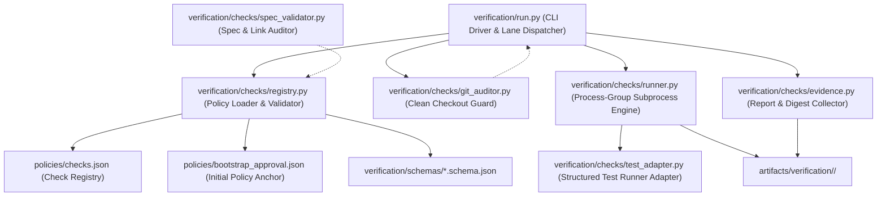

# FCT-000 Technical Design Specification — Minimum Viable Verification Harness

**Change ID:** `FCT-000`  
**Milestone:** `FCT-000`  
**Document ID:** `SPEC-DES-FCT000`  
**Version:** `1.1.0 (G3 Readiness Revision)`  
**Status:** `DRAFT (Prepared for Implementation-Readiness Sign-Off)`  

---

## 1. System Architecture & Module Boundaries

The Verification Harness is designed as a modular, dependency-free Python 3 (standard library only) application residing in `verification/`. It enforces strict separation of concerns across runner execution, policy validation, subprocess management, structured test inventory auditing, evidence generation, and specification auditing.



### 1.1 Directory Structure
```text
verification/
├── run.py                       # Main CLI entry point and lane orchestrator
├── checks/                      # Core execution modules
│   ├── __init__.py
│   ├── registry.py              # Registry loader, schema validation, policy hasher
│   ├── runner.py                # Subprocess runner, process group manager, timeout handler
│   ├── test_adapter.py          # Structured unittest execution and metric extractor
│   ├── evidence.py              # Report generator, log hasher, evidence validator
│   ├── git_auditor.py           # Git status checker, repository mutation detector
│   └── spec_validator.py        # Markdown links, requirement traceability, defect linter
├── schemas/                     # Canonical JSON schemas
│   ├── checks.schema.json       # Schema for policies/checks.json
│   ├── report.schema.json       # Schema for artifacts/verification/<run_id>/report.json
│   ├── defects.schema.json      # Schema for verification/defects.jsonl
│   └── antipatterns.schema.json # Schema for verification/antipatterns.json
├── fixtures/                    # Static test fixtures for selftests
│   ├── valid_checks.json
│   ├── all_optional_checks.json # Fixture for negative registry test
│   ├── invalid_checks.json
│   └── mock_spec.md
├── selftests/                   # Standalone harness selftest suite
│   ├── __init__.py
│   ├── test_registry.py         # Tests for registry parsing & schema rejection
│   ├── test_runner.py           # Tests for subprocess execution, exit codes, timeouts
│   ├── test_test_adapter.py     # Tests for structured test inventory execution
│   ├── test_evidence.py         # Tests for report hashing, log verification, staleness
│   ├── test_git_auditor.py      # Tests for dirty repo aborts and mutation detection
│   ├── test_spec_validator.py   # Tests for spec link & requirement audits
│   ├── test_defects.py          # Tests for defect registry and anti-pattern rules
│   └── test_mutations.py        # Controlled validator mutation proofs
├── defects.jsonl                # Machine-readable defect registry
└── antipatterns.json            # Machine-readable anti-pattern database
policies/
├── checks.json                  # Active check registry
└── bootstrap_approval.json      # FCT-000 bootstrap approval digest
```

---

## 2. Verification Lanes & Execution Lifecycle

The runner establishes two distinct operational lanes to balance developer iteration speed with candidate verification rigor:

```mermaid
sequenceDiagram
    autonumber
    actor Dev as Developer / Agent
    participant Runner as verification/run.py
    participant Git as git_auditor
    participant Reg as registry.py
    participant Proc as runner.py
    participant Evid as evidence.py

    Dev->>Runner: run.py --lane candidate
    Runner->>Git: check_clean_checkout()
    Note over Git: Abort if staged/unstaged/untracked/assume-unchanged files exist
    Git-->>Runner: Clean (HEAD: SHA-123)
    Runner->>Reg: load_and_validate("policies/checks.json")
    Note over Reg: Must contain >=1 required check; locked to canonical policy
    Reg-->>Runner: Validated Checks & Policy Hash
    loop For Each Check
        Runner->>Proc: execute_check(check)
        Note over Proc: Spawn in new process group; monitor timeout & descendants
        Proc-->>Runner: Result (exit_code, stdout/stderr, duration, test_summary, cleanup_failed)
    end
    Runner->>Git: check_post_run_cleanliness()
    Note over Git: Verify no untracked/mutated files created
    Runner->>Evid: generate_report(results, lane="candidate")
    Note over Evid: Recompute verdict from actual results; write report.json
    Evid-->>Runner: artifacts/verification/<run_id>/report.json + logs
    Runner-->>Dev: Exit Code 0 (PASS) or 1 (FAIL)
```

### 2.1 Fast Local Lane (`--lane fast`)
- **Invocation:** `python3 verification/run.py --lane fast [--check <id>] [--config <path>]`
- **Tolerances:** Does NOT require a clean git checkout; allows execution against modified files for rapid feedback during development.
- **Scope:** Allows targeting a single check (`--check spec-hygiene`) or running all enabled checks.
- **Evidence Output:** Writes report to `artifacts/verification/<run_id>/report.json` with `"lane": "fast"`.
- **Integrity Rule:** Reports with `"lane": "fast"` are explicitly rejected by Quality Gate G4 audits. They serve exclusively as local developer diagnostic feedback.

### 2.2 Candidate / PR Lane (`--lane candidate`)
- **Invocation:** `python3 verification/run.py --lane candidate` (Default if `--lane` is omitted)
- **Pre-condition:** Strictly mandates `git status --porcelain --untracked-files=all` returns empty string and no files have assume-unchanged (`h`) or skip-worktree (`S`) index flags. Aborts with exit code 2 (`NOT_CLEAN`) if uncommitted state exists.
- **Policy Locking:** Mandates execution against the canonical approved policy path (`policies/checks.json`). Specifying alternate `--config` files that differ from the approved policy digest is rejected with exit code 2 (`UNAPPROVED_POLICY_CONFIG`).
- **No Partial Verification:** Specifying `--check <id>` in candidate lane is strictly prohibited and aborts with exit code 2 (`PARTIAL_CANDIDATE_EXECUTION_PROHIBITED`). Candidate verification executes 100% of enabled required checks in sequence.
- **Post-condition:** Re-verifies repository state after all checks complete. If any check mutated existing files or generated untracked files outside `artifacts/verification/`, execution fails with exit code 2 (`MUTATED_CHECKOUT`).
- **Evidence Output:** Writes official candidate report with `"lane": "candidate"`, recording exact tested commit SHA, base SHA, policy digest, and recomputed verdict.

---

## 3. Subprocess Execution & Linux Process-Tree Management

To ensure reliable timeout termination and prevent orphaned background processes, subprocess execution adheres to strict POSIX process-group controls:

```python
# Conceptual implementation in verification/checks/runner.py
import os
import signal
import subprocess
import time
from verification.checks.registry import CheckDefinition

def run_command_with_timeout(argv: list[str], timeout_seconds: int, cwd: str) -> tuple[int, bytes, float, bool]:
    """
    Executes command in a new POSIX process group, handling creation errors,
    timeout escalation (SIGTERM -> SIGKILL), bounded cleanup, and output capture.
    Returns: (exit_code, combined_output, duration_seconds, cleanup_failed)
    """
    start_time = time.monotonic()
    try:
        # Spawn child as session leader of a new process group (pgid = pid)
        proc = subprocess.Popen(
            argv,
            stdout=subprocess.PIPE,
            stderr=subprocess.STDOUT,
            cwd=cwd,
            start_new_session=True
        )
    except FileNotFoundError:
        duration = time.monotonic() - start_time
        return 127, f"[EXECUTABLE NOT FOUND: {argv[0]}]\n".encode(), duration, False
    except PermissionError:
        duration = time.monotonic() - start_time
        return 126, f"[PERMISSION DENIED: {argv[0]}]\n".encode(), duration, False
    except OSError as err:
        duration = time.monotonic() - start_time
        return 126, f"[SUBPROCESS CREATION ERROR: {err}]\n".encode(), duration, False

    pgid = proc.pid
    cleanup_failed = False
    try:
        stdout, _ = proc.communicate(timeout=timeout_seconds)
        duration = time.monotonic() - start_time
        return proc.returncode, stdout, duration, False
    except subprocess.TimeoutExpired as exc:
        duration = time.monotonic() - start_time
        partial_output = exc.stdout or b""
        
        # Step 1: Send SIGTERM to entire process group
        try:
            os.killpg(pgid, signal.SIGTERM)
        except ProcessLookupError:
            pass  # Parent process already died

        # Step 2: Bounded wait for process group termination (0.5s)
        deadline = time.monotonic() + 0.5
        alive = True
        while time.monotonic() < deadline:
            try:
                # Check if session leader or descendants still exist
                os.kill(pgid, 0)
                time.sleep(0.05)
            except ProcessLookupError:
                alive = False
                break

        # Step 3: Escalate to SIGKILL if processes remain
        if alive:
            try:
                os.killpg(pgid, signal.SIGKILL)
            except ProcessLookupError:
                pass

        # Step 4: Final bounded cleanup inspection (max 1.0s)
        cleanup_deadline = time.monotonic() + 1.0
        while time.monotonic() < cleanup_deadline:
            try:
                os.kill(pgid, 0)
                time.sleep(0.05)
            except ProcessLookupError:
                break
        else:
            # Process could not be reaped or detached
            cleanup_failed = True

        # Clean up pipes without blocking indefinitely
        try:
            proc.communicate(timeout=0.5)
        except subprocess.TimeoutExpired:
            if proc.stdout:
                proc.stdout.close()

        combined_output = partial_output + b"\n[VERIFICATION RUNNER TIMEOUT EXPIRED]\n"
        return 124, combined_output, duration, cleanup_failed
```

### 3.1 Subprocess Trust & Linux Process-Group Limitations Notice
> [!WARNING]
> **Process-Group Containment Boundaries:**
> 1. Calling `start_new_session=True` ensures all ordinary child and grandchild processes belong to `pgid`.
> 2. **Limitation:** If a descendant process explicitly calls `setsid()` or `setpgrp()`, it detaches from the parent's process group and cannot be tracked or signaled via `os.killpg`.
> 3. **Host Security:** The runner executes with the current host user's privileges; it does NOT constitute an OS-level virtual sandbox or jail. Strict isolation is delegated to clean-room container CI runners.

---

## 4. Evidence Report & Cryptographic Provenance

Every verification execution generates a structured report `artifacts/verification/<run_id>/report.json` conforming to `verification/schemas/report.schema.json`:

```json
{
  "$schema": "https://json-schema.org/draft/2020-12/schema",
  "schema_version": 1,
  "run_id": "c8d4e2a1-7b3f-4e9a-8c1d-6f2a5b4e3c1d",
  "tested_sha": "ede151c9f442c75466fbf94e1005c9855a03002a",
  "base_sha": "ede151c9f442c75466fbf94e1005c9855a03002a",
  "policy_sha256": "4b68e7c10b48...5d81",
  "policy_modified_from_base": false,
  "lane": "candidate",
  "started_at": "2026-11-24T12:00:00.000Z",
  "finished_at": "2026-11-24T12:00:05.420Z",
  "environment": {
    "python": "3.12.3",
    "platform": "linux",
    "os": "Ubuntu 24.04 LTS"
  },
  "verdict": "PASS",
  "checks": [
    {
      "id": "spec-hygiene",
      "required": true,
      "status": "PASS",
      "exit_code": 0,
      "duration_seconds": 0.42,
      "cleanup_failed": false,
      "log": "spec-hygiene.log",
      "log_sha256": "8a3f...12e9",
      "test_summary": {
        "total": 1,
        "passed": 1,
        "failures": 0,
        "errors": 0,
        "skipped": 0
      }
    }
  ]
}
```

### 4.1 Independent Verdict Recomputation Rules
The evidence validator (`verification/checks/evidence.py`) never trusts the report's self-declared `verdict` field alone:
1. **Recompute Verdict:** Evaluates every required check in `checks`:
   - If any required check has `status != "PASS"` or `exit_code != 0`, the recomputed verdict is strictly `FAIL`.
   - If any required test suite reports `total == 0` or `skipped > 0`, the recomputed verdict is strictly `FAIL`.
   - If any check reports `cleanup_failed == true`, the recomputed verdict is `FAIL`.
2. **Forged Verdict Rejection:** If the report's self-declared `verdict == "PASS"` but the recomputed verdict is `FAIL`, the report is rejected as forged (`FORGED_VERDICT_REJECTED`) with exit code 2.
3. **Inconsistent Status Check:** If any check reports `exit_code != 0` but `status == "PASS"`, or `exit_code == 0` but `status == "FAIL"`, the report is rejected as corrupt (`INCONSISTENT_CHECK_STATUS`) with exit code 2.

### 4.2 Four-Tier Governance Boundary
```text
Tier 1: Local Execution Result  -> exit_code emitted by run.py on host.
Tier 2: Evidence Audit Result   -> verification/checks/evidence.py asserting report & log integrity.
Tier 3: Governance Authorization -> Product Owner & Lead Maintainer human sign-off records.
Tier 4: Remote CI Status        -> Remotely executed GitHub Actions status check on PR.
```
*A valid local report is proof of execution provenance; it is NOT merge or release authorization.*

---

## 5. Structured Test Inventory Adapter (`test_adapter.py`)

To eliminate fragile console scraping, `verification/checks/test_adapter.py` executes test suites via Python's standard `unittest` framework with a custom `TestResult` collector:

```python
import unittest
import json
import sys

class StructuredTestResult(unittest.TestResult):
    def __init__(self):
        super().__init__()
        self.passed_count = 0

    def addSuccess(self, test):
        super().addSuccess(test)
        self.passed_count += 1

    def to_dict(self) -> dict[str, int]:
        return {
            "total": self.testsRun,
            "passed": self.passed_count,
            "failures": len(self.failures),
            "errors": len(self.errors),
            "skipped": len(self.skipped),
            "unexpected_successes": len(self.unexpectedSuccesses),
            "expected_failures": len(self.expectedFailures)
        }
```
- Test checks invoke `python3 -m verification.checks.test_adapter <test_module_or_dir>`.
- The adapter executes the suite, writes structured JSON to stdout/log, and sets exit code 0 only if `testsRun > 0`, `failures == 0`, `errors == 0`, and `skipped == 0`.

---

## 6. Specification, Hygiene & Anti-Pattern Governance

### 6.1 Specification & Link Linter (`spec_validator.py`)
- **External URL Filtering:** Ignores web schemes (`^https?://`, `^mailto:`).
- **Heading Anchor Slugification:** Converts headings to lowercase, removes punctuation, replaces spaces with hyphens.
- **Traceability Linter:** Asserts 100% of MUST acceptance criteria (`AC-xxx`) map to tasks, test oracles, and checks.

### 6.2 Anti-Pattern Rules Engine & Lifecycle States
Anti-patterns are categorized by strict lifecycle states:
- **`PROPOSED`:** Documented prospective anti-patterns; inactive during CI.
- **`ADVISORY`:** Scanned and reported as warnings; non-blocking.
- **`APPROVED_ACTIVE`:** Formally approved by Lead Maintainer; executed as blocking gates.

```json
{
  "$schema": "verification/schemas/antipatterns.schema.json",
  "rule_id": "ANTI-001",
  "status": "PROPOSED",
  "description": "Global Cleartext HTTP Permission",
  "rationale": "Cleartext traffic leaks credentials (SEC-01)",
  "target_globs": ["app/src/main/res/xml/network_security_config.xml"],
  "pattern": "<base-config\\b[^>]*cleartextTrafficPermitted\\s*=\\s*[\"']true[\"']",
  "matcher_type": "regex",
  "positive_test_sample": "<network-security-config><base-config cleartextTrafficPermitted=\"true\"></base-config></network-security-config>",
  "negative_mutation_sample": "<network-security-config><base-config cleartextTrafficPermitted=\"false\"></base-config></network-security-config>",
  "false_positive_assessment": "Scoped domain-config tags (e.g. 127.0.0.1 or 192.168.4.1) do not match <base-config>.",
  "author": "Verification Architect"
}
```
*Note: Future Android rules remain `PROPOSED` and are NOT activated during FCT-000.*

---

## 7. CI Pipeline Design & Remote Governance Notice

```yaml
name: Verification Harness Gate (G4)

on:
  push:
    branches: [ main ]
  pull_request:
    branches: [ main ]

permissions:
  contents: read

concurrency:
  group: ${{ github.workflow }}-${{ github.ref }}
  cancel-in-progress: true

jobs:
  verify:
    name: Clean Candidate Verification
    runs-on: ubuntu-latest
    timeout-minutes: 10

    steps:
      - name: Checkout repository
        uses: actions/checkout@v4
        with:
          ref: ${{ github.event.pull_request.head.sha || github.sha }}
          fetch-depth: 0

      - name: Set up Python
        uses: actions/setup-python@v5
        with:
          python-version: '3.12'

      - name: Verify Clean Repository
        run: |
          if [ -n "$(git status --porcelain)" ]; then
            echo "ERROR: Checkout is not clean"
            git status
            exit 2
          fi

      - name: Execute Candidate Verification Harness
        run: python3 verification/run.py --lane candidate

      - name: Validate Candidate Evidence
        run: python3 verification/checks/evidence.py --audit-latest --require-candidate

      - name: Upload Verification Evidence
        if: always()
        uses: actions/upload-artifact@v4
        with:
          name: verification-evidence
          path: artifacts/verification/
          retention-days: 14
```

> [!IMPORTANT]
> **Repository Remote Status & Governance Notice:**
> The repository currently has no Git remote configured. Therefore:
> 1. Remote CI is `NOT_RUN`.
> 2. Branch protection rulesets are `NOT_CONFIGURED`.
> 3. Remote required-check enforcement is `NOT_VERIFIED`.
> The CI workflow specification provides the blueprint for future remote deployment upon human authorization.
