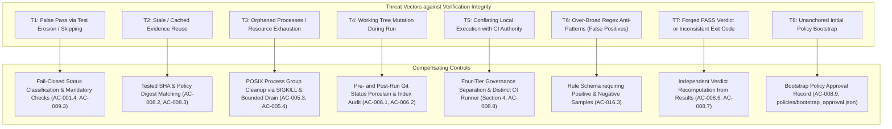

# FCT-000 Risk Assessment & Threat Model — Minimum Viable Verification Harness

**Change ID:** `FCT-000`  
**Milestone:** `FCT-000`  
**Document ID:** `SPEC-RSK-FCT000`  
**Version:** `1.1.0 (G3 Readiness Revision)`  
**Status:** `DRAFT (Prepared for Implementation-Readiness Sign-Off)`  
**Assigned Risk Tier:** `T4 — Critical (Verification Trust Boundary & Policy Assets per POL-RISK-01)`  

---

## 1. Risk Tier Rationale

Under `policies/risk-tiers.md`, `T4 — Critical` explicitly governs:
> *"Authentication token management, Android Keystore cryptography, Wi-Fi provisioning, hardware pilot testing, modifications to `policies/` or `verification/run.py`."*

While `FCT-000` touches zero production Android code or external networks, it establishes both `policies/checks.json` and `verification/run.py`. These components establish the **automated gatekeeper** that will evaluate Quality Gates G1 through G6 for the entire lifecycle of the WeBack Android product. Under `POL-RISK-01` Section 2, self-downgrading this risk tier to T3 is strictly prohibited. Therefore, FCT-000 is formally classified as **T4 — Critical**, mandating dual human authorization (Product Owner and Lead Maintainer).

---

## 2. Threat Modeling & Vulnerability Analysis

### 2.1 Threat Matrix & Mitigations

| Threat ID | Threat Scenario | Potential Impact | Severity | Mandated Mitigation / Control |
| :--- | :--- | :--- | :--- | :--- |
| **THR-001** | **False PASS on Missing or Skipped Checks:** An agent deletes a failing check from `checks.json`, makes all checks optional, or relies on `SKIP` / `NOT_RUN` to pass. | Defective code enters repository undetected. | **P0 (Critical)** | Registry validator checks completeness and rejects all-optional registries (`AC-001.4`); any required `SKIP`, `ERROR`, `NOT_RUN`, or `TIMEOUT` produces an overall `FAIL` verdict (`AC-009.3`). |
| **THR-002** | **Stale Evidence Reuse & Local Policy Tampering:** An agent submits a prior commit's `report.json`, or modifies `policies/checks.json` to delete checks and matches its own modified hash. | Unverified or unauthorized code merged. | **P0 (Critical)** | Evidence validator compares `tested_sha` against active candidate HEAD SHA and `base_sha` against expected target base. Candidate runner audits git diff of `policies/` against base branch; any policy modification requires explicit human approval. |
| **THR-003** | **Orphaned Process Zombie Leak:** A command spawns child processes that do not terminate when the parent runner times out, consuming host CPU/RAM. | Build hang, denial of service on host or CI runner. | **P1 (High)** | Process group isolation (`start_new_session=True`), process group tracking (`pgid = proc.pid`), SIGTERM with 0.5s grace escalated to SIGKILL, bounded 2.0s cleanup, and explicit `cleanup_failed: true` recording (`AC-005.2`..`005.4`). |
| **THR-004** | **Silent Working Tree Mutation:** A check script generates artifacts or alters source files during verification, leaving uncommitted state in candidate branch. | Divergence between tested commit and merged code. | **P1 (High)** | Two-phase git status check: candidate lane strictly checks `git status --porcelain --untracked-files=all` and index bits (`git ls-files -v`) before and after check execution, ignoring only `artifacts/verification/` (`AC-006.1`, `AC-006.2`). |
| **THR-005** | **Subprocess Sandboxing Misconception:** Believing that `run.py` protects the host against malicious code executed within tests. | False sense of security; potential host modification. | **P2 (Medium)** | Clear architectural disclaimer: `run.py` does not provide an OS sandbox or container boundary. Real containment is delegated to isolated CI runner containers. Descendant processes detaching via `setsid` or in unkillable D-state cannot be guaranteed to terminate; runner records `cleanup_failed` rather than claiming universal containment. |
| **THR-006** | **Global Regex Anti-Pattern Bloat:** Discovered defects converted into broad, unchecked global regex blacklists causing widespread false-positive build breaks. | Developer friction, eroded trust in linting. | **P2 (Medium)** | Anti-pattern rules must provide evidence rationale, explicit file scope, positive test sample, negative mutation sample, and false-positive evaluation (`AC-016.3`). Active rules must be in `APPROVED_ACTIVE` state. |
| **THR-007** | **Forged PASS Verdict or Inconsistent Result Status:** An agent manually edits `report.json` to declare `"verdict": "PASS"` while checks failed, or marks a failing exit code as `PASS`. | Compromised quality gate evaluation. | **P0 (Critical)** | Evidence validator independently recomputes overall verdict from actual required check results and exit codes (`AC-008.6`), rejecting forged verdicts and inconsistent status/code pairs (`AC-008.7`). |
| **THR-008** | **Unanchored Initial Policy Bootstrap:** During initial repository setup (FCT-000), no base commit exists to diff `policies/checks.json` against, creating an unanchored trust window. | Initial policy bypass or unauthorized check deletion. | **P0 (Critical)** | Initial policy is cryptographically anchored in `policies/bootstrap_approval.json` signed by human authorities (Product Owner and Lead Maintainer), validated by evidence auditor (`AC-008.9`). |

---

## 3. Governance Boundaries & Non-Waivable Invariants

In accordance with `policies/quality-gates.md`, `policies/verification-integrity.md`, and Constitution Invariant `C-008`:

1. **Zero-Tolerance Invariants:**
   - Under no circumstances shall a waiver be granted for secret exposure, verification tampering, or false `PASS` conversions.
   - A report with `"lane": "fast"` can never satisfy Gate G4 or candidate PR evaluation.
   - A valid local execution report does NOT constitute merge or release authorization.

2. **Four-Tier Governance Model:**
   - **Tier 1: Local Execution Result:** Produced by `run.py`; represents execution observations on the developer or agent workstation.
   - **Tier 2: Evidence Validation Result:** Produced by `evidence.py`; proves structural integrity, log digest authenticity, and tested commit SHA binding.
   - **Tier 3: Remote CI Status:** Produced by isolated GitHub Actions runner; confirms clean checkout build on independent infrastructure.
   - **Tier 4: Governance Authorization:** Explicit sign-off by designated human authorities (Product Owner for scope/milestones, Lead Maintainer for architecture/policy/merge).

3. **Policy Modifications:**
   - Any modification to `policies/checks.json` or `verification/run.py` is classified as `T4 (Critical)` and requires explicit review and approval by the Lead Maintainer.
