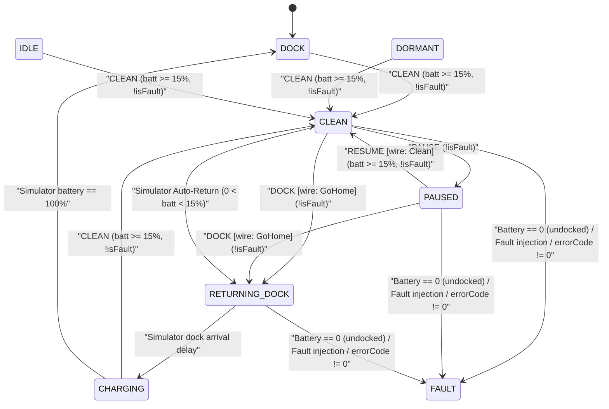

# FCT-002 Technical Design — Simulated Robot Control

- **Change ID:** `FCT-002`
- **Risk Tier:** `T2`
- **References:** [proposal.md](proposal.md) | [requirements.md](requirements.md) | [validation.md](validation.md) | [specs/tech-stack.md](../../tech-stack.md) | [specs/constitution.md](../../constitution.md)

---

## 1. Architectural Boundaries & Package Design

FCT-002 preserves the single-module `:app` clean-architecture package layout established in FCT-001:

```text
app/src/main/java/com/weback/robot/
├── core/
│   ├── AppContainer.kt              (Injects DispatcherProvider, MonotonicClock, SimulatorRobotTransport; owns close())
│   ├── DispatcherProvider.kt        (Standard + TestDispatcher abstraction)
│   └── MonotonicClock.kt            (NEW: Pure Kotlin monotonic injectable clock; SystemMonotonicClock via nanoTime)
├── domain/                          [PURE KOTLIN — ZERO android.* / androidx.* / kotlinx.serialization / okhttp3 imports]
│   ├── model/
│   │   ├── RobotCommand.kt          (NEW: CLEAN, PAUSE, RESUME, DOCK + wireStatus mapping)
│   │   ├── RobotMode.kt             (EXTENDED: DOCK, CLEAN, PAUSED, RETURNING_DOCK, CHARGING, DORMANT, IDLE, FAULT)
│   │   ├── RobotState.kt            (EXTENDED: battery 0..100 guard, isDocked, isFault)
│   │   ├── CommandExecutionState.kt (NEW: Idle, Pending, Acknowledged, Rejected + CommandRejectionReason)
│   │   ├── CommandResult.kt         (NEW: Transport result Acknowledged | Rejected)
│   │   ├── ControlAvailability.kt   (NEW: Pure function computing button enablement)
│   │   └── SimulatorErrorCodes.kt   (NEW: Synthetic simulator error codes; NOT hardware firmware codes)
│   └── control/
│       └── RobotStateMachine.kt     (NEW: Pure transition matrix & deterministic precedence guards)
├── protocol/
│   ├── RobotTransport.kt            (EXTENDED: suspend fun sendCommand(RobotCommand): CommandResult)
│   ├── SimulatorConfig.kt           (NEW: Synthetic timing defaults + test failure/exception injection)
│   └── SimulatorRobotTransport.kt   (EXTENDED: Unified stateMutex, generation-checked jobs, virtual-time loop, close())
└── ui/
    ├── DashboardViewModel.kt        (EXTENDED: Unidirectional DashboardIntent, atomic admission, timeout/cancellation/error handling)
    ├── screens/
    │   └── DashboardScreen.kt       (EXTENDED: String-resourced Clean/Pause/Resume/Dock controls, feedback banner, OFFLINE badge)
    └── theme/
```

Dependency rule (enforced statically and via unit test `TEST-CTRL-201`):
- `ui` -> `domain`, `protocol`, `core`
- `protocol` -> `domain`, `core`
- `domain` -> Kotlin stdlib ONLY (zero `android.*`, `androidx.*`, `kotlinx.coroutines.*`, `kotlinx.serialization.*`, `okhttp3.*`).

---

## 2. RE Wire Token Mapping vs. Client Simulator State Machine

Based on `SPEC-PROT-01` (`PROT-WS-01`), `SPEC-STATE-01`, and `SPEC-MODEL-01`:

| Domain `RobotCommand` | Wire `working_status` (`[RE-OBSERVED]`) | Valid Source `RobotMode`s (`[SIMULATOR-DESIGN]`) | Resulting Simulator `RobotMode` | Guard Failure Precedence |
| :--- | :--- | :--- | :--- | :--- |
| `RobotCommand.CLEAN` | `"Clean"` | `DOCK`, `CHARGING`, `DORMANT`, `IDLE` | `RobotMode.CLEAN` | 1. `FAULT_ACTIVE` -> 2. `LOW_BATTERY` (`< 15%`) -> 3. `INVALID_TRANSITION` |
| `RobotCommand.PAUSE` | `"Pause"` | `CLEAN` | `RobotMode.PAUSED` | 1. `FAULT_ACTIVE` -> 3. `INVALID_TRANSITION` |
| `RobotCommand.RESUME` | `"Clean"` (per `SPEC-STATE-01`) | `PAUSED` | `RobotMode.CLEAN` | 1. `FAULT_ACTIVE` -> 2. `LOW_BATTERY` (`< 15%`) -> 3. `INVALID_TRANSITION` |
| `RobotCommand.DOCK` | `"GoHome"` | `CLEAN`, `PAUSED` | `RobotMode.RETURNING_DOCK` | 1. `FAULT_ACTIVE` -> 3. `INVALID_TRANSITION` |

### Rejection Precedence (`IC-203`)
`RobotStateMachine.evaluateTransition(current: RobotState, command: RobotCommand)` evaluates strictly in order without side effects:
1. **`FAULT_ACTIVE`:** `current.mode == RobotMode.FAULT || current.errorCode != 0` -> `Rejected(FAULT_ACTIVE)` for all commands.
2. **`LOW_BATTERY`:** `(command == RobotCommand.CLEAN || command == RobotCommand.RESUME) && current.batteryPercentage < 15` -> `Rejected(LOW_BATTERY)`. (At `batteryPercentage == 15`, `CLEAN` and `RESUME` are permitted if source mode is valid.)
3. **`INVALID_TRANSITION`:** Source mode not in the valid set for `command` -> `Rejected(INVALID_TRANSITION)`.
4. Otherwise -> `Accepted(targetMode)`.

### State Transition Diagram (Client & Offline Simulator)



---

## 3. Unified Command Lifecycle, Exceptions & Synchronization (`IC-201`, `IC-202`)

### 3.1 `DashboardViewModel` Synchronization & Admission
`DashboardViewModel` uses a lightweight non-suspending `stateLock = Any()` (never held across `suspend` calls) to guarantee atomic read-modify-write transitions on `_uiState` and `nextCommandId`:

1. **Atomic Command Admission (`onIntent(Clean | Pause | Resume | Dock)`):** Inside `synchronized(stateLock)`:
   - Read current `_uiState.value`.
   - If `current.commandState is CommandExecutionState.Pending`:
     - If `current.commandState.command == command`: return immediately (duplicate suppressed; zero transport call; existing `Pending` and `commandId` preserved).
     - Else: update `_uiState.value = current.copy(busyConflictNotice = ...)` (keeping `commandState` as active `Pending` and issuing zero transport calls) and return immediately.
   - Evaluate `RobotStateMachine.evaluateTransition(current.committedRobotState, command)`:
     - Allocate `commandId = nextCommandId++` and read `now = clock.elapsedMs()`.
     - If `Rejected(reason, message)`: commit `CommandExecutionState.Rejected(command, commandId, reason, message, settledAtMs = now)`, clear `busyConflictNotice`, recompute `controls`, and return WITHOUT calling `robotTransport.sendCommand`.
     - If `Accepted`: commit `CommandExecutionState.Pending(command, commandId, submittedAtMs = now)`, clear `busyConflictNotice`, recompute `controls` (all four disabled while `Pending`).
2. **Asynchronous Dispatch & Bounded Timeout (outside lock):**
   Launch on `scope` (`dispatchers.main` or injected scope):
   - Execute `withTimeout(commandTimeoutMs) { robotTransport.sendCommand(command) }` (default `commandTimeoutMs = 5_000L`).
   - Settlement paths (all guarded inside `synchronized(stateLock)` by **completion identity check**: `current.commandState is Pending && current.commandState.commandId == commandId`):
     - `CommandResult.Acknowledged`: transition `commandState` to `CommandExecutionState.Acknowledged(command, commandId, settledAtMs = clock.elapsedMs())`, clear `busyConflictNotice`, update committed state snapshot if ahead of collector, recompute `controls`.
     - `CommandResult.Rejected`: transition `commandState` to `CommandExecutionState.Rejected(command, commandId, result.reason, result.message, settledAtMs = clock.elapsedMs())`, clear `busyConflictNotice`, recompute `controls`. Committed telemetry is NOT rolled back.
     - `TimeoutCancellationException`: transition `commandState` to `CommandExecutionState.Rejected(command, commandId, CommandRejectionReason.TIMEOUT, ...)`, clear `busyConflictNotice`, recompute `controls`. Committed telemetry remains authoritative.
     - `CancellationException` (external/scope cancellation, caught AFTER `TimeoutCancellationException`): inside `synchronized(stateLock)`, if `commandId` still owns `Pending`, clean up `commandState` to `CommandExecutionState.Idle`, clear `busyConflictNotice`, recompute `controls`; then **rethrow `ce`** (never swallow `CancellationException`).
     - `Throwable` (unexpected transport runtime exception): transition `commandState` to `CommandExecutionState.Rejected(command, commandId, CommandRejectionReason.TRANSPORT_ERROR, ...)`, clear `busyConflictNotice`, recompute `controls`. Committed telemetry remains authoritative.
3. **`DismissCommandFeedback` Contract (`AC-204.4`, `AC-207.3`):** Inside `synchronized(stateLock)`:
   - If `commandState is CommandExecutionState.Pending`: clear `busyConflictNotice = null` ONLY — do **NOT** modify `commandState` or release the active `Pending` command lock.
   - If `commandState` is `Acknowledged` or `Rejected`: reset `commandState = CommandExecutionState.Idle`, clear `busyConflictNotice = null`, recompute `controls` without touching `robotState` or cancelling simulator loops.
4. **Telemetry Collection:** `scope.launch(dispatchers.main)` collects `robotTransport.robotState`. Inside `synchronized(stateLock)`, updates committed telemetry fields on `_uiState.value` and recomputes `controls` while preserving active `commandState` and `busyConflictNotice`.

---

## 4. `SimulatorRobotTransport` State Ownership, Timing & Lifecycle (`IC-201`, `IC-203`)

### 4.1 Unified `stateMutex` Contract (Zero Locks Across Delays)
`SimulatorRobotTransport` owns:
- `private val stateMutex = Mutex()`
- `private val scope = CoroutineScope(SupervisorJob() + dispatcherProvider.default)` (closed via `close()`)
- `private var stateGeneration: Long = 0L` (incremented monotonically on every committed mode/fault transition)
- `private var activeSimulationJob: Job? = null`

Every state read-modify-write (`sendCommand` commit point, battery drain tick, return-to-dock arrival, charging tick, `injectFault`, `setStateForTest`, `close`) executes under `stateMutex.withLock`. **`stateMutex` is NEVER held across `delay(...)`!**

### 4.2 Explicit Command Commit Point & Tick/Command Race Safety
In `sendCommand(command: RobotCommand): CommandResult`:
1. Optional simulated acknowledgement latency (`if (config.ackDelayMs > 0L) delay(config.ackDelayMs)`) executes **outside `stateMutex`**, allowing concurrent ticks or fault injections to execute without deadlock or blocking.
2. **Command Commit Point (inside `stateMutex.withLock`):**
   - Check and consume one-shot test failure/exception injection (if an unexpected exception hook is configured, throw outside state mutation; if a `CommandResult.Rejected` hook is configured, return it without mutating `_robotState`).
   - Re-evaluate `RobotStateMachine.evaluateTransition(_robotState.value, command)` against the **latest committed telemetry**.
   - If `Rejected`, return `CommandResult.Rejected(reason, message, clock.elapsedMs())` with `_robotState` unchanged.
   - If `Accepted(targetMode)`, commit `newState = _robotState.value.copy(mode = targetMode)`, increment `stateGeneration++`, cancel `activeSimulationJob`, schedule new `activeSimulationJob` for `(targetMode, stateGeneration)`, and return `CommandResult.Acknowledged(newState, clock.elapsedMs())`.

### 4.3 Synthetic Timing Defaults (`SimulatorConfig`) & Progression Rules
| Parameter | Synthetic Default | Behavior |
| :--- | :--- | :--- |
| `ackDelayMs` | `250L` ms | Simulated command acknowledgement latency before commit point. |
| `returnToDockDurationMs` | `2_000L` ms | Virtual delay from `RETURNING_DOCK` to `CHARGING`. |
| `cleanBatteryDrainIntervalMs` | `5_000L` ms | Period per battery decrement while `mode == CLEAN`. |
| `cleanBatteryDrainStep` | `1` % | Battery decrement per `CLEAN` tick (clamped `>= 0`). |
| `chargeIntervalMs` | `1_000L` ms | Period per battery increment while `mode == CHARGING`. |
| `chargeStepPercent` | `5` % | Battery increment per `CHARGING` tick (clamped `<= 100`). |
| `lowBatteryThreshold` | `15` % | Minimum battery required for `CLEAN`/`RESUME` and auto-return threshold. |

Delayed job generation check (`IC-201`):
- Each tick wakes from `delay(...)` and enters `stateMutex.withLock`.
- First line inside lock: `if (stateGeneration != expectedGeneration || _robotState.value.mode != expectedMode) return@withLock` — ensuring stale `RETURNING_DOCK` or `CHARGING` jobs can NEVER overwrite a newer mode or command!
- While `CLEAN`: decrement battery clamped `[0, 100]`. If `newBattery == 0`: enter `FAULT` (`errorCode = SimulatorErrorCodes.SYNTHETIC_BATTERY_DEPLETED`) and stop. Else if `newBattery < 15`: transition `CLEAN -> RETURNING_DOCK`, increment `stateGeneration++`, cancel drain job, and schedule `RETURNING_DOCK`.
- While `RETURNING_DOCK`: after `returnToDockDurationMs`, if still `(RETURNING_DOCK, expectedGeneration)`: transition to `CHARGING`, increment `stateGeneration++`, schedule `CHARGING`.
- While `CHARGING`: increment battery clamped `[0, 100]`. If `newBattery == 100`: transition `CHARGING -> DOCK`, increment `stateGeneration++`, and terminate job.
- **Initial State Normalization:** On `SimulatorRobotTransport` construction, if `initialState.errorCode != 0`, normalize `mode = RobotMode.FAULT`. Else if `initialState.batteryPercentage == 0 && !initialState.isDocked`, normalize `mode = RobotMode.FAULT, errorCode = SimulatorErrorCodes.SYNTHETIC_BATTERY_DEPLETED`. Otherwise schedule progression if initial mode is `CLEAN`, `RETURNING_DOCK`, or `CHARGING`.

### 4.4 Synthetic Error Codes (`SimulatorErrorCodes`)
- `SYNTHETIC_BATTERY_DEPLETED = 9001`: Synthetic simulator error code emitted when battery hits `0%` while undocked.
- `SYNTHETIC_INJECTED_FAULT = 9002`: Synthetic simulator error code used by deterministic test fault injection.
*(Explicitly synthetic clean-room simulator constants — NOT observed physical hardware firmware codes.)*

### 4.5 Scope Ownership & Lifecycle Cleanup (`IC-202`)
- `SimulatorRobotTransport` implements `AutoCloseable`; `close()` cancels its child `CoroutineScope` (`scope.cancel()`) and clears `activeSimulationJob`.
- `AppContainer` (`DefaultAppContainer`) owns `dispatcherProvider`, `clock`, and `robotTransport`, and exposes `close()` delegating to `(robotTransport as? AutoCloseable)?.close()`.
- `DashboardViewModel` scopes all collectors and command launches to `scope = coroutineScope ?: viewModelScope`, so clearing the ViewModel or cancelling test `scope` cancels all active ViewModel jobs cleanly.

---

## 5. UI State Schema & Compose Controls

Backward-compatible extension of FCT-001 `RobotUiState`:
```kotlin
data class RobotUiState(
    val robotName: String = "WeBack Simulator Robot",
    val batteryPercentage: Int = 100,
    val mode: RobotMode = RobotMode.DOCK,
    val isDocked: Boolean = true,
    val isDustbinClean: Boolean = true,
    val isSimulator: Boolean = true,
    val appVersion: String = "v0.1.0-alpha (FCT-001 Foundation)",
    val errorCode: Int = 0,
    val isFault: Boolean = false,
    val statusSummary: String = "Simulator Active (Offline)",
    val commandState: CommandExecutionState = CommandExecutionState.Idle,
    val busyConflictNotice: String? = null,
    val controls: ControlAvailability = ControlAvailability.from(RobotState(), CommandExecutionState.Idle)
)
```

`ControlAvailability.from(robotState, commandState)`:
- When `commandState is CommandExecutionState.Pending` or `robotState.isFault`: all 4 (`canClean`, `canPause`, `canResume`, `canDock`) = `false`.
- Otherwise, each action delegates directly to `RobotStateMachine.evaluateTransition(robotState, cmd).isAccepted` — single source of truth, zero duplicate guard logic.
- In `RETURNING_DOCK`, all four (`canClean`, `canPause`, `canResume`, `canDock`) evaluate to `false`.

Compose semantics tags on `DashboardScreen` (all user-visible text sourced via `stringResource(R.string.*)` with readable light/dark Material 3 tokens):
- `simulator_badge` (always visible, displaying `OFFLINE` + simulator provenance wording)
- `robot_mode_text`, `robot_battery_text`, `robot_dock_status_text`, `robot_error_text`
- `command_status_banner`, `busy_conflict_banner`, `btn_dismiss_feedback`
- `btn_clean`, `btn_pause`, `btn_resume`, `btn_dock`

---

## 6. Test Dependencies & Robolectric Compatibility Strategy (`IC-205`)

To execute real Jetpack Compose UI semantics tests inside the existing 7-check policy (`android-unit-tests` -> `./gradlew testDebugUnitTest` via `gradle_test_adapter.py`, 180s timeout) without adding emulator infrastructure or altering `policies/checks.json`:
- Pin compatible test-only dependencies in `gradle/libs.versions.toml` and `app/build.gradle.kts` without upgrading AGP (`8.7.2`), Kotlin (`2.1.21`), Compose BOM (`2024.10.01`), or Gradle (`8.10.2`):
  - `robolectric` (`4.14.1`, supporting Android API 35 on JDK 21) -> `testImplementation`
  - `androidx.test.ext:junit` (`1.2.1`) -> `testImplementation`
  - `androidx.compose.ui:ui-test-junit4` (BOM-managed `1.7.5`) -> `testImplementation`
  - `androidx.compose.ui:ui-test-manifest` (BOM-managed `1.7.5`) -> `debugImplementation`
- Enable `testOptions { unitTests.isIncludeAndroidResources = true }` in `app/build.gradle.kts`.
- Perform a focused Compose/Robolectric compatibility spike first during Task 4 (before building out full UI assertions) to verify JUnit XML emission in `app/build/test-results/testDebugUnitTest/`, compatibility with `apk_validator.py` and `lintDebug`, and comfortable margin under the 180s `android-unit-tests` timeout.
