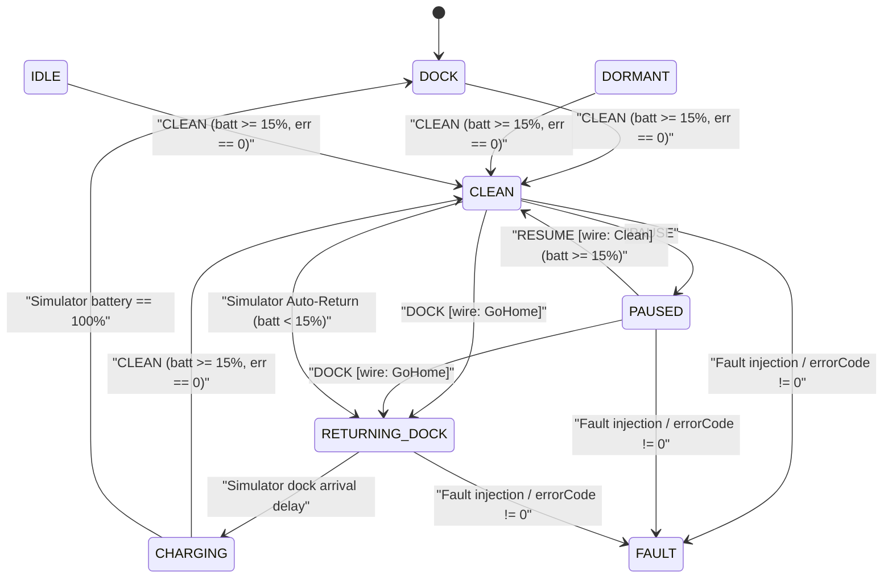

# FCT-002 Technical Design — Simulated Robot Control

- **Change ID:** `FCT-002`
- **Risk Tier:** `T2`
- **References:** [proposal.md](proposal.md) | [requirements.md](requirements.md) | [validation.md](validation.md) | [specs/tech-stack.md](../../tech-stack.md) | [specs/constitution.md](../../constitution.md)

---

## 1. Architectural Boundaries & Package Design

FCT-002 preserves the single-module `:app` clean-architecture package layout established in FCT-001:

```text
app/src/main/java/com/weback/robot/
├── core/
│   ├── AppContainer.kt              (Injects DispatcherProvider + SimulatorRobotTransport)
│   └── DispatcherProvider.kt        (Standard + TestDispatcher abstraction)
├── domain/                          [PURE KOTLIN — ZERO android.* / kotlinx.serialization imports]
│   ├── model/
│   │   ├── RobotCommand.kt          (NEW: CLEAN, PAUSE, RESUME, DOCK + wireStatus mapping)
│   │   ├── RobotMode.kt             (EXTENDED: DOCK, CLEAN, PAUSED, RETURNING_DOCK, CHARGING, DORMANT, IDLE, FAULT)
│   │   ├── RobotState.kt            (EXTENDED: battery 0..100 guard, isDocked consistency)
│   │   ├── CommandExecutionState.kt (NEW: Idle, Pending, Acknowledged, Rejected + CommandRejectionReason)
│   │   ├── CommandResult.kt         (NEW: Transport result Acknowledged | Rejected)
│   │   └── ControlAvailability.kt   (NEW: Pure function computing button enablement)
│   └── control/
│       └── RobotStateMachine.kt     (NEW: Pure transition matrix & low-battery/fault guard evaluator)
├── protocol/
│   ├── RobotTransport.kt            (EXTENDED: suspend fun sendCommand(RobotCommand): CommandResult)
│   ├── SimulatorConfig.kt           (NEW: Delay/tick intervals + optional test failure injector)
│   └── SimulatorRobotTransport.kt   (EXTENDED: Deterministic virtual-time simulation & mutex serialization)
└── ui/
    ├── DashboardViewModel.kt        (EXTENDED: Unidirectional DashboardIntent, lifecycle tracking, busy guard)
    ├── screens/
    │   └── DashboardScreen.kt       (EXTENDED: Clean/Pause/Resume/Dock controls, feedback banner, OFFLINE badge)
    └── theme/
```

Dependency rule (enforced statically and via code review):
- `ui` -> `domain`, `protocol`
- `protocol` -> `domain`, `core`
- `domain` -> Kotlin stdlib ONLY (zero `android.*`, `androidx.*`, `kotlinx.coroutines.*`, `okhttp3.*`).

---

## 2. RE Wire Token Mapping vs. Client Simulator State Machine

Based on `SPEC-PROT-01` (`PROT-WS-01`), `SPEC-STATE-01`, and `SPEC-MODEL-01`:

| Domain `RobotCommand` | Wire `working_status` (`RE-OBSERVED`) | Valid Source `RobotMode`s | Resulting Simulator `RobotMode` | Guard Failure Reason |
| :--- | :--- | :--- | :--- | :--- |
| `RobotCommand.CLEAN` | `"Clean"` | `DOCK`, `CHARGING`, `DORMANT`, `IDLE` | `RobotMode.CLEAN` | `LOW_BATTERY` (`< 15%`), `FAULT_ACTIVE`, `INVALID_TRANSITION` |
| `RobotCommand.PAUSE` | `"Pause"` | `CLEAN` | `RobotMode.PAUSED` | `FAULT_ACTIVE`, `INVALID_TRANSITION` |
| `RobotCommand.RESUME` | `"Clean"` (per `SPEC-STATE-01`) | `PAUSED` | `RobotMode.CLEAN` | `LOW_BATTERY` (`< 15%`), `FAULT_ACTIVE`, `INVALID_TRANSITION` |
| `RobotCommand.DOCK` | `"GoHome"` | `CLEAN`, `PAUSED` | `RobotMode.RETURNING_DOCK` | `FAULT_ACTIVE`, `INVALID_TRANSITION` |

### State Transition Diagram (Client & Offline Simulator)



---

## 3. Command Execution Lifecycle & Concurrency Control

To satisfy `REQ-CTRL-203` and `REQ-CTRL-204` without race conditions:

1. **ViewModel Single-Writer Gate (`busy` check):**
   - `DashboardViewModel` tracks `commandState: CommandExecutionState` inside `RobotUiState`.
   - When `onIntent(intent)` receives a command intent (`Clean`, `Pause`, `Resume`, `Dock`):
     - If `currentUiState.commandState is CommandExecutionState.Pending`:
       - If pending command equals incoming command: ignore duplicate submission (no second transport call, preserve active `Pending`).
       - If pending command differs from incoming command: emit non-destructive `lastConflictNotice` (or expose conflict state cleanly without overriding active `Pending` lifecycle or issuing a second transport call). *Correction check:* Keeping `commandState` as `Pending` for the active in-flight command while recording a transient `conflictWarning: String?` ensures `AC-204.2` both preserves the active `Pending` lock and surfaces user feedback cleanly!
     - Otherwise evaluate `RobotStateMachine.evaluateTransition(currentRobotState, command)` locally first:
       - If `Rejected(reason)`: immediately emit `CommandExecutionState.Rejected(command, nextId, reason, userMessage)` without calling `RobotTransport.sendCommand`.
       - If `Accepted`: emit `CommandExecutionState.Pending(command, commandId, submittedAtMs)` **before** suspending on `robotTransport.sendCommand(command)`.
2. **Transport Serialization (`Mutex` in `SimulatorRobotTransport`):**
   - `SimulatorRobotTransport.sendCommand` acquires a `kotlinx.coroutines.sync.Mutex` internally as defense-in-depth even for callers bypassing ViewModel.
   - Inside the critical section, after simulated `ackDelayMs` (`delay(config.ackDelayMs)`):
     - Check test fault injection (`nextCommandRejection` or `errorCode != 0`).
     - Re-evaluate `RobotStateMachine.evaluateTransition(state.value, command)` against latest committed state (eliminating TOCTOU bugs if telemetry changed mid-flight).
     - Commit updated `MutableStateFlow` value and return `CommandResult.Acknowledged(newState)` or `CommandResult.Rejected(reason, message)`.

---

## 4. Deterministic Time & Simulator Simulation Loop

Per `REQ-CTRL-205` and `REQ-CTRL-206`:
- `SimulatorRobotTransport` runs simulator ticks in a dedicated injectable `CoroutineScope` built on `dispatcherProvider.default` (which in tests is replaced with `TestScope(StandardTestDispatcher())` / `TestDispatcherProvider`).
- **No `Thread.sleep`, `Timer`, or `System.currentTimeMillis()`** in domain or simulator timing loops; monotonic timestamps use an injectable `TimeSource` / `clockMs: () -> Long` (defaulting cleanly to test virtual clock in unit tests and `SystemClock.elapsedRealtime()` or `System.currentTimeMillis()` only inside Android-wired `core/AppContainer` or coroutine delay counters). Even simpler and 100% pure Kotlin: accumulate elapsed simulated `Long` ms inside the coroutine tick loop using `delay(stepMs)` so `advanceTimeBy(...)` in `kotlinx-coroutines-test` advances simulator state AND timestamps 100% deterministically!
- **Progression Rules (Simulator Only):**
  - While `mode == CLEAN`: every `cleanBatteryDrainIntervalMs` (e.g., `5_000L` ms), battery decreases by `1` clamped at `0`; if battery drops below `15%`, simulator transitions `CLEAN -> RETURNING_DOCK` automatically.
  - While `mode == RETURNING_DOCK`: after `returnToDockDurationMs` (e.g., `2_000L` ms), transitions `RETURNING_DOCK -> CHARGING` (setting `isDocked = true` via `mode`).
  - While `mode == CHARGING`: every `chargeIntervalMs` (e.g., `1_000L` ms), battery increments by `5` clamped at `100`; upon reaching `100`, transitions `CHARGING -> DOCK`.
  - Simulation jobs cancel cleanly when leaving a timed state or when transport `close()` is called.

---

## 5. UI State Schema & Compose Controls

```kotlin
data class RobotUiState(
    val robotState: RobotState = RobotState(),
    val isSimulatorMode: Boolean = true,
    val statusSummary: String = "Simulator Active (Offline)",
    val commandState: CommandExecutionState = CommandExecutionState.Idle,
    val busyConflictNotice: String? = null,
    val controls: ControlAvailability = ControlAvailability.from(RobotState(), CommandExecutionState.Idle)
)
```

`ControlAvailability.from(robotState, commandState)`:
- When `commandState is CommandExecutionState.Pending` or `robotState.mode == RobotMode.FAULT` or `robotState.errorCode != 0`: all 4 (`canClean`, `canPause`, `canResume`, `canDock`) = `false`.
- Otherwise, each action delegates directly to `RobotStateMachine.evaluateTransition(robotState, cmd).isAccepted` — single source of truth, zero duplicate condition logic between UI enablement and domain guards!

Compose semantics tags on `DashboardScreen`:
- `simulator_badge` (retained from FCT-001, always visible)
- `robot_mode_text`, `robot_battery_text`, `robot_dock_status_text`
- `command_status_banner`
- `btn_clean`, `btn_pause`, `btn_resume`, `btn_dock`

---

## 6. Test Dependencies & Build Integration Plan (Executed at FCT-002 Implementation, Not Spec Phase)

To keep all verification inside the existing 7-check `policies/checks.json` (`android-unit-tests` -> `./gradlew testDebugUnitTest`) without adding emulator flakes or altering verification policy:
- FCT-002 Implementation Tasks will pin `robolectric`, `androidx.test.ext:junit`, `androidx.compose.ui:ui-test-junit4`, and `androidx.compose.ui:ui-test-manifest` in `gradle/libs.versions.toml` and `app/build.gradle.kts` (`testImplementation` / `debugImplementation`), with `testOptions { unitTests.isIncludeAndroidResources = true }`.
- This enables real Jetpack Compose UI interaction assertions (`onNodeWithTag("btn_clean").assertIsEnabled().performClick()`, `onNodeWithTag("simulator_badge").assertIsDisplayed()`) directly inside `android-unit-tests`.
