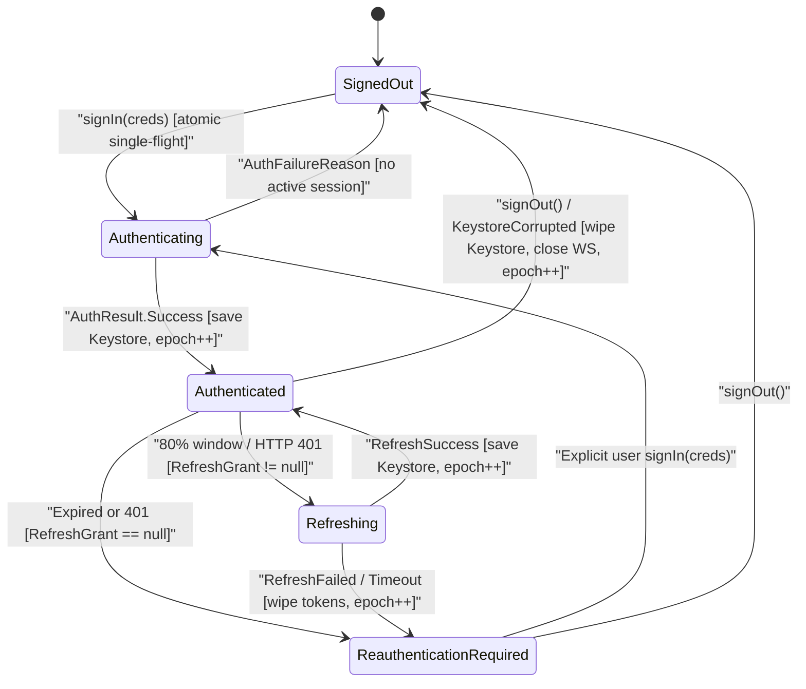

# FCT-003 Technical Design & Keystore Security ADR — Authentication, Device Inventory & Connectivity

- **Change ID:** `FCT-003`
- **Risk Classification:** `T4` (Auth, Session, Keystore AES-256-GCM Storage & Redaction) / `T3` (Protocol Contracts, Inventory, Capability Detection & WebSocket Adapters)
- **References:** [proposal.md](proposal.md) | [risk-assessment.md](risk-assessment.md) | [requirements.md](requirements.md) | [validation.md](validation.md) | [specs/tech-stack.md](../../tech-stack.md) | [specs/constitution.md](../../constitution.md)

---

## 1. Architecture Decision Record (ADR-003): Android Keystore Token Storage & Passwordless Renewal

Per [specs/tech-stack.md](../../tech-stack.md) Section 3.3 (*"The project will not prematurely commit to a specific custom storage implementation before an approved Threat Model and Security ADR are completed in Milestone FCT-003"*):

- **Status:** `PROPOSED FOR GATE G2 APPROVAL`
- **Context:** Legacy APK `com.yugong.Backome` persisted raw plaintext passwords (`p0.f43937e`) and session JSON (`identity_Info`) inside unencrypted `SharedPreferences`. Meanwhile, Google's `androidx.security:security-crypto` (`EncryptedSharedPreferences`) is officially deprecated and banned by `C-010` / [specs/tech-stack.md](../../tech-stack.md) §4 due to `KeyStore`/XML corruption and deadlock bugs.
- **Decision:**
  1. **Encrypted Material Scope:** `TokenStore` persists ONLY `PersistedSessionRecord` (`jwtToken`, `apiUrl`, `wssUrl`, `regionName`, optional opaque `refreshToken`, `expiresInSeconds`, `issuedAtEpochMs`, `accountAliasRedacted`). Plaintext user passwords and MD5 digests are **never** written to disk.
  2. **Keystore Primitive:** Create/retrieve a non-exportable symmetric key (`alias = "com.weback.robot.auth.session_key.v1"`) in `"AndroidKeyStore"` via `KeyGenParameterSpec.Builder`: `PURPOSE_ENCRYPT or PURPOSE_DECRYPT`, `KEY_ALGORITHM_AES`, `keySize = 256`, `BLOCK_MODE_GCM`, `ENCRYPTION_PADDING_NONE`, `randomizedEncryptionRequired = true`.
  3. **Binary Envelope Layout:** Encrypt UTF-8 serialized `PersistedSessionRecord` bytes (`kotlinx.serialization.json`) per write, producing `[0x01 schemaVersion (1B) | iv (12B) | gcmCiphertextWithTag (>=16B tag)]`, stored atomically (`write-temp-then-rename` or atomic single-file write inside `context.noBackupFilesDir`, excluded from cloud backup alongside `android:allowBackup="false"`).
  4. **Associated Authenticated Data (AAD):** Supply fixed canonical AAD byte array (`"com.weback.robot:session:v1".toByteArray(UTF_8)`) into `Cipher.updateAAD(aad)` to bind ciphertext integrity to application/record context.
  5. **Fail-Closed Tamper & Corruption Policy:** On `AEADBadTagException`, `KeyPermanentlyInvalidatedException`, `IllegalArgumentException` (short buffer, version != `0x01`), or deserialization failure: delete the corrupt file atomically, zeroize transient byte arrays, return `TokenLoadResult.CorruptedOrInvalidated`, and transition `SessionStateMachine` to `SignedOut` / `ReauthenticationRequired`. Never recover silently to plaintext.
  6. **Testability:** Separate `AeadCipherProvider` (Android Keystore implementation for device/Robolectric vs deterministic JCA `SecretKeySpec` AES/GCM in-memory fake for fast pure-JVM failure-injection tests of `KeystoreAeadTokenStore` envelope parsing/truncation/tag-tampering).
- **Consequences:** Eliminates `security-crypto` dependency completely, guarantees AES-256-GCM authenticated confidentiality under `minSdk = 31`, and forces explicit user sign-in on token expiration unless server-side passwordless refresh tokens are confirmed in `FCT-004`.

---

## 2. Package Architecture & Pure Domain Boundaries

FCT-003 extends the existing single-module `:app` clean architecture (`C-002`, `C-005`):

```text
app/src/main/java/com/weback/robot/
├── core/
│   ├── AppContainer.kt                    (EXTENDED: SessionManager, TokenStore, DeviceInventoryRepository, SecretRedactor; Offline default preserved)
│   ├── DispatcherProvider.kt              (EXISTING)
│   └── MonotonicClock.kt                  (EXISTING)
├── domain/                                [PURE KOTLIN — ZERO android.* / androidx.* / coroutines / serialization / okhttp3 imports]
│   ├── auth/
│   │   ├── SessionStateMachine.kt         (Pure deterministic session FSM transitions + epoch checks)
│   │   └── TokenExpiryPolicy.kt           (Long arithmetic 80% renewal & 100% expiration checks)
│   ├── device/
│   │   └── DeviceCapabilityClassifier.kt  (Prefix matcher over observed P0/q1/l1/m1/N0/Y0/v0/n1/e1 sets -> Compatibility classification)
│   └── model/
│       ├── AuthModels.kt                  (AuthCredentials, RegionCallingCode, SessionCredentials, SessionState, AuthFailureReason, AuthResult)
│       ├── ConnectivityModels.kt          (ConnectionState, ConnectivityError, DeviceInventoryItem, InventoryState, DeviceCapability, TransportKind)
│       └── ...                            (Existing RobotCommand, RobotMode, RobotState, etc.)
├── security/                              [T4 SECURITY ENCLAVE — Keystore, URI, Redaction, Digest Boundary]
│   ├── TokenStore.kt                      (suspend get/save/clear -> TokenLoadResult)
│   ├── KeystoreAeadTokenStore.kt          (AES-256-GCM AEAD envelope + AndroidKeyStore/AeadCipherProvider)
│   ├── SecretRedactor.kt                  (Header, JSON field & JWT scrubbing for logs/errors)
│   ├── UriValidator.kt                    (Strict https/wss/no-userinfo validator + test loopback allowance)
│   └── PasswordDigestStrategy.kt          (Utf8TlsDefault + explicitly gated legacy compatibility contract)
├── protocol/                              [T3 CONNECTIVITY ADAPTERS & DTOs]
│   ├── RobotTransport.kt                  (EXISTING — shared control contract)
│   ├── SimulatorRobotTransport.kt         (EXISTING — offline simulator preserved)
│   ├── auth/
│   │   ├── AuthGateway.kt                 (Interface: signIn, optional refreshSession)
│   │   ├── RegionEndpointRouter.kt        (CN grit-cloud.cn vs Global grit-cloud.com `[RE-OBSERVED]` + test overrides)
│   │   ├── OkHttpAuthGateway.kt           (POST JSON login envelope, validates response via UriValidator + Response parser)
│   │   └── OfflineFixtureAuthGateway.kt   (Deterministic synthetic offline auth & fault-injection stub)
│   ├── inventory/
│   │   ├── DeviceInventoryGateway.kt      (Interface: fetchThings(session))
│   │   ├── OkHttpDeviceInventoryGateway.kt(POST {"opt":"user_thing_list_get"} w/ headers "token" & "region")
│   │   └── OfflineFixtureInventoryGateway.kt
│   └── ws/
│       ├── RealtimeSessionTransport.kt    (connectionState: StateFlow<ConnectionState>, inboundStatus: StateFlow<...>, connect/disconnect/send)
│       ├── ConnectionConfig.kt            (reconnectDelayMs=4000, sendStallTimeoutMs=20000, maxReconnectAttempts)
│       ├── OkHttpWebSocketTransport.kt    (Upgrade headers token+region, thing_status_update parsing, backoff, 401 short-circuit, idempotent close)
│       └── OfflineFixtureRealtimeTransport.kt
└── app/session/                           (or ui/ + service coordinator binding AppContainer)
    ├── SessionCoordinator.kt              (Single-flight Mutex owning SessionState, TokenStore, epoch, refresh, WebSocket tear-down)
    └── DeviceInventoryRepository.kt       (Coordinates inventory fetch, capability filtering, conservative telemetry hydration)
```

---

## 3. Protocol Wire Formats & Validation Contracts

### 3.1 Authentication (`OkHttpAuthGateway`)
- **Region Routing (`RegionEndpointRouter`):**
  - Input calling code trimmed; CN match if normalized equals `"+86"` or `"0086"` (`[RE-OBSERVED: utils/e0.java:144-149]`) -> `https://user.grit-cloud.cn/prod/oauth` (`function/b.java:28`).
  - Non-empty non-CN calling code matching `^(\+|00)[0-9]{1,4}$` -> `https://user.grit-cloud.com/prod/oauth` (`function/b.java:31`).
  - Reject blank/malformed calling codes locally with `AuthFailureReason.ConfigurationError` before any network call.
  - Test / offline configurations bypass live routing via explicitly injected `AuthEndpointConfig(authUrl, allowLoopbackForTest = true)`.
- **Request Payload (`@Serializable` `kotlinx.serialization.json`):**
  ```json
  {
    "header": {
      "api_version": "0.1.0-alpha",
      "app_name": "WeBack",
      "calling_code": "+1",
      "account": "user@example.invalid",
      "client_id": "yugong_app",
      "language": "en"
    },
    "payload": {
      "opt": "login",
      "pwd": "<output from injected PasswordDigestStrategy>"
    }
  }
  ```
- **Response Validation:** Must be HTTP `200..209`/`200..299` (check HTTP `401`/`403` -> `InvalidCredentials` / `Unauthorized`), JSON `code == 1`, non-blank `data.jwt_token`, `data.expired_time > 0`, non-blank `data.region_name`, and `UriValidator` passing on `data.api_url` (`https://`, or loopback test override) and `data.wss_url` (`wss://`, or loopback test override). Missing/invalid fields fail closed with `MalformedResponse`.

### 3.2 Device Inventory (`OkHttpDeviceInventoryGateway`)
- **Request:** `POST` to validated `session.apiUrl` with headers `"token": session.jwtToken` and `"region": session.regionName` (`function/b.java:244-247`), body `{"opt": "user_thing_list_get"}`.
- **Response Envelope:** `{"code": 1, "msg": "...", "data": {"thing_list": [...]}}`.
- **Per-Item Validation & Defensive Telemetry Hydration:** Each `ThingBean` requires non-blank `thing_name` and `sub_type`; `thing_status` maps safely (`battery_level?.coerceIn(0, 100)` or fault-flagged if malformed, `connected` `"true"` vs offline, `working_status` mapped conservatively without guessing unknown enums).

### 3.3 Device Capability Classification (`DeviceCapabilityClassifier`)
- Exact normalized matching (`[RE-OBSERVED: utils/c.java:1135]`): `val normalized = subType.trim().lowercase() + "-"` matching against prefix sets grounded in `enums/p.java` and `utils/c.java`:
  1. Excluded camera/P2P (`n1`) -> `ThroughTekCameraVacuum` (`MvpIncompatible: Proprietary P2P Video Excluded`).
  2. Excluded peripherals (`m1`, `N0`, `Y0`, `v0`, `g1`) -> `PeripheralDevice(...)` (`MvpIncompatible: Non-Vacuum Peripheral`).
  3. Legacy XMPP (`e1`, `T0`, `H0`) -> `LegacyXmppVacuum` (`MvpIncompatible: XMPP Unsupported in MVP`).
  4. Laser SLAM (`P0`, noting visual-laser subset `q1` metadata) -> `LaserSlamVacuum` (`MvpSupportedShadowWs`).
  5. Non-laser Gyro (`l1` / `L0` minus peripherals/laser) -> `GyroVacuum` (`PartialTelemetryOnly` / deferred per [specs/mission.md](../../mission.md) §3.2).
  6. Unmatched / blank -> `UnknownDevice` (`MvpIncompatible: Unrecognized Device Model`).

### 3.4 Session Lifecycle & WebSocket State Machines



WebSocket FSM (`OkHttpWebSocketTransport`):
- **`Disconnected -> Connecting -> Connected`:** Upgrade request includes HTTP headers `"token"` and `"region"`.
- **`Connected -> Reconnecting(attempt, retryDelayMs)`:** On unexpected socket failure or `20_000ms` send-stall (`e.java:453`), schedule delayed reconnect (`4_000ms` base `[RE-OBSERVED: e.java:326]`, bounded by `maxReconnectAttempts`) ONLY if `session` remains valid and not closed.
- **Auth Failure Short-Circuit:** On HTTP `401`/`403` upgrade failure or close frame indicating revoked credentials, emit `AuthInvalidated` signal to `SessionCoordinator` and transition cleanly to `Disconnected` without retrying stale credentials.
- **`* -> Closed`:** Synchronized idempotent `close()` (adopting `FCT-002` `FIX-201` `commitLock` ordering: cancel pending retry job + `webSocket.close(1000, "Client closed")` + reject post-close frames/state mutations).

---

## 4. Dependency & Policy Boundary Delta (For Post-G3 Implementation Planning)

Look at current workspace state (`gradle/libs.versions.toml` and `policies/checks.json` / `verification/checks/apk_validator.py`):
1. **Dependencies Deferred to G4 Implementation Phase (Pinned Versions in [specs/tech-stack.md](../../tech-stack.md)):**
   - `com.squareup.okhttp3:okhttp:4.12.0`
   - `com.squareup.okhttp3:mockwebserver:4.12.0` (`testImplementation` only!)
   - `org.jetbrains.kotlinx:kotlinx-serialization-json:1.7.3` + `org.jetbrains.kotlin.plugin.serialization` (`2.1.21` aligned with Kotlin plugin)
   *(Must be reviewed by Lead Maintainer as part of `FCT-003` Task 1/Task 4 dependency addition — strictly `testImplementation` for `mockwebserver`!)*
2. **Android Manifest Permission Boundary (`android.permission.INTERNET`):**
   - `verification/checks/apk_validator.py` currently includes `"android.permission.INTERNET"` inside `PROHIBITED_PERMISSIONS`.
   - `FCT-003` offline & JVM `MockWebServer` verification requires **NO `INTERNET` permission** in `app/src/main/AndroidManifest.xml`, allowing `apk-validation` and all 7 checks in `policies/checks.json` to pass unmodified throughout `FCT-003` offline development.
   - Actually permitting live outbound connections (`FCT-004` Pilot) requires BOTH: (a) external Product Owner + Lead Maintainer pilot authorization, AND (b) an isolated `T4` policy PR updating `apk_validator.py` & `AndroidManifest.xml` before live socket use on hardware.
3. **Separate Security Check Proposal (Deferred / Out-of-Policy Here):**
   - Recommend proposing (in a dedicated `POL-INT-01` PR) an automated static/manifest audit check `secret-redaction-lint` scanning for `EncryptedSharedPreferences`, `setDefaultSSLSocketFactory`, `MessageDigest.getInstance("MD5")` in credential paths, and unredacted auth header logging. It is **not** activated or added to `policies/` inside `FCT-003`.
