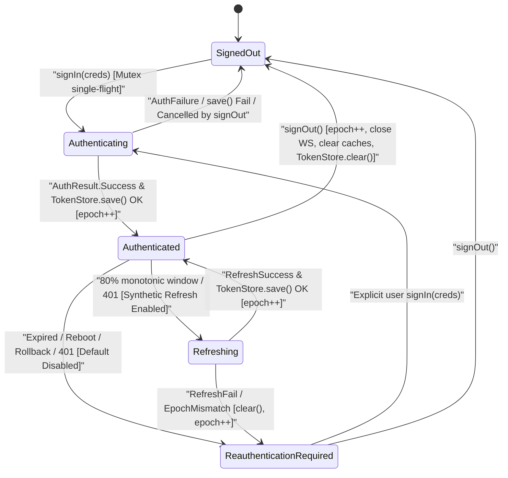

# FCT-003 Technical Design & Keystore Security ADR — Authentication, Device Inventory & Connectivity

- **Change ID:** `FCT-003`
- **Risk Classification:** `T4` (Auth, Endpoint Trust, Session Ownership, Dual-Clock Expiry, Keystore AES-256-GCM Storage & Deny-by-Default Logging) / `T3` (Protocol Contracts, Inventory, Capability Detection & WebSocket Adapters)
- **References:** [proposal.md](proposal.md) | [risk-assessment.md](risk-assessment.md) | [requirements.md](requirements.md) | [validation.md](validation.md) | [specs/tech-stack.md](../../tech-stack.md) | [specs/constitution.md](../../constitution.md)

---

## 1. Finalized Security Architecture Decision Record (ADR-003): Android Keystore AES-256-GCM Token Storage

Per [specs/tech-stack.md](../../tech-stack.md) Section 3.3 (*"The project will not prematurely commit to a specific custom storage implementation before an approved Threat Model and Security ADR are completed in Milestone FCT-003"*):

- **Status:** `FINALIZED CANDIDATE FOR GATE G2/G3 APPROVAL`
- **Context:** Legacy APK `com.yugong.Backome` persisted raw plaintext passwords (`p0.f43937e`) and session JSON (`identity_Info`) inside unencrypted `SharedPreferences`. Meanwhile, Google's `androidx.security:security-crypto` (`EncryptedSharedPreferences`) is officially deprecated and prohibited by `C-010` / [specs/tech-stack.md](../../tech-stack.md) §4 due to `KeyStore`/XML corruption and deadlock bugs.
- **Decision:**
  1. **Encrypted Material Scope:** `TokenStore` persists ONLY `PersistedSessionRecord` (`jwtToken`, `apiUrl`, `wssUrl`, `regionName`, optional synthetic-only `refreshToken`, `expiresInSeconds`, `issuedAtEpochMs`, `lastSeenEpochMs`, `issuedAtElapsedRealtimeMs`, `bootGenerationId`, `accountAliasRedacted`). Plaintext user passwords and MD5 digests are **never** written to disk.
  2. **Non-Exportable AndroidKeyStore AES-256 Key:** Create/retrieve a non-exportable symmetric key (`alias = "com.weback.robot.auth.session_key.v1"`, rotation-capable via versioned alias) in `"AndroidKeyStore"` via `KeyGenParameterSpec.Builder`:
     - `KeyProperties.KEY_ALGORITHM_AES`, `keySize = 256`
     - `PURPOSE_ENCRYPT or PURPOSE_DECRYPT`
     - `BLOCK_MODE_GCM`, `ENCRYPTION_PADDING_NONE`
     - `setRandomizedEncryptionRequired(true)` (mandatory randomized IVs; key material never exportable from `AndroidKeyStore`)
  3. **Cipher-Generated 12-Byte IV & 128-Bit GCM Tag:**
     - **Encrypt:** Initialize `Cipher.getInstance("AES/GCM/NoPadding")` with `cipher.init(Cipher.ENCRYPT_MODE, secretKey)` and **no caller-supplied `AlgorithmParameterSpec`**, allowing AndroidKeyStore/JCA to generate a fresh random IV internally. Validate `val iv = cipher.iv; require(iv.size == 12)` before writing.
     - **Decrypt:** Extract `iv = blob.copyOfRange(1, 13)` (`12` bytes) and initialize `cipher.init(Cipher.DECRYPT_MODE, secretKey, GCMParameterSpec(128, iv))` enforcing an explicit **128-bit (`16`-byte) authentication tag**.
  4. **Canonical AAD & Bounded Authenticated Binary Envelope:**
     - Canonical AAD: `AAD_V1 = "com.weback.robot:session:v1:01".toByteArray(Charsets.UTF_8)` passed to `cipher.updateAAD(AAD_V1)` on BOTH encryption and decryption, binding ciphertext integrity to app/record/schema context.
     - Envelope layout: `[schemaVersion = 0x01 (1B) | iv (12B) | gcmCiphertextWithTag (>= 16B tag)]`.
     - Bounded record size: `MIN_ENCRYPTED_RECORD_BYTES = 1 + 12 + 16 = 29` bytes; `MAX_ENCRYPTED_RECORD_BYTES = 16_384` bytes (`16 KiB`). Records `< 29` or `> 16_384` bytes are rejected **before** decryption allocation.
  5. **Strict Post-Decryption Parsing & Validation:** Even after GCM authentication succeeds, decode UTF-8 JSON inside a bounded mutable buffer, parse `PersistedSessionRecord` strictly via `kotlinx.serialization.json`, and validate `jwtToken.isNotBlank()`, `regionName.isNotBlank()`, `expiresInSeconds > 0`, `issuedAtEpochMs > 0`, `lastSeenEpochMs >= issuedAtEpochMs`, and `UriValidator` / `EndpointTrustPolicy` conformance on `apiUrl` and `wssUrl`. Any validation error fails closed identically to cryptographic tampering.
  6. **Atomic File Replacement & App-Private Directory:** Persist inside `context.noBackupFilesDir` (`session_record.bin`) alongside manifest `android:allowBackup="false"` and `@xml/data_extraction_rules`. Writes stream to `session_record.bin.tmp`, invoke `FileOutputStream.fd.sync()`, close, and atomically move via `Files.move(tmp, target, StandardCopyOption.ATOMIC_MOVE, StandardCopyOption.REPLACE_EXISTING)` (with `renameTo` fallback only if `ATOMIC_MOVE` is unsupported by the filesystem, always deleting `.tmp` on error).
  7. **Fail-Closed Read, Save, Clear, Missing-Key, Invalidation, Rotation & Logout Behavior:**
     - **Missing blob:** Return `TokenLoadResult.Empty`.
     - **Missing key while blob exists:** Decryption is impossible; atomically delete the orphaned blob and return `TokenLoadResult.CorruptedOrInvalidated`.
     - **Tamper / Truncation / Oversize / Version Mismatch / Post-Decrypt Parse Failure / `AEADBadTagException`:** Atomically delete the corrupt blob, return `TokenLoadResult.CorruptedOrInvalidated`, and transition `SessionCoordinator` to `SignedOut` / `ReauthenticationRequired`.
     - **Key Invalidation / Rotation (`KeyPermanentlyInvalidatedException` / `UnrecoverableKeyException`):** Atomically delete the unreadable blob, delete the invalidated Keystore alias (`keyStore.deleteEntry(alias)`), return `TokenLoadResult.CorruptedOrInvalidated`, and generate a fresh key on the next authorized `save()`.
     - **Save / Clear Failures & Threat-Model Limitations (`IC-302`):** `save()` returns `TokenSaveResult.Failure(safeCategory)` (never reporting durable persistence); `clear()` deletes `session_record.bin` + `.tmp` + invalidated Keystore alias (and records a fail-closed invalidation tombstone if deletion fails so restart after failed logout NEVER silently restores an invalidated session, returning `TokenClearResult.Failure(safeCategory)` and never reporting durable logout success). **Encrypted-Storage Threat-Model Limitation:** AES-256-GCM guarantees confidentiality, integrity, and tamper detection of the stored blob under the `AndroidKeyStore` key, **but AES-GCM alone does NOT prevent filesystem-level snapshot/rollback replay of an older valid encrypted record** prior to expiration or key deletion/rotation; mitigation relies on key deletion/invalidation on logout/rotation, dual-clock expiry (`issuedAtEpochMs`, `lastSeenEpochMs`, `bootGenerationId`), and server-side revocation.
     - **Zero Production Plaintext or Software-Key Fallback:** Runtime production `KeystoreAeadTokenStore` MUST exclusively use `"AndroidKeyStore"`. No `SecretKeySpec`, no `SharedPreferences`, no `EncryptedSharedPreferences`.
  8. **Security-Level Requirement & Hardware Verification Distinction:**
     - **Non-Exportability vs Hardware Backing:** `minSdk = 31` enforces `AndroidKeyStore` key non-exportability across all targets, whereas **verified hardware-backed protection** requires `KeyInfo.getSecurityLevel()` (`API 31+`) to equal `KeyProperties.SECURITY_LEVEL_TRUSTED_ENVIRONMENT` (`TEE`) or `KeyProperties.SECURITY_LEVEL_STRONGBOX` (replacing deprecated `isInsideSecureHardware()`).
     - **Verification Scope (`IC-304`):** Pure-JVM JCA `AeadCipherProvider` test doubles (strictly `src/test` only!) test envelope framing, cipher-generated 12B IVs, AAD binding, size bounds, bit-flip/tag tamper, and atomic replacement; Robolectric tests verify `noBackupFilesDir`, file cleanup, and Android integration wiring. **Neither JCA, Robolectric, nor compiling the `androidTest` APK proves TEE or StrongBox hardware backing.** Real-device `androidTest` verification (`TEST-AUTH-312`) uses an **isolated test key alias and isolated storage namespace** (never destroying existing app session data) and inspects `KeyInfo.getSecurityLevel()` on an explicitly authorized physical Android >= 12 device, remaining `NOT_RUN` in offline CI when no authorized device is attached.
  9. **Realistic Secret-Lifetime & Mutable-Buffer Cleanup Guarantees:**
     - Do **NOT** claim complete memory zeroization of immutable JVM `String`s (which are GC-managed and cannot be reliably wiped).
     - Minimize secret lifetimes by encoding/decoding encryption payloads via mutable `ByteArray` / `CharArray` buffers wiped via `Arrays.fill(..., 0)` inside `finally` blocks, avoiding long-lived plaintext record caches outside `SessionCoordinator`, and overriding `toString()` on all credential models.

---

## 2. Package Architecture & Pure Domain Boundaries

FCT-003 extends the existing single-module `:app` clean architecture (`C-002`, `C-005`):

```text
app/src/main/java/com/weback/robot/
├── core/
│   ├── AppContainer.kt                    (EXTENDED: SessionCoordinator, TokenStore, DeviceInventoryRepository, DiagnosticLogger; Offline default preserved)
│   ├── DispatcherProvider.kt              (EXISTING)
│   ├── MonotonicClock.kt                  (EXISTING — preserved for command timestamps & simulator timing)
│   └── BootSessionTimeProvider.kt         (NEW: SystemClock.elapsedRealtime() AuthMonotonicClock + WallClock + bootGenerationId for restart/reboot/rollback)
├── domain/                                [PURE KOTLIN — ZERO android.* / androidx.* / kotlinx.* / okhttp3.* imports]
│   ├── auth/
│   │   ├── SessionStateMachine.kt         (Pure deterministic session FSM transitions + epoch checks)
│   │   └── TokenExpiryPolicy.kt           (Overflow-safe Long 80%/100% + restart/reboot/rollback evaluation)
│   ├── device/
│   │   └── DeviceCapabilityClassifier.kt  (Prefix matcher grounded in enums/p.java & utils/c.java -> Compatibility)
│   └── model/
│       ├── AuthModels.kt                  (Secret-safe toString() on AuthCredentials, SessionCredentials, AuthResult, AuthFailureReason)
│       └── ConnectivityModels.kt          (ConnectionState, ConnectivityError, DeviceInventoryItem, InventoryState, DeviceCapability)
├── security/                              [T4 SECURITY ENCLAVE — Endpoint Trust, Keystore AEAD, Logging, Digest Boundary]
│   ├── EndpointTrustPolicy.kt             (Disabled ProductionEndpointTrustPolicy until FCT-004 + TestLoopbackTrustPolicy)
│   ├── UriValidator.kt                    (Exact origin, userinfo, credential query/fragment, scheme validation)
│   ├── TokenStore.kt                      (save -> TokenSaveResult, load -> TokenLoadResult, clear -> TokenClearResult)
│   ├── KeystoreAeadTokenStore.kt          (AES-256-GCM AEAD envelope + AndroidKeyStore AeadCipherProvider + atomic file replacement)
│   ├── DiagnosticLogger.kt                (Deny-by-default allowlisted structured safe logger + exception sanitizer)
│   ├── SecretRedactor.kt                  (Defense-in-depth scrubbing: headers, opaque/JWT tokens, nested/malformed JSON, URL-encoded secrets)
│   └── PasswordDigestStrategy.kt          (Utf8TlsDefault only in FCT-003; no legacy MD5 wire transmission implemented)
├── protocol/                              [T3 CONNECTIVITY ADAPTERS & DTOs]
│   ├── RobotTransport.kt                  (EXISTING — shared control contract)
│   ├── SimulatorRobotTransport.kt         (EXISTING — offline simulator preserved)
│   ├── auth/
│   │   ├── AuthGateway.kt                 (Interface: signIn, synthetic-only refreshSession)
│   │   ├── RegionEndpointRouter.kt        (CN grit-cloud.cn vs Global grit-cloud.com `[RE-OBSERVED]` + test overrides)
│   │   ├── OkHttpAuthGateway.kt           (POST JSON login envelope, followRedirects=false, EndpointTrustPolicy + UriValidator)
│   │   └── OfflineFixtureAuthGateway.kt   (Deterministic synthetic offline auth & fault-injection stub)
│   ├── inventory/
│   │   ├── DeviceInventoryGateway.kt      (Interface: fetchThings(session))
│   │   ├── OkHttpDeviceInventoryGateway.kt(POST {"opt":"user_thing_list_get"}, pre-send expiry/trust checks, followRedirects=false)
│   │   └── OfflineFixtureInventoryGateway.kt
│   └── ws/
│       ├── RealtimeSessionTransport.kt    (connectionState: StateFlow<ConnectionState>, inboundStatus: StateFlow<...>, generation-fenced)
│       ├── ConnectionConfig.kt            (reconnectDelayMs=4000, sendStallTimeoutMs=20000, maxReconnectAttempts)
│       ├── OkHttpWebSocketTransport.kt    (Upgrade headers token+region, pre-connect trust/expiry, send-stall, 401/3xx short-circuit, idempotent close)
│       └── OfflineFixtureRealtimeTransport.kt
└── app/session/
    ├── SessionCoordinator.kt              (Single-flight Mutex + short commitLock owning SessionState, TokenStore, epoch, WS tear-down)
    └── DeviceInventoryRepository.kt       (Epoch-scoped inventory cache, capability filtering, selected device & telemetry ownership)
```

---

## 3. Security & Protocol Contracts

### 3.1 Endpoint Trust & Network Isolation Contract (`SEC-301`)
1. **Explicit Trust Authorization Before Credential Attachment:** Neither `OkHttpAuthGateway`, `OkHttpDeviceInventoryGateway`, nor `OkHttpWebSocketTransport` may transmit `"token"`, `"region"`, or login credentials until BOTH `UriValidator` AND the active `EndpointTrustPolicy` authorize the target URL.
2. **Exact Origin Matching & Structural Rejection:**
   - Normalize scheme (`lowercase`) and host (`lowercase`, IDN/ASCII validated, non-blank) and resolve explicit or default port (`443` for `https`/`wss`, `80` for `http`/`ws` in loopback test mode only).
   - Require **exact origin match** (`(scheme, host, port)` tuple equality against the active policy's explicitly approved origin set). Substring, suffix, or unapproved wildcard host matches are rejected.
   - Reject unapproved HTTPS/WSS hosts even when TLS scheme is valid.
   - Reject embedded `user:pass@` or `user@` userinfo, fragments containing query/credential markers, and credential-bearing query parameters (e.g., `token`, `jwt`, `jwt_token`, `auth`, `authorization`, `pwd`, `password`, `refresh_token`, `secret`, `session`, case-insensitive).
3. **Strict Redirect Handling:**
   - Credential-bearing OkHttp clients MUST configure `.followRedirects(false)` and `.followSslRedirects(false)`.
   - Any HTTP `300..399` response is treated as an explicit non-followed `ConnectivityError.RedirectRejected` / `AuthFailureReason.RedirectRejected`, guaranteeing credentials are never forwarded to redirect targets.
4. **TLS Verification Hygiene:**
   - Standard platform `TrustManager` and `HostnameVerifier` remain active on all `OkHttpClient` instances.
   - Trust-all `X509TrustManager` / `HostnameVerifier { _, _ -> true }` and process-global `HttpsURLConnection.setDefaultSSLSocketFactory` / `SSLContext.setDefault` mutations are strictly prohibited.
5. **Test-Only Loopback Isolation vs Disabled Production Policy:**
   - `ProductionEndpointTrustPolicy` defaults to **disabled** (`empty/deny-all`) in `FCT-003` until `FCT-004` approval; **no speculative production host allowlists** (such as guessed `*.grit-cloud.*` or `*.amazonaws.com` dynamic origins) may be hardcoded.
   - `TestLoopbackTrustPolicy` (`MockServerConfig`, test-only) binds each `MockWebServer` client to its single exact configured loopback origin (e.g., `http://127.0.0.1:<port>` / `ws://127.0.0.1:<port>`), configures `.proxy(Proxy.NO_PROXY)` to prevent system/HTTP proxy diversion, and installs a custom `Dns` / pre-connect address validator asserting all resolved `InetAddress` results satisfy `address.isLoopbackAddress`, failing closed before any TCP/DNS contact to public DNS or external hosts.

### 3.2 Authentication & Inventory Wire Contracts (`REG-06`, `REG-08`, `UNK-AUTH-07`)
- **Region Routing (`RegionEndpointRouter`):**
  - CN match (`"+86"`, `"0086"`, trimmed `[RE-OBSERVED: e0.java:144-149]`) -> `https://user.grit-cloud.cn/prod/oauth` (`function/b.java:28`).
  - Valid non-CN calling code `^(\+|00)[0-9]{1,4}$` -> `https://user.grit-cloud.com/prod/oauth` (`function/b.java:31`).
  - Blank/malformed calling codes fail locally before I/O (`AuthFailureReason.ConfigurationError`).
- **Login Request Payload (`@Serializable`, `AuthEnvelopeConfig`):**
  ```json
  {
    "header": {
      "api_version": "<configured AuthEnvelopeConfig.protocolApiVersion; NEVER clean-room 0.1.0-alpha>",
      "app_name": "WeBack",
      "calling_code": "+1",
      "account": "user@example.invalid",
      "client_id": "yugong_app",
      "language": "<configured locale tag per v0.u()>"
    },
    "payload": {
      "opt": "login",
      "pwd": "<output from Utf8TlsDefault PasswordDigestStrategy>"
    }
  }
  ```
  *(Note: Legacy 6.1.7 passed `v0.l(TApplication.b())` (`"6.1.7"`) for `api_version` and `v0.u()` for `language`; FCT-003 parameterizes `AuthEnvelopeConfig` rather than substituting `"0.1.0-alpha"` as a wire version, and defers legacy MD5 wire encoding per §3.2 non-goals.)*
- **Login & Inventory Response Validation:** Require HTTP `200..299` (non-3xx), JSON `code == 1`, non-blank `jwt_token`, `expired_time > 0`, non-blank `region_name`, and `EndpointTrustPolicy` + `UriValidator` acceptance of `api_url` and `wss_url`. Inventory sends `POST` `{"opt": "user_thing_list_get"}` with `"token"` and `"region"` headers, clamping `battery_level` into `0..100`.

### 3.3 Device Capability Classification (`DeviceCapabilityClassifier`)
Grounded directly in `enums/p.java` (308 constants) and `utils/c.java` (`c2` normalization `subType.trim().lowercase() + "-"`):
1. `n1` (`5` prefixes, e.g. `"xs-x5c2-"`) -> `ThroughTekCameraVacuum` (`MvpIncompatible`).
2. `m1` (`8` thermostats), `N0` (`2` lamps), `Y0` (`7` plugs/switches), `v0` (`7` air purifiers), `g1` (`"tx3-mini-"`) -> `PeripheralDevice` (`MvpIncompatible`).
3. `H0` (`4` prefixes) / `U0` (`10` prefixes) -> `LegacyXmppVacuum` (`MvpIncompatible`; `e1` is XMPP JID server `"yubot"`, not `sub_type`).
4. `P0` (`64` prefixes, e.g. `"yg-yw10001-"`, `"xs-x8-"`, `"tesvor-s6-"`) -> `LaserSlamVacuum` (`MvpSupportedShadowWs`).
5. `q1` (`43` visual/gyro-mapped prefixes inside `l1`, disjoint from `P0`) -> `VisualGyroVacuum` (`MvpIncompatible` / deferred).
6. Remaining `l1` / `L0` non-laser vacuums -> `GyroVacuum` (`MvpIncompatible` / deferred).
7. Unmatched / blank -> `UnknownDevice` (`MvpIncompatible`).

### 3.4 Session Ownership, Dual-Clock Expiry & Commit Contract (`SEC-302`, `SEC-304`)



1. **Dual-Clock Expiry & Persistence Rules (`SEC-302`, `IC-301`):**
   - **Android Auth Clock vs Command Clock:** Android authentication/session lifetime uses `AuthMonotonicClock` backed by `android.os.SystemClock.elapsedRealtime()` (including deep-sleep time), preserving existing `MonotonicClock` (`System.nanoTime()`) exclusively for command lifecycle & simulator timing (`System.nanoTime()` MUST NOT be assumed sufficient for Android session expiry).
   - **In-Process (`AuthMonotonicClock`) & Checked Arithmetic:** `SessionCredentials` captures `issuedAtElapsedMs`, `priorElapsedMs = 0L`, and `expiresInSeconds: Long`. All subtraction, addition, and multiplication (`nowElapsedMs - issuedAtElapsedMs`, `priorElapsedMs + deltaMs`, `expiresInSeconds * 800L`, `expiresInSeconds * 1000L`) MUST use **checked `Long` arithmetic**, failing closed (`isExpired = true`) on `expiresInSeconds <= 0L`, `priorElapsedMs < 0L`, `nowElapsedMs < issuedAtElapsedMs`, or any `Long` overflow.
     - Exact 80% proactive window: `shouldProactivelyRefresh = elapsedMs > checkedMul(expiresInSeconds, 800L)` (`false` at `800L * expiresInSeconds`, `true` at `+1ms`).
     - Exact expiration boundary: `isExpired = elapsedMs >= checkedMul(expiresInSeconds, 1000L)`.
   - **Persistence (`PersistedSessionRecord`) & Restart/Reboot/Rollback:**
     - Stores `issuedAtEpochMs`, `lastSeenEpochMs`, `expiresInSeconds`, `bootGenerationId?`, `issuedAtElapsedRealtimeMs?`.
     - **Never reset lifetime on load.** On load (`BootSessionTimeProvider.snapshot()`):
       - **Clock Rollback** (`nowEpochMs < issuedAtEpochMs` or `nowEpochMs < lastSeenEpochMs` or `issuedAtEpochMs <= 0L`) -> fail closed: wipe blob, transition to `ReauthenticationRequired`.
       - **Device Reboot** (`bootGenerationId == null` or `bootGenerationId != persisted.bootGenerationId` or `issuedAtElapsedRealtimeMs == null` or `nowElapsedRealtimeMs < issuedAtElapsedRealtimeMs`) -> persisted monotonic lifetime cannot be safely established -> conservative `ReauthenticationRequired`, wipe blob.
       - **Verified Same-Boot Process Restart** (`bootGenerationId` matches, `nowElapsedRealtimeMs >= issuedAtElapsedRealtimeMs`, wall clock non-regressed): compute `priorElapsedMs = checkedSub(nowElapsedRealtimeMs, issuedAtElapsedRealtimeMs)`. If `priorElapsedMs >= checkedMul(expiresInSeconds, 1000L)`, wipe blob and transition to `ReauthenticationRequired`; else restore `Authenticated` with `priorElapsedMs` and fresh `issuedAtElapsedMs = authMonotonicClock.elapsedMs()`.
   - **Unverified JWT Claims:** Never decode or trust unverified JWT payload `exp`/`iat` claims.
   - **Pre-Send, In-Flight & Connected-Socket Expiry Checks:** Every authenticated REST/WS call validates `TokenExpiryPolicy` + `sessionEpoch` immediately **before** sending; returning HTTP responses verify expiry and `sessionEpoch` **post-response** before applying state; active WebSocket connections continuously enforce session expiry while connected (`IC-303`: stop authenticated outbound traffic, ignore/reject expired-session telemetry, cancel reconnects, close socket, trigger epoch-checked reauthentication).
   - **Refresh Strategy:** Defaults to `DisabledPasswordlessRefreshStrategy` -> `ReauthenticationRequired` (optional refresh stays synthetic/test-only; zero password/MD5 persistence or replay).

2. **Serialization, Commit Ordering & Cross-Account/Device Isolation (`SEC-304`, `IC-302`):**
   - **Locking & Persistence Serialization Discipline:** `SessionCoordinator` uses: (a) a single-flight workflow `Mutex` (`authMutex`) to serialize login/refresh/logout decisions; (b) a short-held `commitLock` ONLY around atomic in-memory state/epoch/cache memory updates — **never across network I/O, disk I/O, or reconnect sleeps**; and (c) a **serialized persistence boundary** (`persistenceMutex` + epoch-checked disk operations, executed outside network delays) for ALL `TokenStore` `save`, `clear`, invalidation, and key rotation side effects (checking epoch before and after disk I/O alone is insufficient). Cleanup/invalidation runs under `NonCancellable` inside the persistence step so coroutine cancellation cannot skip storage cleanup or violate persistence ordering.
   - **Full `sessionEpoch` Scope:** `sessionEpoch` governs EVERY async step: `TokenStore` `save`/`clear`/invalidation/rotation, concurrent `signIn`/`refresh`, logout during login or `TokenStore.save`, Account A -> Account B switches, late HTTP auth/inventory responses, late `401`/`403` failure callbacks, `DeviceInventoryRepository` cache, `selectedDeviceThingName`, WebSocket instances + reconnect jobs (`(sessionEpoch, connectionGeneration)`), and inbound telemetry frames.
   - **Durable Commit Rules:**
     - `signIn`/`refresh`: Inside the serialized persistence boundary, re-verify `currentEpoch == capturedEpoch` immediately before writing to disk; abort without disk write on mismatch. Only publish durable `Authenticated` if `TokenStore.save()` succeeds while epoch still matches; if `save()` fails, delete any partial artifact and fail closed without publishing durable `Authenticated`.
     - `signOut` / Forced Invalidation: Immediately increment `sessionEpoch` under `commitLock` (blocking all credential use in memory immediately), close WebSocket (`connectionGeneration++`), clear inventory cache, selected device, and `RobotState`, and enqueue durable persistent invalidation (`TokenStore.clear()` / key removal / invalidation tombstone) behind `persistenceMutex` under `NonCancellable`. `Account A`'s stale `clear()` MUST NOT delete `Account B`'s newer record (`clearIfEpochMatches`); if `TokenStore.clear()` fails -> leave in-memory state `SignedOut` (zero credentials usable), mark restart invalidation required, and return `LogoutResult.IncompleteStorageClear` — **never reporting durable logout success**, and refusing automatic session restoration on subsequent process restart (`IC-302`).
   - **Telemetry Ownership Guard:** Inbound `thing_status_update` frames apply to `RobotState` ONLY if `(frameEpoch == activeSessionEpoch && frameGen == activeConnectionGeneration && frame.thingName == activeSelectedThingName && capability == MvpSupportedShadowWs)`. Frames for unknown, unsupported, or unselected devices are dropped without mutating `RobotState`.

### 3.5 Deny-by-Default Logging & Credential Models (`SEC-305`)
- **Allowlisted `DiagnosticLogger`:** Normal execution paths log ONLY structured safe categories and allowlisted fields (`eventCategory`, `opt`, `httpStatus`, `latencyMs`, `safeHostPath` without query, `sessionEpoch`, `connectionGeneration`, `errorCategory`). Never log auth request/response bodies, raw `token`/`authorization`/`cookie`/`set-cookie` headers, raw WebSocket payloads, passwords/digests, or unredacted exceptions.
- **Credential Models & Exceptions:** `AuthCredentials`, `SessionCredentials`, `PersistedSessionRecord`, and `PasswordDigest` override `toString()` to mask secret fields (`[REDACTED]`). Exception wrappers scrub messages via `SecretRedactor` before surfacing or logging.
- **`SecretRedactor` (Defense-in-Depth):** Case-insensitive header scrubbing (`token`, `authorization`, `cookie`, `set-cookie`, `x-auth-token`), opaque token + `eyJ...` JWT scrubbing, nested & malformed JSON field scrubbing (`jwt_token`, `token`, `pwd`, `password`, `refresh_token`, `tutk_secret`), and URL-encoded secret scrubbing (`password=...`, `token=...`, `user%3Apass%40`). No broad global logging framework is introduced.

---

## 4. Dependency & Policy Boundary Delta (For Post-G3 Implementation Planning)

1. **Dependencies Deferred to G4 Implementation Phase (Pinned Versions in [specs/tech-stack.md](../../tech-stack.md)):**
   - `com.squareup.okhttp3:okhttp:4.12.0`
   - `com.squareup.okhttp3:mockwebserver:4.12.0` (`testImplementation` only!)
   - `org.jetbrains.kotlinx:kotlinx-serialization-json:1.7.3` + `org.jetbrains.kotlin.plugin.serialization` (`2.1.21` aligned with Kotlin `2.1.21`)
2. **Android Manifest & Policy Boundary (`android.permission.INTERNET`):**
   - `policies/checks.json` (7 checks), `verification/`, `.github/workflows/`, and `AndroidManifest.xml` (zero `INTERNET` permission) remain completely unmodified in `FCT-003`.
   - Production endpoint trust and live `FCT-004` connectivity remain disabled until external Product Owner + Lead Maintainer approval and an isolated `T4` policy/manifest PR.
