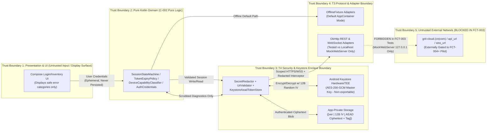

# FCT-003 Risk Assessment, Workstream Classification & Threat Model

- **Change ID:** `FCT-003`
- **Overall Milestone Risk Ceiling:** **`T4 (Critical Risk)`** per [policies/risk-tiers.md](../../../policies/risk-tiers.md)
- **Gate Target:** Gate G0 (Scope & Risk) / Gate G1 (Requirements) / Gate G2 (Design & Threat Model) / Gate G3 (Implementation Readiness)
- **References:** [proposal.md](proposal.md) | [requirements.md](requirements.md) | [design.md](design.md) | [validation.md](validation.md) | [specs/constitution.md](../../constitution.md) | [specs/tech-stack.md](../../tech-stack.md)

---

## 1. Workstream-Partitioned Risk Classification

Per [policies/risk-tiers.md](../../../policies/risk-tiers.md) (`POL-RISK-01`: *Impact Over Diff Size* and *Anti-Downgrading Prohibition*), `FCT-003` MUST NOT be classified as ordinary `T2` work. Each workstream is classified explicitly by its highest security blast radius:

| Workstream | Scope & Components | Assigned Risk Tier | `POL-RISK-01` Rationale | Mandatory Governance & Verification Controls |
| :--- | :--- | :--- | :--- | :--- |
| **Workstream A: Authentication, Session Lifecycle, Token Expiry & Keystore Storage** | Auth request/response contract, `SessionStateMachine`, `TokenExpiryPolicy`, `TokenStore`, `KeystoreAeadTokenStore` (AES-256-GCM ADR), `PasswordDigestStrategy`, `SecretRedactor`. | **`T4 (Critical)`** | `POL-RISK-01` explicitly classifies *"Authentication token management, Android Keystore cryptography"* as `T4`. Compromised key handling, weak crypto, fallback to plaintext prefs, or token leakage compromises full account/robot ownership. | `T3` controls + Threat Model, Security ADR approval, Keystore tamper/AEAD negative tests, log-redaction negative tests, Verification Integrity Review, **Dual Approval (Product Owner + Lead Maintainer)**. |
| **Workstream B: Network Protocol Contracts, Inventory Client & WebSocket Lifecycle** | Region routing, `OkHttpAuthGateway`, `OkHttpDeviceInventoryGateway` (`user_thing_list_get`), `OkHttpWebSocketTransport`, `ConnectionState` FSM, `OfflineFixture*` and `MockWebServer` adapters, TLS & URI validation. | **`T3 (High)`** | `POL-RISK-01` explicitly classifies *"Network protocol serializers, WebSocket/REST clients"* as at least `T3`. Protocol header placement bugs, scheme downgrades, or reconnect loops risk token leakage and availability failures. | `T2` controls + Threat Model inclusion, negative HTTP/WS handshake & malformed-payload tests, fault-injection timeout/disconnect tests, deterministic `MockWebServer` tests, Independent Security Review, **Lead Maintainer Approval**. |
| **Workstream C: Device Capability Detection & Offline/ViewModel Integration** | `DeviceCapabilityClassifier` (`sub_type` filtering), `ConnectivityError` mapping, `AppContainer` session wiring preserving FCT-002 offline default. | **`T3 (High ceiling inherited from Connectivity)`** *(Never below `T2`; subject to `T3`/`T4` milestone gate)* | Misclassifying unsupported peripherals/cameras or XMPP legacy robots can invoke wrong transport endpoints or destabilize UI state; session state binds directly to `T4` token invalidation. | Table-driven capability classification tests, error recovery tests, FCT-001/FCT-002 non-regression verification, CI 7-check candidate pass. |
| **Future External Gate (`FCT-004` Pilot Boundary)** | Enabling `android.permission.INTERNET` in `AndroidManifest.xml`, modifying `apk_validator.py` / `policies/`, contacting live Grit Cloud / AWS IoT / physical robot. | **`T4 (Critical)` (Out of Scope / Externally Gated)** | Hardware/cloud interaction + protected asset (`policies/` / `verification/`) edits are strictly `T4` under `C-006`, `C-008`, `C-013`, `POL-INT-01`. | Strictly **prohibited** inside `FCT-003`; requires separate PO + Lead Maintainer authorization and dedicated isolated policy PR. |

---

## 2. Trust Boundaries & Data Flow Architecture

### Trust Boundary Rules
1. **`TB1 -> TB2`:** Credentials submitted from UI enter `AuthCredentials` ephemerally in memory and are zeroized/discarded immediately after the auth call finishes; raw passwords NEVER cross `TB2 -> TB3` for disk storage.
2. **`TB2 <-> TB3`:** Persisted session material (`jwtToken`, `apiUrl`, `wssUrl`, `regionName`, optional `refreshToken`, `expiresInSeconds`, `issuedAtEpochMs`) crosses into `TB3` solely through `TokenStore`, which encrypts/authenticates using a non-exportable Android Keystore AES-256-GCM key (`KS`). Any AEAD authentication failure fails closed and wipes persisted bytes.
3. **`TB3 -> Logging/UI`:** `SecretRedactor` scrubs all outbound/inbound HTTP header tokens, JSON `"jwt_token"` / `"pwd"` / `"refresh_token"` fields, and raw bearer patterns before entering logs, diagnostic files, exceptions, or `TB1`.
4. **`TB4 -> TB5`:** All `FCT-003` automated verification targets `OFF` or loopback `MockWebServer` inside `TB4`. Reaching `TB5` requires separate human pilot authorization (`FCT-004`) and an isolated `T4` policy/manifest change enabling `android.permission.INTERNET`.

---

## 3. STRIDE Threat Model & RE-Grounded Vulnerability Countermeasures

Legacy bytecode (`com.yugong.Backome` and `final/07_SECURITY_FINDINGS.md`) exhibited severe authentication and transport flaws (`d.java` credential logging, plaintext password storage in `SharedPreferences`, unsalted MD5 password hashing, `EncryptedSharedPreferences`-equivalent missing crypto, and global `HttpsURLConnection` socket factory replacement). `FCT-003` mitigates every identified threat explicitly:

| Threat ID | STRIDE Category & Asset | Attack / Failure Scenario | Clean-Room Mitigation & Requirement Reference | Verification Oracle |
| :--- | :--- | :--- | :--- | :--- |
| **`THREAT-301`** | **Information Disclosure / Tampering** *(Account Password at Rest)* | Following legacy `LoginActivity`/`p0.f43937e`, app stores user password or MD5 digest in preferences for automatic 80% re-login, allowing extraction on rooted devices or backups. | Strictly prohibit storing plaintext passwords or MD5 password digests anywhere on disk (`android:allowBackup="false"`, zero password fields in `TokenStore`). When no server refresh token exists, transition to `ReauthenticationRequired` (`REQ-AUTH-304`, `REQ-AUTH-305`). | `TEST-AUTH-304`, `TEST-AUTH-306` |
| **`THREAT-302`** | **Information Disclosure** *(Logs, Crash Reports, Exception Messages)* | Legacy `utils/net/d.java:50,181` prints HTTP `"token"` header to `System.out` and full login JSON/passwords via `x.r`; OkHttp/exception traces expose `jwt_token` or URLs. | Enforce `SecretRedactor` at HTTP interceptor, WebSocket logger, repository error mapper, and exception formatter (`REQ-AUTH-305`, `AC-305.3`); redact `"token"`, `"jwt_token"`, `"pwd"`, `"password"`, `"refresh_token"`, `eyJ...` JWT patterns. | `TEST-AUTH-308` |
| **`THREAT-303`** | **Tampering / Elevation of Privilege** *(Token Store Corruption or Keystore Bypass)* | Attacker or storage corruption alters persisted token JSON (`api_url`, `jwt_token`), triggers fallback to plaintext storage after `AEADBadTagException`, or reuses old Android `EncryptedSharedPreferences`. | Use Android Keystore AES-256-GCM (`12`-byte random IV, `128`-bit GCM tag, non-exportable Keystore alias, versioned framing) without `EncryptedSharedPreferences`; AEAD/Keystore failure wipes blob atomically and fails closed to `SignedOut` (`REQ-AUTH-305`, `AC-305.1..2`). | `TEST-AUTH-307` |
| **`THREAT-304`** | **Spoofing / Credential Theft** *(Scheme Downgrade & SSRF-via-Redirect)* | Malicious or compromised auth server returns `api_url: "http://..."`, `wss_url: "ws://..."`, embedded `user:pass@host`, or HTTP 3xx redirect off TLS, leaking `token`/`region` headers in cleartext. | Enforce `UriValidator` (`https://` / `wss://` strictly for non-test configs; no userinfo; disable cross-scheme/credential-leaking redirects); preserve `usesCleartextTraffic="false"` (`network_security_config.xml`) (`REQ-AUTH-301`, `AC-301.2`, `REQ-AUTH-302`). | `TEST-AUTH-301`, `TEST-AUTH-309` |
| **`THREAT-305`** | **Repudiation / Race Condition** *(Concurrent Refresh & Cross-Session Token Reuse)* | Concurrent API calls trigger duplicate refreshes overwriting newer credentials, OR sign-out happens while an in-flight login/refresh finishes late and re-hydrates a signed-out session or leaks User A's token into User B's inventory call. | Single-flight synchronization mutex on login/refresh + monotonic `sessionGeneration` epoch checked before committing auth/refresh results or attaching headers (`REQ-AUTH-303`, `REQ-AUTH-304`). | `TEST-AUTH-303`, `TEST-AUTH-305` |
| **`THREAT-306`** | **Denial of Service** *(Auth-Reject Reconnect Storm)* | WebSocket receives HTTP `401`/`403` (revoked/expired token) and enters an unbounded 4s reconnect timer loop like legacy `websocket/e.java:326` without halting or invalidating session. | Treat HTTP `401`/`403` upgrade rejections and auth failures as non-retriable transport-level auth signals: stop reconnect loop, notify single-flight renewal or invalidate session to `ReauthenticationRequired` (`REQ-CONN-308`, `AC-308.3`). | `TEST-CONN-308`, `TEST-CONN-309` |
| **`THREAT-307`** | **Tampering / Supply Chain** *(Unintended Live Cloud Access or Unauthorized `INTERNET` Permission)* | Automated tests hit live `user.grit-cloud.*` or manifest accidentally enables `INTERNET` during offline `FCT-003`, violating `C-006`/`C-010` and `apk_validator.py`. | Test adapters inject `AuthEndpointConfig` pointing exclusively to `MockWebServer` / offline fixtures; `AndroidManifest.xml` retains zero `INTERNET` permission during `FCT-003`; live endpoints remain blocked until external `FCT-004` pilot authorization (`REQ-CONN-309`, `AC-309.2..3`). | `TEST-CONN-310`, `TEST-CONN-312` (`apk-validation`) |
| **`THREAT-308`** | **Unsafe Parsing / Domain Confusion** *(Device Type Spoofing or Malformed `thing_status` Crash)* | Server returns unrecognized `sub_type`, smart-plug/camera `thing_status`, out-of-range battery integer (`-5` / `999`), or arbitrary JSON errors, crashing domain `RobotState` invariants or misrouting device controls. | `DeviceCapabilityClassifier` defaults unrecognized/excluded devices cleanly (`UnsupportedPeripheral` / `LegacyXmppUnsupported` / `UnknownDevice`); `thing_status` hydration validates & clamps/handles missing/corrupt fields cleanly via `kotlinx.serialization.json` (`REQ-CONN-306`, `REQ-CONN-307`). | `TEST-CONN-302`, `TEST-CONN-304`, `TEST-CONN-305` |

---

## 4. Non-Waivable Invariants & External Authorization Boundaries (`FCT-003`)

1. **Zero Secret Material in Git, Logs, or UI (`C-010`):** No test account credentials, Grit Cloud hashes, production JWTs, or private keys may ever appear in source, test fixtures, or logs; `SecretRedactor` enforcement is non-waivable.
2. **Zero Legacy Plaintext Password Caching or `EncryptedSharedPreferences` (`C-010`, [specs/tech-stack.md](../../tech-stack.md)):** Password caching on disk is strictly banned; Android Keystore AES-256-GCM without `EncryptedSharedPreferences` is non-waivable.
3. **Zero Live Cloud or Hardware Contact (`C-006`, `C-013`):** Automated unit/contract tests operate 100% against offline synthetic fixtures and local loopback `MockWebServer` only. Any live cloud or physical-robot connectivity pilot (`FCT-004`) requires explicit signed external authorization from the Product Owner and Lead Maintainer plus an isolated `T4` policy/permission transition PR.
4. **Pure Kotlin Domain Isolation (`C-002`):** `com.weback.robot.domain` remains 100% pure Kotlin with zero `android.*`, `androidx.*`, `kotlinx.coroutines.*`, `kotlinx.serialization.*`, or `okhttp3.*` imports.
5. **Protected Policy & Verification Integrity (`POL-INT-01`):** Active `policies/checks.json` (7 checks) and `verification/` harness files remain unmodified in `spec/fct-003-authentication-connectivity`. Additional future checks (`secret-redaction-scan`, `FCT-004` manifest permission transition) are documented strictly as separate governance proposals.
