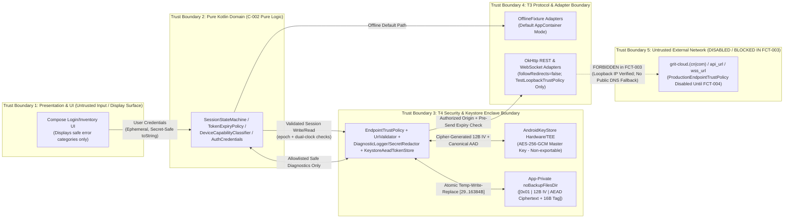

# FCT-003 Risk Assessment, Workstream Classification & Threat Model

- **Change ID:** `FCT-003`
- **Overall Milestone Risk Ceiling:** **`T4 (Critical Risk)`** per [policies/risk-tiers.md](../../../policies/risk-tiers.md)
- **Gate Target:** Gate G0 (Scope & Risk) / Gate G1 (Requirements) / Gate G2 (Design & Threat Model) / Gate G3 (Implementation Readiness)
- **References:** [proposal.md](proposal.md) | [requirements.md](requirements.md) | [design.md](design.md) | [validation.md](validation.md) | [specs/constitution.md](../../constitution.md) | [specs/tech-stack.md](../../tech-stack.md)

---

## 1. Workstream-Partitioned Risk Classification

Per [policies/risk-tiers.md](../../../policies/risk-tiers.md) (`POL-RISK-01`: *Impact Over Diff Size* and *Anti-Downgrading Prohibition*), `FCT-003` MUST NOT be classified as ordinary `T2` work. Each workstream is classified explicitly by its highest security blast radius:

| Workstream | Scope & Components | Assigned Risk Tier | `POL-RISK-01` Rationale | Mandatory Governance & Verification Controls |
| :--- | :--- | :--- | :--- | :--- |
| **Workstream A: Authentication, Endpoint Trust, Session Ownership, Time Semantics, Keystore Storage & Logging** | Auth contract, `EndpointTrustPolicy` & `UriValidator` (origin, redirect, loopback isolation), `SessionStateMachine`, `SessionCoordinator` (`sessionEpoch` & commit contract), dual-clock `TokenExpiryPolicy`, `KeystoreAeadTokenStore` (AES-256-GCM ADR), `PasswordDigestStrategy`, `DiagnosticLogger` & `SecretRedactor`. | **`T4 (Critical)`** | `POL-RISK-01` explicitly classifies *"Authentication token management, Android Keystore cryptography"* as `T4`. Redirect leaks, untrusted endpoints, clock rollback bypasses, weak crypto, fallback to plaintext/software keys, race-condition token leaks, or credential logging compromise full account/robot ownership. | `T3` controls + Threat Model, Security ADR approval, endpoint/redirect/clock/race/AEAD/redaction negative tests, real-device `KeyInfo` verification plan (`NOT_RUN` when no authorized device attached), Verification Integrity Review, **Manual UAT Sign-off + Dual Approval (Product Owner + Lead Maintainer)**. |
| **Workstream B: Network Protocol Contracts, Inventory Client & WebSocket Lifecycle** | Region routing, `OkHttpAuthGateway`, `OkHttpDeviceInventoryGateway` (`user_thing_list_get`), `OkHttpWebSocketTransport`, `ConnectionState` FSM (`sessionEpoch`, `connectionGeneration`), `OfflineFixture*` and hermetic `MockWebServer` adapters, TLS & redirect-free OkHttp config. | **`T3 (High)`** | `POL-RISK-01` explicitly classifies *"Network protocol serializers, WebSocket/REST clients"* as at least `T3`. Protocol header placement bugs, unapproved origins, redirect forwarding, or reconnect loops risk token leakage and availability failures. | `T2` controls + Threat Model inclusion, negative HTTP/WS handshake, redirect, cross-device frame & malformed-payload tests, fault-injection timeout/disconnect tests, loopback-isolated `MockWebServer` tests, Independent Security Review, **Lead Maintainer Approval**. |
| **Workstream C: Device Capability Detection & Offline/ViewModel Integration** | `DeviceCapabilityClassifier` (`sub_type` filtering), `ConnectivityError` mapping, `AppContainer` session/telemetry wiring preserving FCT-002 offline default. | **`T3 (High ceiling inherited from Connectivity)`** *(Never below `T2`; subject to `T3`/`T4` milestone gate)* | Misclassifying unsupported peripherals/cameras or XMPP legacy robots, or applying telemetry for an unselected `thing_name`, can corrupt `RobotState` or misroute controls; session state binds directly to `T4` token invalidation. | Table-driven capability classification tests, cross-device telemetry negative tests, error recovery tests, FCT-001/FCT-002 non-regression verification, CI 7-check candidate pass. |
| **Future External Gate (`FCT-004` Pilot Boundary)** | Enabling `android.permission.INTERNET` in `AndroidManifest.xml`, enabling `ProductionEndpointTrustPolicy`, modifying `apk_validator.py` / `policies/`, contacting live Grit Cloud / AWS IoT / physical robot. | **`T4 (Critical)` (Out of Scope / Externally Gated)** | Hardware/cloud interaction + protected asset (`policies/` / `verification/`) edits are strictly `T4` under `C-006`, `C-008`, `C-013`, `POL-INT-01`. | Strictly **prohibited** inside `FCT-003`; requires separate PO + Lead Maintainer authorization and dedicated isolated policy/manifest PR. |

---

## 2. Trust Boundaries & Data Flow Architecture

### Trust Boundary Rules
1. **`TB1 -> TB2`:** Credentials submitted from UI enter `AuthCredentials` ephemerally with secret-safe `toString()`; mutable buffers (`CharArray`/`ByteArray`) are wiped in `finally` blocks after serialization without claiming impossible immutable JVM `String` zeroization. Raw passwords and MD5 digests NEVER cross `TB2 -> TB3` for disk storage.
2. **`TB2 <-> TB3`:** Persisted session material (`PersistedSessionRecord`: `jwtToken`, `apiUrl`, `wssUrl`, `regionName`, optional synthetic `refreshToken`, `expiresInSeconds`, `issuedAtEpochMs`, `lastSeenEpochMs`, `issuedAtElapsedRealtimeMs`, `bootGenerationId`, `accountAliasRedacted`) crosses into `TB3` solely through `TokenStore`. `KeystoreAeadTokenStore` encrypts/authenticates via a non-exportable `AndroidKeyStore` AES-256-GCM key with cipher-generated 12-byte IV and canonical AAD. Any tamper, missing key, invalidation, or post-decrypt validation error fails closed and atomically deletes the blob.
3. **`TB3 -> Logging/UI`:** Deny-by-default `DiagnosticLogger` emits only allowlisted structured categories/fields (never logging raw bodies, `token`/`authorization`/`cookie` headers, WS frames, or passwords). `SecretRedactor` acts as defense-in-depth across exceptions and any captured diagnostic sink.
4. **`TB3 -> TB4 -> TB5`:** Before attaching `"token"`/`"region"` headers, clients enforce BOTH explicit `EndpointTrustPolicy` + `UriValidator` authorization (exact approved origin, zero userinfo, zero credential query params, disabled redirects) AND immediate pre-send `TokenExpiryPolicy` + `sessionEpoch` checks. Production endpoint trust remains disabled until `FCT-004` approval; all `FCT-003` network tests bind exclusively to loopback `MockWebServer` origins with destination IP verification preventing public DNS or external host fallback.

---

## 3. STRIDE Threat Model & RE-Grounded Vulnerability Countermeasures

Legacy bytecode (`com.yugong.Backome` and `final/07_SECURITY_FINDINGS.md`) exhibited severe authentication and transport flaws (`d.java` credential logging, plaintext password storage in `SharedPreferences`, unsalted MD5 password hashing, missing crypto on `IdentityInfo`, and global `HttpsURLConnection` socket factory replacement). Every threat below maps directly to verified independent test oracles in [validation.md](validation.md):

| Threat ID | STRIDE Category & Asset | Attack / Failure Scenario | Clean-Room Mitigation & Requirement Reference | Verification Oracle (In `validation.md`) |
| :--- | :--- | :--- | :--- | :--- |
| **`THREAT-301`** | **Information Disclosure / Tampering** *(Account Password at Rest)* | Following legacy `LoginActivity`/`p0.f43937e`, app stores user password or MD5 digest in preferences for automatic 80% re-login, allowing extraction on rooted devices or backups. | Strictly prohibit storing plaintext passwords or MD5 digests anywhere on disk (`android:allowBackup="false"`, zero password fields in `TokenStore`). Production defaults to `ReauthenticationRequired` with synthetic refresh disabled (`REQ-AUTH-304`, `REQ-AUTH-305`). | `TEST-AUTH-304`, `TEST-AUTH-305`, `TEST-AUTH-306` |
| **`THREAT-302`** | **Information Disclosure** *(Logs, Model `toString()`, Crash Reports, Exceptions)* | Legacy `utils/net/d.java:50,181` and `websocket/e.java:358,448` log raw `"token"` headers, login JSON/passwords, and WS frames; Kotlin `data class` `toString()` or URL-encoded exception messages leak secrets. | Adopt deny-by-default allowlisted `DiagnosticLogger`, override `toString()` on credential models, scrub exception chains, and enforce `SecretRedactor` defense-in-depth (`REQ-AUTH-302`, `REQ-AUTH-305`, `AC-305.3`). | `TEST-AUTH-308` |
| **`THREAT-303`** | **Tampering / Elevation of Privilege** *(Token Store Corruption, Software Fallback, Key Invalidation)* | Attacker or storage corruption alters persisted token JSON, truncates/bloats blob, replays old version, exploits missing Keystore alias or `KeyPermanentlyInvalidatedException`, triggers plaintext/software-key fallback, or fails silently on `save()`/`clear()`. | Require non-exportable `AndroidKeyStore` AES-256-GCM (cipher-generated 12B IV, 128-bit tag, canonical AAD, `[29..16_384]` byte bounds, atomic write-temp-fsync-replace, strict post-decrypt validation, no software fallback), fail-closed blob/key cleanup, explicit `save()`/`clear()` error reporting, and real-device `KeyInfo` security-level verification plan (`REQ-AUTH-305`, `AC-305.1..4`). | `TEST-AUTH-306`, `TEST-AUTH-307`, `TEST-AUTH-312` |
| **`THREAT-304`** | **Spoofing / Credential Theft** *(Untrusted HTTPS Origin, Userinfo/Query Secrets, Scheme Downgrade, Redirect Leakage)* | Compromised/spoofed auth server returns untrusted `https://evil.invalid` `api_url`/`wss_url`, `http://`/`ws://` downgrade, `user:pass@host`, credential-bearing query params, or HTTP `302`/`307`/`308` redirect forwarding `"token"`/`"region"` headers; or code mutates global SSL factory / disables cert verification. | Enforce `EndpointTrustPolicy` + `UriValidator` (exact approved origin match, no userinfo, no credential query params, production trust disabled in FCT-003), disable OkHttp automatic redirects (`followRedirects(false)`, `followSslRedirects(false)`), preserve platform TLS verification, and prohibit global SSL factory mutation (`REQ-AUTH-301`, `AC-301.2..3`, `REQ-AUTH-302`). | `TEST-AUTH-301`, `TEST-AUTH-309` |
| **`THREAT-305`** | **Repudiation / Race Condition** *(Concurrent Refresh, Logout-During-Persist, Late Auth Callbacks)* | Concurrent calls trigger duplicate refreshes; `signOut()` occurs during `signIn()` or `TokenStore.save()`; late HTTP response or late `401` callback from old session overwrites/invalidates newer session; or durable logout reports success when `TokenStore.clear()` failed. | Single-flight `Mutex` + short-held `commitLock` (no locks across network/sleep I/O), monotonic `sessionEpoch` checked before storage/state commits, durable `save()`/`clear()` failure propagation, and stale-epoch callback discard (`REQ-AUTH-303`, `AC-303.1..3`). | `TEST-AUTH-304`, `TEST-AUTH-311` |
| **`THREAT-306`** | **Denial of Service / Stale Socket** *(Auth-Reject Reconnect Storm & Generation Leaks)* | WebSocket receives HTTP `401`/`403` or `3xx` redirect and loops every 4s like `websocket/e.java:326`, or a superseded WS instance / delayed reconnect timer from a prior session reconnects after `signOut()`/`close()`. | Treat `401`/`403`/`3xx` handshake rejections as non-retriable auth signals stopping retries immediately; fence every WS instance and reconnect job with `(sessionEpoch, connectionGeneration)` and idempotent synchronized `close()` (`REQ-CONN-308`, `AC-308.1..3`). | `TEST-CONN-305`, `TEST-CONN-308` |
| **`THREAT-307`** | **Tampering / Supply Chain** *(Public DNS Fallback, Live Cloud Contact, Unauthorized `INTERNET` Permission)* | Test clients resolve public DNS or contact external hosts (`user.grit-cloud.*`), `ProductionEndpointTrustPolicy` activates prematurely, or `AndroidManifest.xml` adds `INTERNET` during offline `FCT-003`. | Bind test clients exclusively via `TestLoopbackTrustPolicy` (`MockServerConfig`) with destination IP loopback validation preventing public DNS/external fallback; keep production endpoint trust disabled and `AndroidManifest.xml` `INTERNET`-free until `FCT-004` approval (`REQ-AUTH-301`, `REQ-CONN-309`). | `TEST-AUTH-309`, `TEST-CONN-306`, `TEST-CONN-307` (`apk-validation`) |
| **`THREAT-308`** | **Unsafe Parsing / Domain Confusion** *(Device Type Spoofing or Malformed `thing_status` Crash)* | Server returns unrecognized `sub_type`, smart-plug/camera `thing_status`, out-of-range battery integer (`-5` / `999`), or arbitrary JSON errors, crashing `RobotState` invariants or misrouting device controls. | `DeviceCapabilityClassifier` grounds prefix matching in `enums/p.java`/`utils/c.java` and defaults unknown/excluded devices to `Unsupported`; `thing_status` hydration clamps/validates safely via `kotlinx.serialization.json` (`REQ-CONN-306`, `REQ-CONN-307`). | `TEST-CONN-302`, `TEST-CONN-303` |
| **`THREAT-309`** | **Elevation of Privilege / Stale Token Replay** *(Lifetime Reset on Restart, Reboot, Clock Rollback, In-Flight Expiry, Unverified JWT Claims)* | App resets token lifetime when loading persisted records, trusts rolled-back wall clock (`EpochMs`) across restart/reboot, parses unverified JWT `exp` claims, overflows `Int` millis, or dispatches/applies an expired token during an in-flight request. | Resolve in-process `MonotonicClock` vs persisted `PersistedSessionRecord` (`issuedAtEpochMs`, `lastSeenEpochMs`, `bootGenerationId`, `issuedAtElapsedRealtimeMs`): preserve remaining lifetime on verified same-boot restart without resetting, conservatively transition to `ReauthenticationRequired` on reboot or clock rollback, use overflow-safe `Long` math, ignore unverified JWT claims, and check expiry immediately pre-send & post-response (`REQ-AUTH-304`, `AC-304.1..2`). | `TEST-AUTH-305`, `TEST-AUTH-310` |
| **`THREAT-310`** | **Information Disclosure / Integrity** *(Cross-Account Cache Leak & Cross-Device Telemetry Mutation)* | Rapid Account A -> Account B switch leaks Account A's inventory cache or selected device into Account B, OR inbound `thing_status_update` WS frame for an unselected/unknown/unsupported `thing_name` mutates active `RobotState`. | Bind inventory cache & selected device identity to `sessionEpoch`, wipe caches/device selection/telemetry atomically on logout or account switch, and validate `(sessionEpoch, connectionGeneration)`, active selected `thing_name`, and `MvpSupportedShadowWs` capability before mutating `RobotState` (`REQ-AUTH-303`, `REQ-CONN-308`). | `TEST-AUTH-311`, `TEST-CONN-308`, `TEST-CONN-309` |

---

## 4. Non-Waivable Invariants & External Authorization Boundaries (`FCT-003`)

1. **Zero Secret Material in Git, Logs, or UI (`C-010`):** No real account credentials, Grit Cloud hashes, production JWTs, or private keys may ever appear in source, fixtures, verification artifacts, or logs; deny-by-default logging and `SecretRedactor` enforcement are non-waivable.
2. **Zero Plaintext Password Caching, `EncryptedSharedPreferences`, or Runtime Software Key Fallback (`C-010`, [specs/tech-stack.md](../../tech-stack.md)):** Password/MD5 caching on disk is strictly banned; runtime production storage uses non-exportable `AndroidKeyStore` AES-256-GCM exclusively.
3. **Zero Live Cloud or Hardware Contact (`C-006`, `C-013`):** Automated unit/contract tests operate 100% against offline synthetic fixtures and loopback `MockWebServer` with destination IP verification. Any live cloud/hardware pilot (`FCT-004`) requires explicit signed external authorization from the Product Owner and Lead Maintainer plus an isolated `T4` policy/manifest PR.
4. **Honest T4 Hardware & UAT Governance (`POL-RISK-01`, `C-012`):** Pure-JVM JCA and Robolectric tests do NOT prove TEE/StrongBox protection. Real-device `KeyInfo.getSecurityLevel()` verification (`TEST-AUTH-312`) remains `NOT_RUN` when no authorized physical device is available and blocks T4 live-device/release closure; T4 manual UAT sign-off and dual Product Owner + Lead Maintainer approval remain mandatory and non-waivable.
5. **Pure Kotlin Domain Isolation (`C-002`) & Protected Policy Integrity (`POL-INT-01`):** `com.weback.robot.domain` remains 100% pure Kotlin; `policies/`, `verification/`, and `.github/workflows/` remain unmodified in `FCT-003`.
