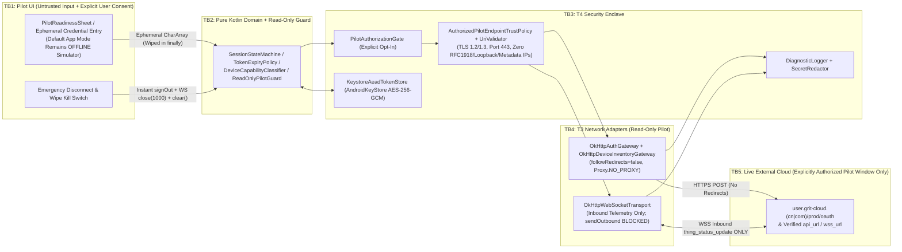

# FCT-004 Risk Assessment, Threat Model, Network Boundaries & Abort Criteria

- **Change ID:** `FCT-004`
- **Overall Milestone Risk Ceiling:** **`T4 (Critical Risk)`** per [policies/risk-tiers.md](../../../policies/risk-tiers.md)
- **Gate Target:** Gate G0 / G1 / G2 / G3 (Specification Readiness Only)
- **References:** [proposal.md](proposal.md) | [requirements.md](requirements.md) | [design.md](design.md) | [validation.md](validation.md) | [specs/constitution.md](../../constitution.md) | [specs/deployment.md](../../deployment.md)

---

## 1. Workstream Risk Classification (`POL-RISK-01`)

| Workstream | Scope | Risk Tier | Rationale |
| :--- | :--- | :--- | :--- |
| **WS-A: Pilot Authorization Gate, `INTERNET` Policy Transition, Endpoint Trust & Credential Entry** | Signed Pilot Authorization verification, `AuthorizedPilotEndpointTrustPolicy`, TLS/CA verification, ephemeral UI credential entry (`CharArray`), `AndroidManifest.xml` `INTERNET` transition proposal, `apk_validator.py` transition proposal. | **`T4 (Critical)`** | Enabling live `INTERNET` + handling real test credentials + pinning/confirming live cloud endpoints touches `POL-RISK-01` critical trust boundaries. |
| **WS-B: Read-Only Live Inventory, Capability Gate, Read-Only WebSocket & Bounded Retries** | Read-only `OkHttpDeviceInventoryGateway` & `OkHttpWebSocketTransport` pilot wiring, capability enforcement (`MvpSupportedShadowWs` read-only observation), bounded retry/backoff, outbound command block. | **`T3` (Under `T4` Pilot Ceiling)** | Live cloud parsing and WebSocket telemetry must fail closed on unknown schemas, cross-device frames, or unauthorized command paths. |
| **WS-C: Emergency Disconnect, Rollback & Sanitized Evidence Export** | One-tap kill switch, automatic abort triggers, `SecretRedactor` export pipeline, rollback to frozen `FCT-003` APK (`3c933db2...`). | **`T4 (Critical)`** | Compromised pilot sessions or unredacted logs risk credential disclosure or lingering cloud sessions. |

---

## 2. Trust Boundaries & Network Architecture

### Explicit Network Boundaries
1. **Default Offline Boot:** App launches into `SimulatorRobotTransport` (`OFFLINE` badge) with zero network traffic on startup.
2. **Protocol & Port Lock:** Only `https://` (`port 443`) and `wss://` (`port 443`) are permitted in pilot mode; cleartext `http://` and `ws://` are strictly rejected (`android:usesCleartextTraffic="false"`).
3. **SSRF / Internal Subnet Block:** `AuthorizedPilotEndpointTrustPolicy.validateResolvedAddresses(...)` MUST reject any resolved IP that is loopback (`127.0.0.0/8`, `::1`), link-local / cloud metadata (`169.254.0.0/16`, `fe80::/10`), site-local / RFC1918 (`10.0.0.0/8`, `172.16.0.0/12`, `192.168.0.0/16`, `fc00::/7`), multicast, or unspecified (`0.0.0.0`, `::`).
4. **Redirect & Proxy Lock:** `followRedirects(false)`, `followSslRedirects(false)`, `Proxy.NO_PROXY`. Any `3xx` aborts immediately without forwarding `"token"` or `"region"`.
5. **Outbound Command Lock:** `sendOutbound(...)` for `send_to_device` robot control commands is structurally blocked in `ReadOnlyPilotGuard`; no live physical robot actuation is reachable in `FCT-004`.

---

## 3. STRIDE Threat Model (`THREAT-401` .. `THREAT-408`)

| Threat ID | Category & Target | Failure / Attack Scenario | Mitigation & Requirement | Verification Oracle |
| :--- | :--- | :--- | :--- | :--- |
| **`THREAT-401`** | **Elevation of Privilege** *(Unintended Live Network / Background Sync)* | App contacts `grit-cloud` automatically at launch or inside automated tests without explicit Pilot Authorization. | `PilotAuthorizationGate` defaults to `DISABLED` (`OfflineSimulator`); no background auto-login; `ProductionEndpointTrustPolicy` remains deny-all in default/test builds (`REQ-PILOT-401`). | `TEST-PILOT-401`, `TEST-PILOT-402` |
| **`THREAT-402`** | **Spoofing / SSRF** *(Dynamic `api_url`/`wss_url` Redirection to Untrusted or Internal Host)* | Auth response returns attacker-controlled host, wildcard spoof, non-443 port, `http://`/`ws://`, or `169.254.169.254` / RFC1918 IP. | `AuthorizedPilotEndpointTrustPolicy` + `UriValidator` enforce exact pinned/human-confirmed `https`/`wss` `:443` origin, public unicast IP validation, and `followRedirects(false)` (`REQ-PILOT-402`). | `TEST-PILOT-403`, `TEST-PILOT-404` |
| **`THREAT-403`** | **Tampering / MITM** *(Weak TLS or Unverified CA Chain)* | `SSLHandshakeException` tempts disabling `HostnameVerifier` or bundling untrusted CAs (`UNK-AUTH-08`). | Standard Android platform TLS 1.2/1.3 `TrustManager` + `HostnameVerifier` strictly enforced; handshake failure aborts pilot (`REQ-PILOT-402`). | `TEST-PILOT-404` |
| **`THREAT-404`** | **Information Disclosure** *(Credential Entry Caching, Keyboard Learning, Screenshot/Log Leak)* | UI caches password in `ViewModel` `String`, keyboard dictionary learns secret, or `DiagnosticLogger` leaks `jwt_token`/`pwd`/`thing_name`. | UI uses `CharArray` wiped in `finally`, `KeyboardType.Password` with `autoCorrectEnabled = false`, zero password persistence, `FLAG_SECURE` option during entry, and `SecretRedactor` log export filter (`REQ-PILOT-404`, `REQ-PILOT-408`). | `TEST-PILOT-406`, `TEST-PILOT-413` |
| **`THREAT-405`** | **Elevation / Policy Drift** *(Silent MD5 Fallback or CAPTCHA Bypass)* | Live server rejects UTF-8 password (`UNK-AUTH-05`) or returns CAPTCHA (`UNK-AUTH-04`), and client tries MD5 or automated solver. | Strict fail-closed abort to `ChallengeRequired` or `ProtocolMismatchAbort`; zero CAPTCHA automation and zero silent MD5 downgrade (`REQ-PILOT-403`). | `TEST-PILOT-405` |
| **`THREAT-406`** | **Safety / Integrity** *(Accidental Physical Robot Movement)* | UI command (`Clean`/`Pause`/`Dock`) routes to live `OkHttpWebSocketTransport` instead of offline simulator or blocked guard. | `ReadOnlyPilotGuard` isolates live WS to inbound `thing_status_update` ONLY and returns `CommandResult.Rejected` on any live outbound robot command (`REQ-PILOT-408`). | `TEST-PILOT-411`, `TEST-PILOT-414` |
| **`THREAT-407`** | **Denial of Service** *(Infinite WS Reconnect Storm / Unbounded Battery Drain)* | Server rejects WS (`401`/`403`/`1008`) or drops repeatedly, exhausting battery or rate-limiting test account. | Bounded `maxReconnectAttempts` (e.g., `3`), exponential/fixed `>= 4000ms` backoff, zero retries on `401`/`403`/`3xx`/auth close, and pilot session timeout (`REQ-PILOT-407`). | `TEST-PILOT-410` |
| **`THREAT-408`** | **Repudiation / Stuck Session** *(Failed Emergency Disconnect or Partial Wipe)* | User taps Emergency Disconnect, but WS stays open or `TokenStore` retains blob. | One-tap kill switch invokes `SessionCoordinator.signOut()`, `OkHttpWebSocketTransport.close(1000)`, `TokenStore.clear()`, wipes inventory, and reverts to `OFFLINE` mode (`REQ-PILOT-408`). | `TEST-PILOT-412` |

---

## 4. Mandatory Abort & Rollback Criteria

Any live pilot run MUST abort immediately (`Emergency Disconnect & Wipe`) if ANY of the following occurs:
1. **Untrusted / Unconfirmed Origin:** `api_url` or `wss_url` fails `UriValidator`, resolves to a non-public/RFC1918/metadata/loopback IP, or does not match the signed/confirmed pilot origin.
2. **TLS / Certificate Failure:** Any `SSLHandshakeException` or `CertificateException` (`UNK-AUTH-08`).
3. **Challenge / Auth Rejection / Password Format Mismatch:** CAPTCHA challenge (`UNK-AUTH-04`), `401`/`403` invalidation, or password format rejection (`UNK-AUTH-05`).
4. **Unexpected Outbound Command Attempt:** Any attempt to dispatch `send_to_device` toward a live socket.
5. **Reconnect Budget Exhausted or Observation Window Expired:** Reconnect attempts exceed `maxReconnectAttempts` or elapsed pilot window exceeds authorized duration.
6. **Secret Leakage Detection:** Any unredacted credential/token detected in diagnostic output.

**Rollback Procedure:** Revoke pilot session (`signOut()` + `TokenStore.clear()`), uninstall pilot build if needed, and re-install frozen `FCT-003` offline APK (`weback-fct003-debug.apk`, SHA-256 `3c933db2160c4407f44b3393dffdd3cf372074e5b06f8b29089ee0408e9fa90e`).
