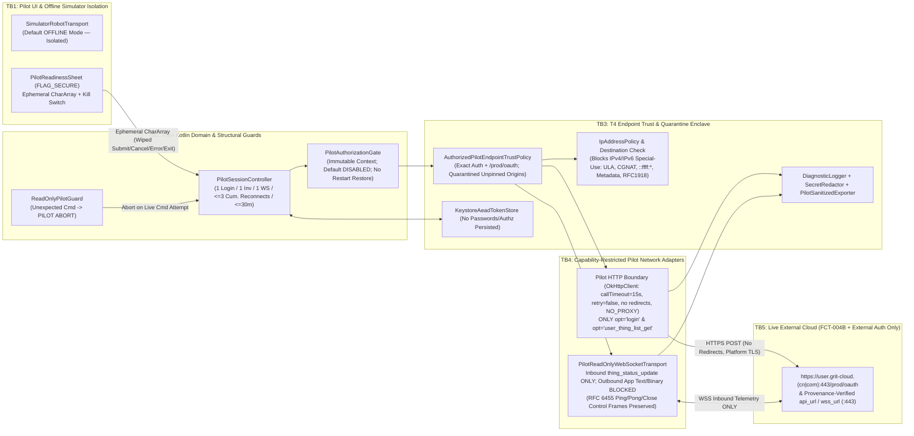

# FCT-004 Risk Assessment, Threat Model, Network Boundaries & Abort Criteria

- **Change ID:** `FCT-004`
- **Overall Milestone Risk Ceiling:** **`T4 (Critical Risk)`** per [policies/risk-tiers.md](../../../policies/risk-tiers.md)
- **Gate Target:** Gate G0 / G1 / G2 / G3 (Calibrated Specification Readiness Only)
- **References:** [proposal.md](proposal.md) | [requirements.md](requirements.md) | [design.md](design.md) | [validation.md](validation.md) | [specs/constitution.md](../../constitution.md) | [specs/deployment.md](../../deployment.md)

---

## 1. Workstream Risk Classification (`POL-RISK-01`)

| Workstream | Scope | Risk Tier | Rationale |
| :--- | :--- | :--- | :--- |
| **WS-A: Pilot Authorization Gate, Build Separation Proposal, Endpoint Trust & Credential Entry** | Immutable `PilotAuthorizationContext`, `PilotAuthorizationGate`, `AuthorizedPilotEndpointTrustPolicy` (quarantined dynamic origins + IPv4/IPv6 CIDR isolation), platform TLS hygiene, ephemeral `CharArray` UI (`FLAG_SECURE`), `SEC-405` build/policy transition proposal. | **`T4 (Critical)`** | Enabling opt-in pilot trust, handling test credentials, and validating dynamic cloud origins touch `POL-RISK-01` critical trust boundaries. |
| **WS-B: Structural Read-Only Transport Boundary, Bounded Execution & Telemetry** | Capability-restricted pilot HTTP/WS transport (rejecting arbitrary `opt` payloads and ALL outbound WS app text/binary frames), cumulative session budgets (`1` login, `0` retries, `1` inventory, `1` initial WS, `<= 3` cumulative reconnects, `15s` call timeout, `<= 30m` window), `DeviceCapabilityClassifier` (`LaserSlam` only). | **`T4 (Critical)`** | Proving live physical robot commands (`send_to_device`) are structurally unreachable and bounding network execution are safety-critical invariants. |
| **WS-C: Non-Blocking Emergency Disconnect, Rollback & Sanitized Evidence Export** | 9-step Emergency Disconnect & Wipe (immediate non-blocking network revocation before disk cleanup), incomplete storage cleanup reporting, `PilotSanitizedExporter` (`SecretRedactor`), rollback to frozen `FCT-003` APK (`3c933db2...`). | **`T4 (Critical)`** | Stuck connections, late callbacks, partial wipes, or unredacted diagnostics risk credential exposure or unauthorized background activity. |

---

## 2. Trust Boundaries & Structural Read-Only Network Architecture (`SEC-402`, `SEC-403`)

### Explicit Network & Security Boundaries (`SEC-402`, `SEC-403`)
1. **Default Offline Boot & Zero Restart Restore:** App boots into `SimulatorRobotTransport` (`OFFLINE` badge) with zero network traffic. `PilotAuthorizationGate` defaults to `Disabled` and never restores authorization after process restart.
2. **Protocol, Port & Auth Path Lock:** Only `https://` (`port 443`) and `wss://` (`port 443`) are permitted in pilot mode. Auth is strictly restricted to `https://user.grit-cloud.cn:443/prod/oauth` or `https://user.grit-cloud.com:443/prod/oauth` (exact scheme, host, port `443`, and path `/prod/oauth`). Userinfo and credential query/fragment parameters are rejected.
3. **Quarantined Dynamic Origins:** Unpinned or newly observed `api_url` / `wss_url` origins keep the session strictly quarantined (`PilotModeState.AwaitingOriginConfirmation`), NEVER publishing `SessionState.Authenticated`, persisting to `TokenStore`, or forwarding `"token"`/`"region"` headers until verified endpoint provenance and explicit external authorization exist. Human UI confirmation alone is NOT accepted as proof of WeBack host ownership.
4. **Explicit IPv4 & IPv6 Special-Use Address Isolation (`SEC-403`):** `AuthorizedPilotEndpointTrustPolicy` inspects raw IPv4 and IPv6 byte representations across all resolved addresses AND actual socket destinations, blocking:
   - **IPv4:** `0.0.0.0/8` (this network), `10.0.0.0/8` (RFC1918), `100.64.0.0/10` (CGNAT), `127.0.0.0/8` (loopback), `169.254.0.0/16` (link-local & cloud metadata `169.254.169.254`), `172.16.0.0/12` (RFC1918), `192.0.0.0/24` (IETF protocol assignments), `192.0.2.0/24` (TEST-NET-1), `192.88.99.0/24` (6to4 relay anycast), `192.168.0.0/16` (RFC1918), `198.18.0.0/15` (benchmarking), `198.51.100.0/24` (TEST-NET-2), `203.0.113.0/24` (TEST-NET-3), `224.0.0.0/4` (multicast), `240.0.0.0/4` (reserved & `255.255.255.255` limited broadcast).
   - **IPv6:** `::/128` (unspecified), `::1/128` (loopback), `::ffff:0:0/96` (IPv4-mapped IPv6 — unwrapped to IPv4 and checked against all IPv4 special-use rules), `64:ff9b::/96` & `64:ff9b:1::/48` (NAT64), `100::/64` (discard), `2001::/32` (Teredo), `2001:2::/48` (benchmarking), `2001:db8::/32` (documentation), `2002::/16` (6to4), `fc00::/7` (ULA, including AWS IPv6 metadata `fd00:ec2::254`), `fe80::/10` (link-local), `fec0::/10` (deprecated site-local), `ff00::/8` (multicast).
   - *Honest Boundary:* Generic `java.net.InetAddress` predicates alone do NOT prove public reachability; explicit IANA CIDR filtering blocks known non-global addresses while actual internet routability depends on network topology.
5. **Redirect, Retry & Proxy Lock:** `followRedirects(false)`, `followSslRedirects(false)`, `retryOnConnectionFailure(false)`, `callTimeout(15s)`, `Proxy.NO_PROXY`.
6. **Structural Outbound Command Block:** Pilot transport boundary never exposes an unrestricted `sendOutbound` path to pilot UI or controller; any direct call to send application-level WS text/binary frames returns `false` and triggers immediate pilot abort (`UnexpectedOutboundCommandAttempt`), while preserving RFC 6455 Ping/Pong/Close control frames.

---

## 3. STRIDE Threat Model (`THREAT-401` .. `THREAT-409`)

| Threat ID | Category & Target | Failure / Attack Scenario | Mitigation & Requirement | Verification Oracle |
| :--- | :--- | :--- | :--- | :--- |
| **`THREAT-401`** | **Elevation of Privilege** *(Unintended Live Network / Background Sync / Restart Resurrection)* | App contacts `grit-cloud` at boot, restores pilot mode after process restart, or relies on a UI checkbox alone. | `PilotAuthorizationGate` defaults to `DISABLED`, never persists authorization across restart, rejects UI-only consent, and requires valid immutable `PilotAuthorizationContext` (`REQ-PILOT-401`). | `TEST-PILOT-401`, `TEST-PILOT-402` |
| **`THREAT-402`** | **Spoofing / SSRF** *(Dynamic `api_url`/`wss_url` Redirection or Special-Use IP Routing)* | Auth returns attacker host, non-443 port, `http://`/`ws://`, `169.254.169.254`, `100.64.0.1` CGNAT, `fd00::1` ULA, or `::ffff:127.0.0.1` IPv4-mapped IPv6. | `AuthorizedPilotEndpointTrustPolicy` + `UriValidator` + explicit IPv4/IPv6 CIDR & destination validation enforce `:443`, `Proxy.NO_PROXY`, `followRedirects(false)`, and quarantined origin confirmation (`REQ-PILOT-402`). | `TEST-PILOT-403`, `TEST-PILOT-415` |
| **`THREAT-403`** | **Tampering / MITM** *(Weak TLS or Unverified CA Chain)* | `SSLHandshakeException` tempts disabling `HostnameVerifier` or bundling untrusted CAs (`UNK-AUTH-08`). | Standard Android platform TLS 1.2/1.3 `TrustManager` + `HostnameVerifier` strictly enforced; handshake failure aborts pilot (`REQ-PILOT-402`). | `TEST-PILOT-404` |
| **`THREAT-404`** | **Information Disclosure** *(Credential Caching, Saved-State Retention, Screenshots, Raw Logs)* | UI stores password in `ViewModel`/`SavedStateHandle`, fails to wipe buffer on cancel/error/exit, allows screenshots, or logs raw payloads. | Mutable `CharArray` wiped on submit/cancel/error/screen exit, `FLAG_SECURE` during entry, zero password persistence, allowlisted diagnostics + `SecretRedactor` (`REQ-PILOT-404`, `REQ-PILOT-408`). | `TEST-PILOT-406`, `TEST-PILOT-413` |
| **`THREAT-405`** | **Elevation / Policy Drift** *(Silent MD5 Fallback, Passwordless Replay, or CAPTCHA Bypass)* | Live server rejects UTF-8 password (`UNK-AUTH-05`) or returns CAPTCHA (`UNK-AUTH-04`), and client tries MD5, password caching, or solver. | Strict fail-closed abort to `ChallengeRequired` or `ProtocolMismatchAbort`; zero CAPTCHA automation, zero passwordless refresh, zero MD5 fallback (`REQ-PILOT-403`). | `TEST-PILOT-405` |
| **`THREAT-406`** | **Safety / Integrity** *(Accidental Physical Robot Movement or Alternate Dispatch Path)* | Direct adapter call, malformed HTTP `opt`, or `sendOutbound` sends `send_to_device` over live transport. | Capability-restricted pilot HTTP/WS transport blocks all non-allowlisted HTTP `opt` payloads and ALL outbound WS app text/binary frames; unexpected command attempts trigger pilot abort (`REQ-PILOT-408`). | `TEST-PILOT-411`, `TEST-PILOT-416` |
| **`THREAT-407`** | **Denial of Service** *(Unbounded Retries, Reconnect Budget Reset, or Hung Calls)* | OkHttp auto-retries silently, successful reconnect resets counter leading to infinite reconnect storm, or observation window never expires. | `retryOnConnectionFailure(false)`, `callTimeout(15s)`, `1` login (`0` retries), `1` inventory, `1` initial WS, `<= 3` cumulative reconnects (never reset on `onOpen`), `<= 30m` monotonic deadline (`REQ-PILOT-406`, `REQ-PILOT-407`). | `TEST-PILOT-410`, `TEST-PILOT-417` |
| **`THREAT-408`** | **Repudiation / Stuck Session** *(Blocking Disk I/O, Late Callbacks, Partial Wipe)* | Emergency Disconnect waits on slow disk cleanup before closing WS, late HTTP/WS callback reactivates pilot, or partial wipe goes unreported. | 9-step non-blocking Emergency Disconnect revokes network/auth before disk I/O, cancels active calls/jobs/WS, blocks late callbacks, restores simulator, reports incomplete cleanup honestly (`REQ-PILOT-408`). | `TEST-PILOT-412`, `TEST-PILOT-418` |
| **`THREAT-409`** | **Governance / Build Boundary Bypass** *(Accidental `INTERNET` Leak Into Offline APK)* | Enabling `INTERNET` in `src/main` weakens offline APK verification or bypasses `apk_validator.py`. | `FCT-004` / `FCT-004A` keep `AndroidManifest.xml` `INTERNET`-free; `FCT-004B` separates offline vs pilot builds and unifies `--connectivity-policy {offline,pilot}` (`REQ-PILOT-405`). | `TEST-PILOT-407` |

---

## 4. Mandatory Abort & Rollback Criteria

Any live pilot run MUST abort immediately (`Emergency Disconnect & Wipe`) if ANY of the following occurs:
1. **Authorization Invalid / Expired / Mismatched:** Expired monotonic deadline, candidate/APK/account/device mismatch, or missing external authorization fields.
2. **Untrusted / Unconfirmed Origin or Special-Use IP:** Endpoint fails `UriValidator`, lacks verified provenance/authorization, or resolves/connects to a non-globally-reachable IPv4/IPv6 address.
3. **TLS / Certificate Failure or Redirect:** Any `SSLHandshakeException`, `CertificateException`, or `3xx` redirect.
4. **Challenge / Auth Rejection / Password Format Mismatch:** CAPTCHA challenge (`UNK-AUTH-04`), `401`/`403` invalidation, or password format rejection (`UNK-AUTH-05`).
5. **Unexpected Outbound Command or Payload Attempt:** Any attempt to dispatch `send_to_device`, arbitrary HTTP `opt`, or outbound WS application text/binary message in read-only pilot mode.
6. **Budget Exhaustion or Observation Window Expiry:** Login (`1`), inventory (`1`), cumulative WS reconnect (`3`), HTTP `15s` call timeout, or `<= 30m` monotonic window exceeded.
7. **Secret Leakage Detection:** Any unredacted credential/token detected in diagnostic output.

**Honest Limitation & Rollback Procedure:** Local Emergency Disconnect revokes in-process authorization, tears down local sockets, and attempts durable local token deletion, but does **NOT** claim to revoke server-side bearer tokens because no verified Grit Cloud revocation endpoint exists. For rollback, uninstall the pilot build if applicable and re-install the frozen `FCT-003` offline APK (`weback-fct003-debug.apk`, SHA-256 `3c933db2160c4407f44b3393dffdd3cf372074e5b06f8b29089ee0408e9fa90e`).
