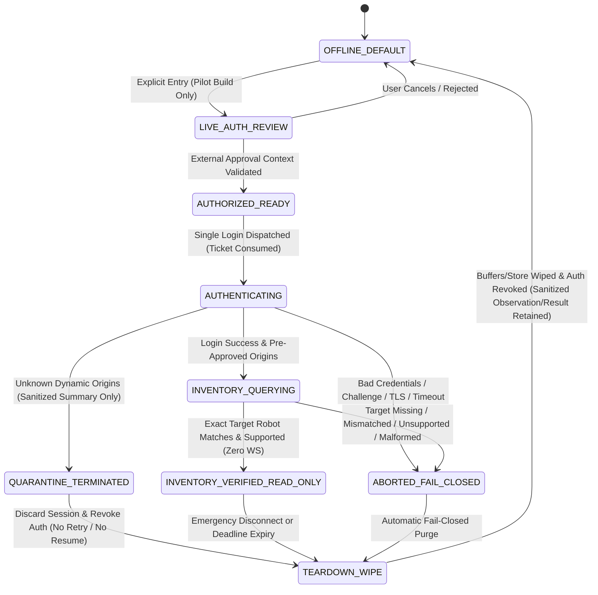

# FCT-004C Technical Design — Controlled Authentication & Single-Inventory Pilot

- **Change ID:** `FCT-004C`
- **Milestone:** `FCT-004C`
- **Document ID:** `SPEC-DSGN-FCT004C`
- **Risk Tier:** `T4 (Critical Risk — Live Network Admission & Credential Entry)`
- **Provenance & Governance:** [proposal.md](proposal.md) | [requirements.md](requirements.md) | [specs/constitution.md](../../constitution.md)

---

## 1. Architecture & Calibrated State Machine (`SEC-462`, `SEC-463`)



---

## 2. Component Design & Responsibilities

### 2.1 `PilotAuthorizationGate` (`domain/pilot/`)
- Preserves existing FCT-004A/B admission ledger and single-use `PilotAdmissionTicket` binding.
- Extends `validateContext` minimally so `maxInitialWsConnections` accepts `0..1` (allowing strict zero-WS FCT-004C contexts with `maxInitialWsConnections = 0`, `maxWsReconnectAttempts = 0`, `permittedOperations = {LOGIN, USER_THING_LIST_GET}`, `observationWindowMs <= 900_000L`) without weakening existing FCT-004A/B checks (`> 1` rejected; `maxWsReconnectAttempts = 0..3`; `observationWindowMs <= 1_800_000L`).
- Enforces `RuntimeAppIdentity` (`pilotBuildEnabled == true` for `LIVE_PILOT`), countersigned `PilotExternalApproval`, `isUiCheckboxOnly == false`, `environment == LIVE_PILOT`, and monotonic `AuthMonotonicClock` deadline checks.

### 2.2 `EphemeralPasswordBuffer`, `FLAG_SECURE` & Live Pilot UI (`ui/pilot/`, `MainActivity.kt`)
- `MainActivity` continues wiring `offlineMockPilotController` for the preserved mock pilot workflow in both `debug` and `pilot` builds.
- In `pilot` builds (`BuildConfig.PILOT_INTERNET_CAPABLE == true`), `MainActivity` additionally exposes an explicit entry to the live pilot workflow wired to `pilotSessionController` (disabled and unactivatable in `debug`).
- Credential entry attaches `WindowManager.LayoutParams.FLAG_SECURE`, avoids `rememberSaveable` or persistent secret storage, clears `EphemeralPasswordBuffer` (`\u0000` fill) and UI input fields on submit/cancel/failure/exit/teardown, and avoids claiming complete JVM heap zeroization.

### 2.3 `PilotCapabilityRestrictedAuthGateway` (`protocol/pilot/`)
- Serializes `LoginRequestEnvelope` using `AuthEnvelopeConfig` (`api_version = "6.1.7"`, `app_name = "WeBack"`, `client_id = "yugong_app"`, `language = "en"`).
- Validates payload strictly via `PilotHttpOperationGuard.validateLoginEnvelopeAndExtractIdentity` (rejects extra keys, duplicate keys, wrong types, non-login ops).
- Uses `Utf8TlsDefault` exclusively (zero MD5 strategy/fallback); enforces `<= 15s` timeout, zero redirects, zero automatic retries.
- On challenge indicators (`"captcha": true` or CAPTCHA message), aborts immediately (`ChallengeRequired`).
- Evaluates response `IdentityProbe` (`api_url`, `wss_url`, `region_name`, `jwt_token`, `expired_time`):
  - If required origins are independently verified and pre-approved (`pinnedApiOrigin`/`pinnedWssOrigin` or approved trust policy), returns `PilotAuthProbeOutcome.Authenticated`.
  - Otherwise returns `PilotAuthProbeOutcome.QuarantinedDynamicOrigins(ObservedOriginSummary)` without publishing any `SessionCredentials` or writing to `TokenStore`.

### 2.4 `PilotSessionController` Conservative Quarantine & Single Inventory Validation (`app/pilot/`)
- **Conservative Quarantine (`SEC-462`):** When `WS_TELEMETRY_OBSERVE !in activeCtx.permittedOperations` (FCT-004C live mode) and `QuarantinedDynamicOrigins` is observed, `submitCredentials` retains ONLY the sanitized `ObservedOriginSummary` for display/export, discards any untrusted session, revokes authorization (`emergencyDisconnectAndWipe(PilotAbortReason.UntrustedOriginRejected, expectedGeneration = capturedGeneration)`), never repeats login, never resets budgets, never treats UI confirmation as provenance proof, and requires a separate newly approved authorization for any later run. Existing FCT-004A/B tests using `WS_TELEMETRY_OBSERVE` retain their `AwaitingOriginConfirmation` expectation without weakening assertions.
- **Separated Exact Target Inventory Validation (`SEC-463`):** Provides `fetchAndValidateTargetInventory()` (or equivalent FCT-004C method) that invokes `refreshReadOnlyInventory()` (at most 1 `USER_THING_LIST_GET` HTTP POST), validates that `expectedTargetThingName` is present and `LaserSlam`-compatible (`ControlCompatibility.MvpSupportedShadowWs.isMvpControlSupported`), exposes ONLY the target robot's minimum necessary read-only summary (`TargetInventorySummary`), NEVER calls `selectAndObserveDevice` or opens any WebSocket, and immediately runs fail-closed cleanup + safe termination on missing, mismatched, unsupported, or malformed inventory responses.

---

## 3. Wire Schema & Envelopes

### Login Request Envelope (`POST /prod/oauth`)
```json
{
  "header": {
    "api_version": "6.1.7",
    "app_name": "WeBack",
    "calling_code": "+1",
    "account": "user@test.invalid",
    "client_id": "yugong_app",
    "language": "en"
  },
  "payload": {
    "opt": "login",
    "pwd": "<UTF-8_PASSWORD_OVER_TLS>"
  }
}
```

### Device Inventory Request Envelope (`POST <pre-approved api_url>`)
Headers: `token: <jwt_token>`, `region: <region_name>`
```json
{
  "opt": "user_thing_list_get"
}
```

---

## 4. Generation-Fenced Teardown & Invalidation Sequence

1. Increment `pilotEpoch` / revoke `PilotAuthorizationGate` synchronously and cancel deadline/countdown jobs.
2. Cancel active OkHttp calls via `PilotActiveCallRegistry.revokeAndCancelAll(revokedGeneration)` immediately.
3. Clear `EphemeralPasswordBuffer` (`\u0000` fill) and any temporary mutable `CharArray` buffers.
4. Clear confirmed dynamic origins on `AuthorizedPilotEndpointTrustPolicy`.
5. Disconnect any transport boundary (`forceDisconnect`) and clear inventory/device selection caches.
6. Clear persisted tokens via `sessionCoordinator.signOutIfEpoch(sessionEpoch)` (`NonCancellable`), reporting `IncompleteStorageClear` explicitly if storage clear fails (and never claiming remote server-side bearer token revocation).
7. Preserve sanitized abort reason / sanitized `ObservedOriginSummary` / sanitized disconnect result for UI & export, and reset active mode state to `OFFLINE_DEFAULT`.
