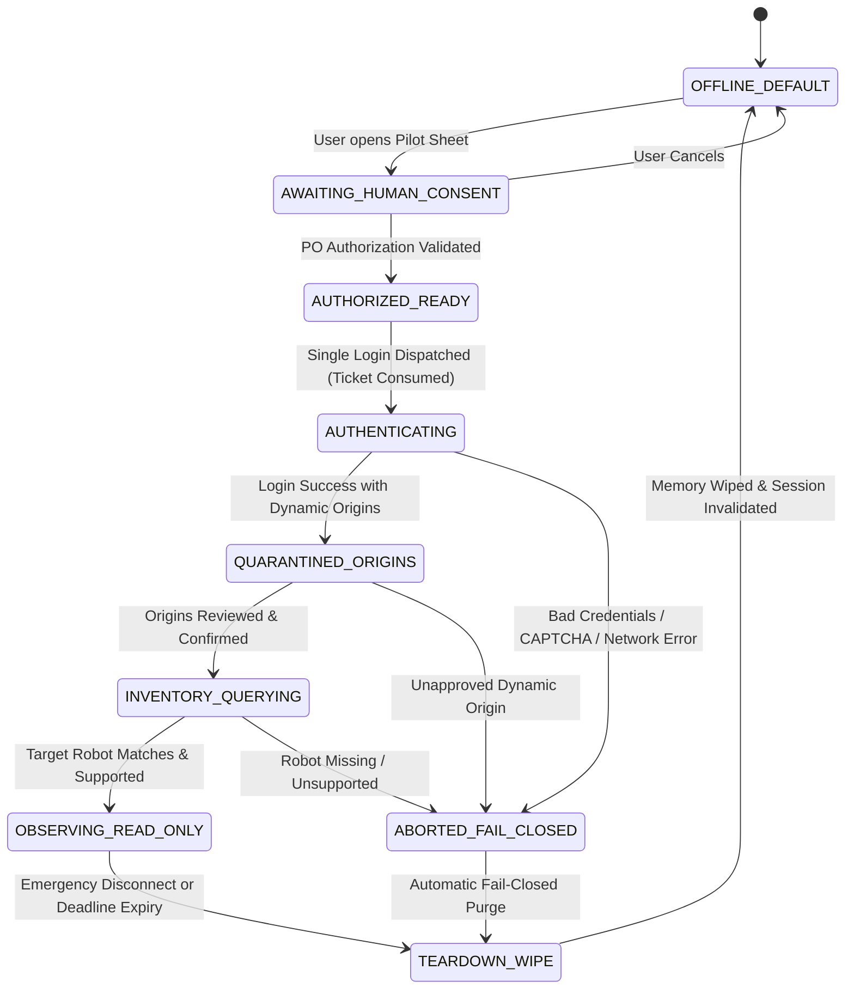

# FCT-004C Technical Design — Controlled Authentication & Single-Inventory Pilot

- **Change ID:** `FCT-004C`
- **Milestone:** `FCT-004C`
- **Document ID:** `SPEC-DSGN-FCT004C`
- **Risk Tier:** `T4 (Critical Risk — Live Network Admission & Credential Entry)`
- **Provenance & Governance:** [proposal.md](proposal.md) | [requirements.md](requirements.md) | [specs/constitution.md](../../constitution.md)

---

## 1. Architecture & State Machine



---

## 2. Component Design & Responsibilities

### 2.1 PilotAuthorizationGate (`domain/pilot/`)
- Tracks authoritative `PilotAdmissionTicket` lifecycle.
- Bounds execution to `loginAttemptsUsed <= 1` and `inventoryRequestsUsed <= 1`.
- Enforces strict monotonic time deadlines via `AuthMonotonicClock`.
- Rejects replayed or altered tickets fail-closed.

### 2.2 EphemeralPasswordBuffer & FLAG_SECURE UI (`ui/pilot/`)
- Credential entry Composable attaches to Android window enforcing `FLAG_SECURE`.
- Password held in `CharArray` inside `EphemeralPasswordBuffer`.
- Buffer is cleared (`Arrays.fill(buffer, '\u0000')`) immediately after request body encoding or cancellation.

### 2.3 PilotCapabilityRestrictedAuthGateway (`protocol/pilot/`)
- Serializes `LoginRequestEnvelope`:
  - `header`: `api_version`, `app_name`, `calling_code`, `account`, `client_id`, `language`.
  - `payload`: `opt = "login"`, `pwd = encode(password)`.
- Validates payload with `PilotHttpOperationGuard` (rejects extra keys).
- Handles response: parses token, captures unpinned API/WSS origins into `QuarantinedDynamicOrigins`.
- If `captcha == true`, immediately returns `CAPTCHA_CHALLENGE_NOT_SUPPORTED`.

### 2.4 PilotCapabilityRestrictedInventoryGateway (`protocol/pilot/`)
- Dispatches exactly ONE read-only inventory query: `{"opt": "user_thing_list_get"}`.
- Rejects mutation verbs (`send_to_device`, rename, delete).
- Matches target robot `thing_name` against authorized device scope.

---

## 3. Wire Schema & Envelopes

### Login Request Envelope
```json
{
  "header": {
    "api_version": "1.0",
    "app_name": "WeBack",
    "calling_code": "+1",
    "account": "user@test.invalid",
    "client_id": "CLIENT_ID_PLACEHOLDER",
    "language": "en"
  },
  "payload": {
    "opt": "login",
    "pwd": "ENCODED_PASSWORD"
  }
}
```

### Device Inventory Request Envelope
```json
{
  "opt": "user_thing_list_get"
}
```

---

## 4. Teardown & Invalidation Sequence

1. Cancel active OkHttp call / close sockets.
2. Clear `EphemeralPasswordBuffer` (`\u0000` fill).
3. Revoke `PilotAdmissionTicket` in `PilotAuthorizationGate`.
4. Delete credentials from `AndroidKeystoreAeadTokenStore`.
5. Reset mode state to `OFFLINE_DEFAULT`.
