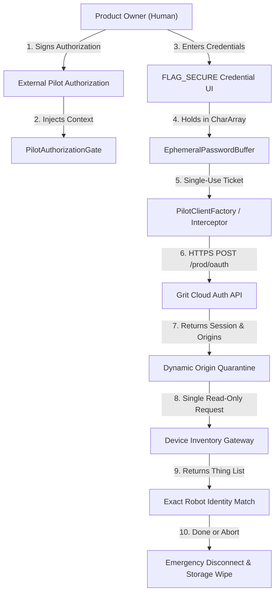

# FCT-004C Proposal — Controlled Live Authentication & Single-Inventory Pilot

- **Change ID:** `FCT-004C`
- **Milestone:** `FCT-004C`
- **Title:** `Controlled Live Authentication & Single-Inventory Read-Only Pilot`
- **Risk Tier:** `T4 (Critical Risk — Live Network Admission & Credential Entry)`
- **Governing Architecture & Law:** [specs/constitution.md](../../constitution.md) | [specs/roadmap.md](../../roadmap.md) | [docs/reference/RE_BASELINE.md](../../../docs/reference/RE_BASELINE.md)
- **Status:** `PROPOSED (Specification-Only Gate G1-G3)`

---

## 1. Context & Problem Statement

Milestones FCT-004A and FCT-004B established an isolated, default-disabled `pilot` build type (`com.weback.robot.pilot`), hardware Keystore security verification, single-use admission ticket gates, and an authoritative 11-check permanent verification policy (`fd870ee6b2b324aa1d2bfbe84d9282df13708821cb7d291d2560d0a80a77bbc4`).

However, live cloud authentication against Grit Cloud (`TEST-PILOT-414`) remains strictly `NOT_RUN`. Several critical protocol uncertainties remain unresolved from reverse engineering:
1. Exact client request envelope fields (`api_version`, `app_name`, `client_id`, `language`).
2. Legacy MD5 password hashing vs clean-room TLS UTF-8 transport.
3. Server-side CAPTCHA challenge behavior.
4. Dynamic origin assignment for region-specific REST and WebSocket gateways.

FCT-004C defines the smallest evidence-grounded, read-only authentication and single-inventory live pilot specification. It transitions the application from synthetic mock fixtures to a strictly controlled, human-supervised live authentication probe while maintaining absolute fail-closed safety.

---

## 2. Goals & Non-Goals

### Goals
- **G-461:** Define exact external pilot authorization with explicit human consent prior to any network interaction.
- **G-462:** Enforce human-operated credential entry into zeroizable, in-memory buffers protected by `FLAG_SECURE`.
- **G-463:** Specify the evidence-grounded login wire envelope with parameter validation and strict extra-field rejection.
- **G-464:** Bound execution to exactly ONE login attempt with zero automatic retries, zero MD5 fallback, and zero CAPTCHA automation.
- **G-465:** Quarantine newly observed REST and WebSocket origins returned by the server.
- **G-466:** Permit exactly ONE read-only inventory request (`user_thing_list_get`) to verify target robot presence without issuing commands.
- **G-467:** Guarantee complete emergency disconnect, token purge, and monotonic deadline expiry cleanup.

### Non-Goals
- Real-time robot control (`send_to_device` is strictly prohibited).
- Live cloud map stream ingestion (deferred to FCT-005).
- Automated CAPTCHA solving or proof-of-work bypass.
- Refresh token persistence or automatic background re-authentication.
- Modifying the offline production APK (`com.weback.robot`).
- Public or automated deployment to Google Play.

---

## 3. Architecture & Boundary Overview

---

## 4. Document Index

- [requirements.md](requirements.md) — Traceable functional and security requirements.
- [design.md](design.md) — Technical design, state machines, and transport guards.
- [validation.md](validation.md) — Test oracle strategy and acceptance matrix.
- [tasks.md](tasks.md) — Granular implementation and verification tasks.
- [traceability.json](traceability.json) — Requirement-to-task-to-test mapping.
- [risk-assessment.md](risk-assessment.md) — Threat modeling and mitigation ledger.
- [external-pilot-authorization.md](external-pilot-authorization.md) — Human authorization form template.
- [protocol-evidence-matrix.md](protocol-evidence-matrix.md) — Reverse-engineering evidence and uncertainty log.
