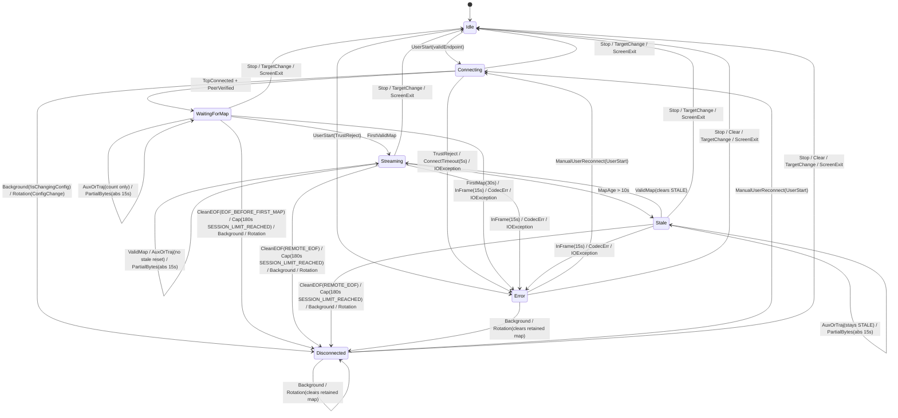

# LOC-001 Technical Design — Rapido R8S Local-First HOSLAM Read-Only Map

- **Change ID:** `LOC-001`
- **Revision:** `1.3.0 (Stage L04A-S Inventory Reconciliation)`
- **Risk Tier:** `T4 (Critical Risk)`
- **Canonical Base SHA:** `184175a14e5eb6659396c95624e2d3b08d1078a1` *(Reconciled against `948c0b23a70a73a83bf2d8cb02e88e071618e2d4` in Stage `L04A-S`)*
- **References:** [proposal.md](proposal.md) | [requirements.md](requirements.md) | [risk-assessment.md](risk-assessment.md) | [validation.md](validation.md) | [t4-transition-proposal.md](t4-transition-proposal.md)

---

## 1. Architecture Integration, Variant Composition Roots & Package Boundaries

`LOC-001` preserves the single `:app` module, pinned toolchain (`AGP 8.7.2`, `Gradle 8.10.2`, `Kotlin 2.1.21`, `minSdk 31`, `targetSdk 35`), manual `AppContainer` DI, and `DomainPurityTest` on `origin/main` (`184175a14e5eb6659396c95624e2d3b08d1078a1`).

```text
Offline (:app debug / release)          Cloud Pilot (:app pilot)               Local (:app local, from L04A T4)
  debug: src/main + src/cloudPilot        src/main + src/cloudPilot +          src/main + src/local
  release: src/main + src/release         src/pilot                            Explicit RFC1918:9999 target
  Simulator + synthetic HOSLAM            Authorized HTTPS/WSS :443            (ZERO cloudPilot classes in DEX)
  (NO live local TCP in DEX)              (NO live local TCP in DEX)           LocalLanTrustPolicy + ReceiveOnlyTcpSource
        |                                         |                                    |
        +----------- shared pure HOSLAM codec & synthetic replay ----------------------+
                                                  |
                                         LocalMapRepository
                                                  |
                                    MapViewModel / MapCanvas UI
```

### 1.1 Variant Composition-Root Partition & Test Migration Inventory (Enacted in `L04A`, Solving `FIND-L01R-03`, `FIND-L01R2-01`, `FIND-L01R2-02`)

On `184175a`, `WeBackApplication.kt` instantiates `DefaultAppContainer`, `MainActivity.kt` (`app/src/main/`) reads `app.container.pilotSessionController`, `pilotAuthorizationGate`, `offlineMockPilotController`, and `DefaultAppContainer.kt` (`app/src/main/`) directly constructs cloud OkHttp/WebSocket/Keystore classes. To guarantee `com.weback.robot.local` **never compiles or instantiates** cloud pilot classes from `L04A` Day 1 while preserving all existing tested behavior, assertions, and security invariants:

1. **Production Partition (`src/main/` vs `src/cloudPilot/` vs `src/{debug,pilot,release,local}/`):**
   - **Retained in `app/src/main/java/` (shared across ALL variants `debug`, `pilot`, `release`, `local`):**
     - `WeBackApplication.kt` (delegates creation to build-type-specific `VariantAppContainerFactory.create(applicationContext)`; retains `internal fun replaceContainerForTesting(testContainer: AppContainer)`)
     - `core/AppContainer.kt` (minimal `AppContainer : AutoCloseable` exposing `robotTransport`, `dispatcherProvider`, `clock`, `diagnosticLogger`, `localMapRepository`, `pilotCapabilityBridge: PilotCapabilityBridge?`, plus pure-enum `AppContainerDependency` with zero cloud imports), `core/PilotCapabilityBridge.kt` (zero cloud/pilot concrete imports), `core/OfflineAppContainer.kt` (`pilotCapabilityBridge = null`, supporting `robotTransportProvider`, `localStreamSourceProvider`, and `dependencyResolutionObserver` R1 seams without cloud types), `core/BootSessionTimeProvider.kt`, `core/DispatcherProvider.kt`, `core/MonotonicClock.kt`
     - `MainActivity.kt` (renders `DashboardScreen` + `MapScreen` unconditionally and delegates optional Pilot UI/resume lifecycle strictly through `app.container.pilotCapabilityBridge` when non-null; `PilotUiWorkflow` enum moves out of `MainActivity.kt` into `src/cloudPilot/`)
     - **Entire `domain/**` package tree:** `domain/auth/*`, `domain/control/*`, `domain/device/*`, `domain/model/*`, `domain/pilot/*` (`PilotAuthorizationGate`, `PilotModels`, `ReadOnlyPilotGuard`), plus `L02A`–`L02B` `domain/map/*` *(remains pure JVM in `src/main/java/com/weback/robot/domain/` so `DomainPurityTest.kt` and `Fct004BPreInternetSecurityTest.kt:411` inspect canonical paths intact)*
     - `protocol/{RobotTransport.kt, SimulatorConfig.kt, SimulatorRobotTransport.kt}`
     - Shared `LOC-001` code: `protocol/local/codec/*` (`L02A`–`L02B`), `protocol/local/{LocalTelemetryStreamSource.kt, SyntheticReplayTelemetrySource.kt}` (`L03A`), `app/local/*` (`L03A`), `ui/map/*` (`L03A`)
     - `security/{DiagnosticLogger.kt, SecretRedactor.kt}` *(shared `SecretRedactor.kt` stays UNMODIFIED per `FIX-05`)*
     - `ui/{DashboardViewModel.kt, screens/DashboardScreen.kt, theme/{Color,Theme,Type}.kt}`
   - **Relocated into `app/src/cloudPilot/java/` (wired ONLY to `debug` and `pilot` build types; EXCLUDED from `local` and `release` compilation & DEX):**
     - `core/PilotAppContainer.kt` (`interface PilotAppContainer : AppContainer`, `PilotContainerTestHooks`, `DefaultPilotContainer` implementing `PilotAppContainer` with all 5 provider seams + `dependencyResolutionObserver`, `InMemoryMockTokenStore`, `NonPersistentSessionStore`, and `PilotCapabilityBridgeImpl` owning `PilotUiWorkflow`)
     - `app/pilot/PilotSessionController.kt`
     - `app/session/{SessionCoordinator.kt, DeviceInventoryRepository.kt}`
     - `protocol/auth/{AuthGateway.kt, OfflineFixtureAuthGateway.kt, OkHttpAuthGateway.kt, RegionEndpointRouter.kt}`
     - `protocol/inventory/{DeviceInventoryGateway.kt, OfflineFixtureInventoryGateway.kt, OkHttpDeviceInventoryGateway.kt}`
     - `protocol/pilot/PilotReadOnlyTransportBoundary.kt` (`PilotAdmissionContextElement`, `PilotReadOnlyTelemetryTransport`, `LoginEnvelopeIdentity`, `PilotHttpOperationGuard`, `StrictJsonKeyUniquenessValidator`, `PilotAuthProbeOutcome`, `PilotCapabilityRestrictedAuthGateway`, `PilotCapabilityRestrictedInventoryGateway`, `PilotReadOnlyWebSocketTransport`, `PilotReadOnlyFixtureTransport`)
     - `protocol/ws/{ConnectionConfig.kt, OfflineFixtureRealtimeTransport.kt, OkHttpWebSocketTransport.kt, RealtimeSessionTransport.kt}`
     - `security/{AuthorizedPilotEndpointTrustPolicy.kt, EndpointTrustPolicy.kt, ExternalPilotAuthorization.kt, KeystoreAeadTokenStore.kt, PasswordDigestStrategy.kt, PilotSanitizedExporter.kt, TokenStore.kt, UriValidator.kt}`
     - `ui/pilot/PilotReadinessSheet.kt` (`EphemeralPasswordBuffer`, `PilotSheetUiState`, top-level `PilotReadinessSheet` composables)
   - **Build-Type Composition Roots (`VariantAppContainerFactory` in package `com.weback.robot.core`):**
     - `src/debug/java/.../VariantAppContainerFactory.kt`: returns `DefaultPilotContainer(context = context)` (`PILOT_INTERNET_CAPABLE = false`)
     - `src/pilot/java/.../VariantAppContainerFactory.kt`: returns `DefaultPilotContainer(context = context)` (`PILOT_INTERNET_CAPABLE = true`)
     - `src/release/java/.../VariantAppContainerFactory.kt`: returns `OfflineAppContainer(...)` (`pilotCapabilityBridge = null`)
     - `src/local/java/.../VariantAppContainerFactory.kt`: returns `OfflineAppContainer` / `LocalAppContainer` (`pilotCapabilityBridge = null`; `ReceiveOnlyTcpSource` + `LocalLanTrustPolicy` wired in `L04B`)

2. **Test Source-Set Partition (Zero `setSrcDirs` Exclusion of Shared Tests/Resources, `FIX-02`, Reconciled in `L04A-S`):**
   - **`app/src/test/{java,resources}` (Common Shared Unit Tests — Compiled & Run in `testDebugUnitTest`, `testLocalUnitTest`, AND `testPilotUnitTest`):**
     Holds all `20` existing pure offline/common files (`67` tests, including `DashboardScreenControlTest`, `DomainPurityTest`, `TestDispatcherProvider`, `DashboardViewModel*Test`, `SimulatorRobotTransportTest`, `DiagnosticLoggerTest`, `SecretRedactorTest`, pure `domain/` tests), `15` cloud-independent `L02A`–`L03A` HOSLAM/replay/viewer files (`81` tests + `HoslamTestFixtures.kt` + `app/src/test/resources/hoslam/` — totaling **`148` eligible existing cloud-independent tests**), **PLUS** the new `L04A` common `OfflineLocalMapActivityNavigationTest.kt` (`2` tests verifying `MainActivity` + `OfflineAppContainer` non-fallback across all 4 replay/EOF/error/recreate scenarios).
   - **`app/src/testCloudPilot/java/` (Added additively via `testDebug.java.srcDir(...)` & `testPilot.java.srcDir(...)` in `L04A`; EXCLUDED from `testLocal`):**
     Receives the `45` legacy cloud/pilot/session/keystore/container unit test files (`90` test methods) from `184175a` **PLUS** the `2` cloud-dependent `L03A` unit test files (`3` test methods: `LocalAppContainerNonFallbackTest.kt` and `LocalMapActivityNavigationTest.kt`) reconciled in `L04A-S`, totaling `47` files (`93` test methods).
   - **`app/src/testLocal/java/` (Native Gradle `local` test source set; `testLocal` only):**
     Holds `L04A` variant isolation & non-fallback container tests (`LocalAppContainerTest`, `LocalBuildSeparationTest`, `LocalSourceSecurityScanTest`) and `L04B` live LAN/lifecycle/privacy tests (`LocalLanTrustPolicyTest`, `ReceiveOnlyTcpBoundaryTest`, `LocalPrivacyRedactionTest`, `LocalTimeoutAndEofTest`, `LocalLifecycleTeardownTest`, `LocalBackpressureBoundsTest`).

3. **Approved Legacy Test & Instrumentation Migration Inventory (`Task 5` / `L04A`, Historical `184175a` `45`-File Inventory Preserved Intact, `FIX-01`):**
   Migration is forbidden until `L04A` (`Task 5`), requires clean compilation across `testDebugUnitTest`, `testPilotUnitTest`, `testLocalUnitTest`, and `assemblePilotAndroidTest`, and requires verifying preserved JUnit XML test identities via `verification/checks/gradle_test_adapter.py`:

| File / Group (`app/src/...`) | Existing Dependency | Applicable Variants | Future Source-Set | Required `L04A` Adaptation | Unchanged Assertions & Invariants | Verification Procedure | Owner |
|---|---|---|---|---|---|---|---|
| `ConnectivityRecoveryTest.kt` (`3` tests) | `DefaultAppContainer`, `endpointTrustPolicy`, `sessionCoordinator`, `inventoryRepository`, `realtimeTransport`, `KeystoreAeadTokenStore` | `debug`, `pilot` | `src/testCloudPilot/java` | Construct `DefaultPilotContainer(...)`; use `PilotAppContainer` type | Offline trust rejection, epoch wipe on signOut/token failure, `KeystoreAeadTokenStore` file clear | `testDebugUnitTest` & `testPilotUnitTest` JUnit XML identity match | `L04A` |
| `AppContainerTest.kt` (`3` tests) | `DefaultAppContainer`, `sessionCoordinator`, `inventoryRepository`, `realtimeTransport`, `endpointTrustPolicy` | `debug`, `pilot` *(+ `local` via `LocalAppContainerTest`)* | `src/testCloudPilot/java` *(+ `src/testLocal/` equivalent)* | Construct `DefaultPilotContainer()`; type as `PilotAppContainer`; add `LocalAppContainerTest` verifying `OfflineAppContainer` singletons/simulator/`close()` | Singleton scoping, initial simulator `DOCK`/100%, `close()` cancels simulator jobs | `testDebugUnitTest`, `testPilotUnitTest`, + `testLocalUnitTest` `LocalAppContainerTest` | `L04A` |
| `PilotBuildSeparationTest.kt` (`1` test) | `DefaultAppContainer`, `pilotAuthorizationGate`, `pilotSessionController`, `activatePilot` | `debug`, `pilot` *(+ `local` via `LocalBuildSeparationTest`)* | `src/testCloudPilot/java` *(+ `src/testLocal/` equivalent)* | Construct `DefaultPilotContainer(...)`; add `LocalBuildSeparationTest` proving `com.weback.robot.local`, `LOCAL_READ_ONLY`, `pilotCapabilityBridge == null`, 0 cloud classes | `OfflineDefault` at boot; `pilot` vs `offline` live activation gating; zero cross-variant leak | `testDebugUnitTest`, `testPilotUnitTest`, `testLocalUnitTest` | `L04A` |
| `Fct004CApprovedOperationScopeTest.kt` (`2` tests) | `DefaultAppContainer`, `PilotContainerTestHooks`, `activateLivePilot`, `pilotAuthorizationGate`, `pilotSessionController` | `debug`, `pilot` | `src/testCloudPilot/java` | `DefaultAppContainer(...)` -> `DefaultPilotContainer(...)` | Approved operation-set enforcement, login/inventory scope gating, fail-closed denial | `testDebugUnitTest` & `testPilotUnitTest` JUnit XML identity match | `L04A` |
| `Fct004CDurableConsumptionFaultTest.kt` (`3` tests) | `DefaultAppContainer`, `PilotContainerTestHooks`, `loadProvisionedLiveAuthorization`, `activateLivePilot`, `pilotAuthorizationGate` | `debug`, `pilot` | `src/testCloudPilot/java` | `DefaultAppContainer(...)` -> `DefaultPilotContainer(...)` | Single-use durable approval consumption & delete-failure quarantine | `testDebugUnitTest` & `testPilotUnitTest` JUnit XML identity match | `L04A` |
| `Fct004CExternalApprovalTrustBoundaryTest.kt` (`2` tests) | `DefaultAppContainer`, `PilotContainerTestHooks`, `loadProvisionedLiveAuthorization`, `activateLivePilot`, `pilotAuthorizationGate`, `pilotSessionController` | `debug`, `pilot` | `src/testCloudPilot/java` | `DefaultAppContainer(...)` -> `DefaultPilotContainer(...)` | SHA-256 companion check, restart `OfflineDefault` reset, anti-replay | `testDebugUnitTest` & `testPilotUnitTest` JUnit XML identity match | `L04A` |
| `Fct004CPilotAdmissionTest.kt` (`3` tests) | `DefaultAppContainer`, `pilotSessionController` | `debug`, `pilot` | `src/testCloudPilot/java` | `DefaultAppContainer(...)` -> `DefaultPilotContainer(...)` | Single-use admission tickets, clock window & origin binding | `testDebugUnitTest` & `testPilotUnitTest` JUnit XML identity match | `L04A` |
| `Fct004CLiveLifecycleRegressionTest.kt` (`5` tests) | `replaceContainerForTesting(DefaultAppContainer(...))`, `PilotContainerTestHooks`, `(app.container).*` | `debug`, `pilot` | `src/testCloudPilot/java` | Inject `DefaultPilotContainer(...)`; cast `(app.container as PilotAppContainer)` | Emergency disconnect, slow-clear gating, incomplete storage lock, reactivation | `testDebugUnitTest` & `testPilotUnitTest` JUnit XML identity match | `L04A` |
| `Fct004CLiveWorkflowActivityTest.kt` (`2` tests) | `replaceContainerForTesting(DefaultAppContainer(...))`, `PilotContainerTestHooks`, `pilot*`, `offlineMock*` | `debug`, `pilot` | `src/testCloudPilot/java` | Inject `DefaultPilotContainer(...)`; cast `(app.container as PilotAppContainer)` | Live UI workflow, dynamic origin quarantine, monotonic deep-sleep expiry | `testDebugUnitTest` & `testPilotUnitTest` JUnit XML identity match | `L04A` |
| `Fct004CMockExpiryReadinessTest.kt` (`1` test) | `replaceContainerForTesting(DefaultAppContainer(...))`, `PilotContainerTestHooks`, `startOfflineMockPilot`, `offlineMock*`, `pilotAuthorizationGate` | `debug`, `pilot` | `src/testCloudPilot/java` | Inject `DefaultPilotContainer(...)`; cast `(app.container as PilotAppContainer)` | 1-min & 30-min mock observation windows, monotonic expiry | `testDebugUnitTest` & `testPilotUnitTest` JUnit XML identity match | `L04A` |
| `MainActivityMockPilotFlowTest.kt` (`1` test) | `MainActivity`, `app.container.offlineMockPilotController` | `debug`, `pilot` | `src/testCloudPilot/java` | Access `(app.container as PilotAppContainer).offlineMockPilotController` | End-to-end mock pilot workflow & return to default simulator UI | `testDebugUnitTest` & `testPilotUnitTest` JUnit XML identity match | `L04A` |
| `PilotSignInSheetTest.kt` (`4` tests) | `DefaultAppContainer()`, `pilot*`, `endpointTrustPolicy`, `PilotReadinessSheet` | `debug`, `pilot` | `src/testCloudPilot/java` | `DefaultAppContainer()` -> `DefaultPilotContainer()` | `FLAG_SECURE`, `EphemeralPasswordBuffer` char wipe on submit/cancel/error/exit | `testDebugUnitTest` & `testPilotUnitTest` JUnit XML identity match | `L04A` |
| `PilotDeviceIdentityCardTest.kt` (`1` test) | `PilotReadinessSheet` (`PilotSheetUiState`) | `debug`, `pilot` | `src/testCloudPilot/java` | Move file cleanly; zero test assertion edits | Read-only target inventory card & unsupported-device gating UI | `testDebugUnitTest` & `testPilotUnitTest` JUnit XML identity match | `L04A` |
| **`PilotDeviceAcceptanceInstrumentationTest.kt`** (`2` `androidTest` tests) | `replaceContainerForTesting(DefaultAppContainer(...))`, `PilotContainerTestHooks`, `loadProvisionedLiveAuthorization`, `activateLivePilot`, `pilot*` | `pilot` (`testBuildType = "pilot"`) | `src/androidTest/java` *(preserved)* | `DefaultAppContainer(...)` -> `DefaultPilotContainer(...)`; cast `(app.container as PilotAppContainer)` | Physical-device/emulator `FLAG_SECURE`, unapproved SHA rejection, emergency disconnect | `assemblePilotAndroidTest` (+ emulator `PilotDeviceAcceptanceInstrumentationTest`) | `L04A` |
| `32` cloud/gateway/session/keystore unit test files (`59` tests, incl. `EndpointTrustAndRedirectTest`, `KeystoreAeadTokenStore*Test`, `OkHttp*Test`, `SessionCoordinatorTest`, `Pilot*Test`) | Concrete `src/cloudPilot/` classes (`OkHttp*`, `Keystore*`, `SessionCoordinator`, `AuthorizedPilotEndpointTrustPolicy`, `PilotAuthorizationGate`, `PilotClientFactory`, `PilotSanitizedExporter`, `EndpointTrustPolicy`) | `debug`, `pilot` | `src/testCloudPilot/java` *(+ `EndpointTrustAndRedirectTest` scanning `src/main` & `src/cloudPilot`; `LocalSourceSecurityScanTest` in `src/testLocal` scanning `src/main` & `src/local`)* | Relocate cleanly without modifying assertions; add `src/cloudPilot` path in `EndpointTrustAndRedirectTest` & `LocalSourceSecurityScanTest` | 100% of original TLS/SSRF/Keystore/session/gateway/redaction invariants preserved | `testDebugUnitTest`, `testPilotUnitTest`, `testLocalUnitTest` JUnit XML identity match | `L04A` |
| `KeystoreHardwareSecurityLevelTest.kt` (`1` `androidTest` test) | `KeystoreAeadTokenStore`, `AndroidKeystoreAeadCipherProvider` | `pilot` (`testBuildType = "pilot"`) | `src/androidTest/java` *(preserved)* | None (`pilot` includes `src/cloudPilot/`) | AndroidKeyStore AES-256-GCM hardware security verification | `assemblePilotAndroidTest` | `L04A` |

#### `L03A` Migration Delta (`Task 5` / `L04A`, Reconciled in Stage `L04A-S` Against `948c0b2`)

The `15` cloud-independent `L02A`–`L03A` files (`81` tests + `HoslamTestFixtures.kt` + `app/src/test/resources/hoslam/`) stay untouched in shared `app/src/test/`. Only the `2` cloud-dependent `L03A` files (`3` tests) require relocation/equivalence pairing in `L04A`:

| File (`app/src/test/java/...`) | Existing Cloud Dependency | Applicable Variants | Future Source-Set | Required `L04A` Adaptation | Preserved Assertions & Local Behavioral Equivalence | Verification Procedure | Owner |
|---|---|---|---|---|---|---|---|
| `app/local/LocalAppContainerNonFallbackTest.kt` (`1` test) | `DefaultAppContainer`, `OfflineFixtureAuthGateway`, `OfflineFixtureInventoryGateway`, `OfflineFixtureRealtimeTransport` | `debug`, `pilot` *(+ `local` via `LocalAppContainerTest`)* | `src/testCloudPilot/java` *(+ `src/testLocal/` equivalent)* | Construct `DefaultPilotContainer(...)` preserving exact JUnit identity `#ac501_3_defaultAppContainerExposesProviderFactoryAndResolutionOracleSeams`; add `LocalAppContainerTest` in `src/testLocal/` testing `OfflineAppContainer` | Zero upfront provider creation, lazy local/simulator non-fallback, cached singletons, `dependencyResolutionObserver`, `pilotCapabilityBridge == null` | `testDebugUnitTest` & `testPilotUnitTest` JUnit XML match + `testLocalUnitTest` `LocalAppContainerTest` | `L04A` |
| `ui/map/LocalMapActivityNavigationTest.kt` (`2` tests) | `DefaultAppContainer`, `AuthGateway`, `DeviceInventoryGateway`, `RealtimeSessionTransport`, `PilotModeState`, `pilotSessionController`, `pilotAuthorizationGate` | `debug`, `pilot` *(+ all 3 variants via `OfflineLocalMapActivityNavigationTest`)* | `src/testCloudPilot/java` *(+ `src/test/` common offline equivalent)* | Construct `DefaultPilotContainer(...)` preserving both exact JUnit identities in `testDebugUnitTest` & `testPilotUnitTest`; add `OfflineLocalMapActivityNavigationTest.kt` (`2` tests) in shared `src/test/java/` using `OfflineAppContainer` + `SpyRobotTransport` | Valid synthetic replay, zero-map EOF, codec error before/after MAP, `Activity.recreate()`, explicit navigation only, zero automatic simulator fallback, truthful labels, constructor-seam anti-vacuity | `testDebugUnitTest` & `testPilotUnitTest` JUnit XML match + `OfflineLocalMapActivityNavigationTest` in `testDebugUnitTest`, `testPilotUnitTest`, `testLocalUnitTest` | `L04A` |

> **Full Machine-Verified Inventories (`948c0b2`):** See [L04A-S Test Migration Inventory](../../../docs/engineering/L04A_S_TEST_MIGRATION_INVENTORY.json) and [L04A-S JUnit Identity Mapping](../../../docs/engineering/L04A_S_JUNIT_IDENTITY_MAPPING.json) (`82` unit test files / `241` tests + `2` `androidTest` files / `3` tests).

---

### 1.2 Planned Package & Source-Set Layout (`L02A` .. `L04B`)

| Planned Location under `app/src` | Stage | Responsibility & Strict Boundary |
|---|---|---|
| `main/java/com/weback/robot/domain/map/` | `L02A`–`L02B` | Pure Kotlin `HoslamFrameKind`, `RawHoslamFrame`, `HoslamFrame` (`Map`, `Aux`, `Trajectory` opaque slot count only), `RasterSnapshot`, `LocalCodecError`, `LocalMapSourceState`, `LocalMapTerminalReason`; **zero `android.*`, `androidx.*`, `kotlinx.*`, or `okhttp3.*` imports** (`DomainPurityTest`). |
| `main/java/com/weback/robot/protocol/local/codec/` | `L02A`–`L02B` | Pure JVM `HoslamStreamFramer` (`L02A`), `HoslamFrameDecoder` (`L02B`), `HoslamByteUtils`; **zero `java.util.zip.Inflater`**, zero ZLIB/LZ4, zero IEEE-754 float parsing/arithmetic, zero sockets, zero deadlines, zero Android/coroutine imports. |
| `main/java/com/weback/robot/protocol/local/` | `L03A` | `LocalTelemetryStreamSource` read-only `Flow<LocalTelemetryEvent>` interface & `SyntheticReplayTelemetrySource` (reads `app/src/main/assets/synthetic_fixtures/valid_mixed.bin`; zero live sockets). |
| `main/java/com/weback/robot/app/local/` | `L03A`–`L04B` | `LocalMapRepository` lifecycle FSM, generation fencing, monotonic deadlines (`L04B` live budgets), conflation, and privacy-preserving `LocalDiagnosticLogger` + `LocalDiagnosticEvent`. |
| `main/java/com/weback/robot/ui/map/` | `L03A`–`L04B` | `MapViewModel`, `MapScreen`, `MapCanvas` (1 cached `ImageBitmap` keyed by `frameGeneration`, visual pan/zoom/reset, explicit source/freshness/unsupported labels). |
| `main/assets/synthetic_fixtures/` | `L03A` | Authored `valid_mixed.bin` + `manifest.json` ONLY (zero household pixels). |
| `cloudPilot/java/com/weback/robot/...` | `L04A` *(T4)* | Relocated concrete cloud pilot composition root (`DefaultPilotContainer`, `PilotAppContainer`, `PilotCapabilityBridgeImpl`, `PilotContainerTestHooks`), `PilotSessionController`, `SessionCoordinator`, `DeviceInventoryRepository`, OkHttp/WS/auth/inventory/security/UI-pilot classes; wired solely to `debug` and `pilot`. |
| `local/java/com/weback/robot/core/` & `local/AndroidManifest.xml` | `L04A` *(T4)* | `VariantAppContainerFactory` (`OfflineAppContainer` / `LocalAppContainer`, `pilotCapabilityBridge = null`) & `INTERNET`-only manifest. |
| `local/java/com/weback/robot/protocol/local/` | `L04B` *(after `L04A`)* | `ReceiveOnlyTcpSource` (`Socket(Proxy.NO_PROXY)`, input-stream read only, zero `OutputStream` write calls). |
| `local/java/com/weback/robot/security/` | `L04B` *(after `L04A`)* | `LocalLanTrustPolicy` (canonical dotted-decimal RFC1918 IPv4 `.1..254`, port `9999`, zero DNS, post-connect peer check) & `LocalDiagnosticSanitizer` (shared `SecretRedactor.kt` untouched). |
| `test/java/...` & `test/resources/hoslam/` | `L02A`–`L04A` | Shared common pure-offline/domain/UI/`L02A`–`L03A` unit tests & SHA-verified synthetic fixtures (common to `testDebugUnitTest`, `testLocalUnitTest`, `testPilotUnitTest`). |
| `testCloudPilot/java/...` | `L04A` | Relocated `45` cloud/pilot/session/keystore/container unit test files (`90` tests; compiled in `testDebug` and `testPilot` only). |
| `testLocal/java/...` | `L04A`–`L04B` | `local`-variant-only unit & fake-socket tests (`LocalAppContainerTest`, `LocalBuildSeparationTest`, `LocalSourceSecurityScanTest`, `LocalLanTrustPolicyTest`, `ReceiveOnlyTcpBoundaryTest`, `LocalPrivacyRedactionTest`, `LocalTimeoutAndEofTest`, `LocalLifecycleTeardownTest`, `LocalBackpressureBoundsTest`). |

### 1.3 Defensive Buffer Ownership (`RawHoslamFrame` & `RasterSnapshot`, Solving `FIND-L01R-10`)
- **`RawHoslamFrame`:** Constructor defensively copies `rawFrameBytes.copyOf()`; exposes `copyBytes(): ByteArray`, `bodyByteAt(offset: Int): Int`, custom `equals`/`hashCode` via `contentEquals`/`contentHashCode`, and redacted `toString()` (never emitting raw bytes).
- **`RasterSnapshot`:** Holds `private val pixels: ByteArray` copied via `copyOf()` on construction; exposes `copyPixels(): ByteArray` and `pixelAt(x: Int, y: Int): Int` (`pixels[y * width + x].toInt() and 0xFF`); overrides `equals`/`hashCode` via dimensions + metadata + `pixels.contentEquals`; overrides `toString()` to emit `width`, `height`, `frameGeneration`, and `rasterSha256` **without** pixel contents.

---

## 2. Deterministic HOSLAM Wire & Framer Contract (`L02A` & `L02B`, Solving `FIND-L01R-02`)

*(Full empirical wire table and epistemic split in [hoslam-evidence-and-unknowns.md](hoslam-evidence-and-unknowns.md).)*

### 2.1 Explicit Unsigned Decoding & Bounds
```kotlin
internal fun readU32Le(bytes: ByteArray, offset: Int): Long =
    (bytes[offset].toLong() and 0xFFL) or
        ((bytes[offset + 1].toLong() and 0xFFL) shl 8) or
        ((bytes[offset + 2].toLong() and 0xFFL) shl 16) or
        ((bytes[offset + 3].toLong() and 0xFFL) shl 24)
```
Every byte converts `.toLong()` and masks `and 0xFFL` **before** shifting. Length validation (`16L <= declaredLength <= 2_097_152L`) executes strictly on `Long` **before** `.toInt()` or allocating any frame body array.

### 2.2 Public `HoslamStreamFramer` Contract (`L02A`)
- **Constants:** `MIN_FRAME_BYTES = 16L`, `MAX_FRAME_BYTES = 2_097_152L` (`2 MiB`), `HEADER_BYTES = 12`.
- **Buffer Cap:** Staging header buffer = `12` bytes; single active frame buffer = exact `declaredLength.toInt()` (`<= 2_097_152` bytes) allocated only after magic and length pass. Zero unbounded queuing inside framer.
- **Chunk Ownership:** `fun feed(chunk: ByteArray, offset: Int = 0, length: Int = chunk.size): HoslamFeedResult` validates bounds `(offset >= 0 && length >= 0 && offset + length <= chunk.size)`, copies needed bytes out synchronously before returning, and never retains a reference to `chunk`.
- **Ordered Delivery & Terminal Isolation:**
  - `HoslamFeedResult.Frames(val frames: List<RawHoslamFrame>)`: ordered list of validated complete frames completed in this `feed()` call.
  - `HoslamFeedResult.Failed(val validFramesBeforeFailure: List<RawHoslamFrame>, val error: LocalCodecError)`: emits any previously validated complete frames from earlier in the same chunk, records `terminalError = error`, clears/drops partial bytes, and rejects all subsequent `feed()` / `finish()` calls with `emptyList()` + `terminalError` until `reset()`.
- **EOF Behavior (`finish()`):**
  - `fun finish(): HoslamFinishResult`:
    - When cleanly on a frame boundary (`bufferedHeaderBytes == 0 && activeFrameBuffer == null && terminalError == null`): returns `HoslamFinishResult.EndOfStream(framesDelivered, bytesConsumed)` (**NOT** a `LocalCodecError`).
    - When `1..11` header bytes or partial body bytes remain at EOF: transitions to terminal failure with `LocalCodecError.TruncatedFrame(frameStartOffset, bytesReadInFrame)` and returns `HoslamFinishResult.Failed(error)`.
    - When already failed: returns `HoslamFinishResult.Failed(terminalError)`.
- **Session Reset:** `fun reset()` clears header/body buffers, resets `bytesConsumed = 0L`, `currentFrameStartOffset = 0L`, `framesDelivered = 0L`, and `terminalError = null`.
- **Error Offsets:** All `LocalCodecError` instances report `frameStartOffset: Long` as the **0-based session-relative byte offset where the failing frame header began** (matching `verify_capture.py`).

### 2.3 Deterministic Multi-Fault Error Precedence

**Stage `L02A` Envelope Precedence (`HoslamStreamFramer`):**
1. Wait until `12` header bytes are available (if EOF occurs with `1..11` bytes -> `TruncatedFrame(frameStartOffset, bufferedHeaderBytes)`).
2. Check 8-byte magic `[0..7]`: if not in `{hoslmap\0, hoslcac\0, hosltraj}` -> `InvalidMagic(frameStartOffset)`.
3. Decode u32 LE `declaredLength` at `[8..11]` via `readU32Le`:
   - If `declaredLength < 16L` -> `InvalidLength(frameStartOffset, declaredLength)`.
   - If `declaredLength > 2_097_152L` (including `0x80000010L` and `0xFFFFFFFFL`) -> `FrameTooLarge(frameStartOffset, declaredLength)`.
4. Collect `declaredLength - 12` remaining body bytes (if EOF occurs before `declaredLength` bytes -> `TruncatedFrame(frameStartOffset, bytesReadInFrame)`).
5. Compute `computed = sum(frame[0 .. declaredLength - 5].toLong() and 0xFFL) and 0xFFFF_FFFFL` and compare with `readU32Le(frame, declaredLength.toInt() - 4)`: if unequal -> `InvalidChecksum(frameStartOffset)`.

**Stage `L02B` Payload Layout Precedence (`HoslamFrameDecoder`, invoked ONLY on valid `RawHoslamFrame`):**
- For `HoslamFrameKind.MAP` (`hoslmap\0`):
  1. `totalLength < 40` -> `UnsupportedLayout(frameStartOffset, MAP, "MAP_LENGTH_BELOW_40")`.
  2. `width = readU32Le(raw, 28)`, `height = readU32Le(raw, 32)`: if `width !in 1L..1024L || height !in 1L..1024L || width * height > 1_048_576L` -> `InvalidDimensions(frameStartOffset, width, height)`.
  3. `end = 36L + width * height`, `aligned = (end + 3L) and 3L.inv()`: if `totalLength.toLong() != aligned + 4L` -> `UnsupportedLayout(frameStartOffset, MAP, "MAP_LENGTH_LAYOUT_MISMATCH")`.
  4. If any byte in `raw[end.toInt() until aligned.toInt()] != 0.toByte()` -> `InvalidPadding(frameStartOffset)`.
  5. Extract raw grayscale `raw[36 until end.toInt()]` directly (zero `Inflater`/ZLIB/LZ4); retain `metadata[0..3]` opaque.
- For `HoslamFrameKind.AUX` (`hoslcac\0`):
  1. `totalLength != 20` -> `UnsupportedLayout(frameStartOffset, AUX, "AUX_LENGTH_NOT_20")`.
- For `HoslamFrameKind.TRAJECTORY` (`hosltraj`):
  1. `totalLength < 16 || (totalLength - 16) % 8 != 0` -> `UnsupportedLayout(frameStartOffset, TRAJECTORY, "TRAJ_LENGTH_NOT_PAIR_ALIGNED")`. *(Payload slots remain strictly opaque byte sequences with zero IEEE-754 float parsing or coordinate math.)*

---

## 3. Canonical Connection Lifecycle FSM, Deadlines & Map Retention (`L03A` / `L04B`, Solving `FIND-L01R-05` & `FIND-L01R2-04`)

### 3.1 Normative State Transition Table (Authoritative Single Source of Truth)

Every active and terminal state has a total deterministic transition rule:

| Current State | Event | Next State | Socket & Generation Action | Retained Map Policy | Mandatory UI Label / Behavior |
|---|---|---|---|---|---|
| `Idle` | `UserStart(validEndpoint)` | `Connecting` | Advance `activeGenerationId`; start connect `5s` | **Cleared** (`null`) | `Connecting` (requires per-session confirmation) |
| `Idle` | `UserStart(invalidEndpoint)` | `Error(TRUST_REJECT)` | No socket opened | `null` | `Error (Invalid Endpoint)` |
| `Connecting` | `TcpConnected + PeerVerified` | `WaitingForMap` | Start `firstMap 30s` & `sessionCap 180s` | `null` | `Waiting for first map` |
| `Connecting` | `TrustReject / ConnectTimeout(5s) / IOException` | `Error` | Close `<= 1_000 ms` | `null` | `Error(typedCode)` |
| `Connecting` | `UserStop / TargetChange / ScreenExit` | `Idle` | Increment `genId`, close `<= 1_000 ms` | **Cleared** (`null`) | `Idle` (no map) |
| `Connecting` | `Background(!isChangingConfigurations)` | `Disconnected(BACKGROUNDED)` | Increment `genId`, close `<= 1_000 ms` | **Cleared** (`null`) | `Disconnected (Backgrounded — Manual Reconnect Required)` |
| `Connecting` | `Rotation / ConfigChange` | `Disconnected(CONFIG_CHANGE_RECONNECT_REQUIRED)` | Increment `genId`, close `<= 1_000 ms` | **Cleared** (`null`) | `Disconnected (Configuration Changed — Manual Reconnect Required)` |
| `WaitingForMap` | `FirstValidMap` | `Streaming` | Clear abs `inFrame`, start `stale 10s` | Store `RasterSnapshot` | `Streaming` (`LIVE`, `mapCount = 1`) |
| `WaitingForMap` | `AuxOrTraj` | `WaitingForMap` | Increment count ONLY (`firstMap 30s` continues) | `null` | `Waiting for first map` |
| `WaitingForMap` | `PartialBytes` | `WaitingForMap` | Start abs `15s` `inFrame` on `0 -> >0` bytes | `null` | `Waiting for first map` |
| `WaitingForMap` | `CleanRemoteEof` | `Disconnected(EOF_BEFORE_FIRST_MAP)` | Close `<= 1_000 ms` | `null` (fails view accept) | `Disconnected — No valid map received` |
| `WaitingForMap` | `SessionLimitReached(180s)` | `Disconnected(SESSION_LIMIT_REACHED)` | Close `<= 1_000 ms` (not codec error) | `null` | `Disconnected (180s session limit)` |
| `WaitingForMap` | `FirstMap(30s) / InFrame(15s) / CodecErr / IOException` | `Error` | Close `<= 1_000 ms` | `null` | `Error(typedCode)` |
| `WaitingForMap` | `UserStop / TargetChange / ScreenExit` | `Idle` | Increment `genId`, close `<= 1_000 ms` | **Cleared** (`null`) | `Idle` |
| `WaitingForMap` | `Background(!isChangingConfigurations)` | `Disconnected(BACKGROUNDED)` | Increment `genId`, close `<= 1_000 ms` | **Cleared** (`null`) | `Disconnected (Backgrounded — Manual Reconnect Required)` |
| `WaitingForMap` | `Rotation / ConfigChange` | `Disconnected(CONFIG_CHANGE_RECONNECT_REQUIRED)` | Increment `genId`, close `<= 1_000 ms` | **Cleared** (`null`) | `Disconnected (Configuration Changed — Manual Reconnect Required)` |
| `Streaming` | `ValidMap` | `Streaming` | Clear abs `inFrame`, reset `stale 10s` | Update `RasterSnapshot` | `Streaming` (`LIVE`) |
| `Streaming` | `AuxOrTraj` | `Streaming` | Increment count ONLY (`stale 10s` NOT reset) | Keep current | `Streaming` |
| `Streaming` | `PartialBytes` | `Streaming` | Abs `15s` `inFrame` from 1st frame byte | Keep current | `Streaming` |
| `Streaming` | `MapAge > 10s` | `Stale` | Keep socket open | Retain last valid | **`STALE`** (explicit age shown) |
| `Streaming` | `CleanRemoteEof` | `Disconnected(REMOTE_EOF)` | Close `<= 1_000 ms` | Retain (manual review) | **`DISCONNECTED / STALE`** (never live) |
| `Streaming` | `SessionLimitReached(180s)` | `Disconnected(SESSION_LIMIT_REACHED)` | Close `<= 1_000 ms` | Retain last valid | **`DISCONNECTED / STALE (180s session limit)`** |
| `Streaming` | `InFrame(15s) / CodecErr / IOException` | `Error` | Close `<= 1_000 ms` | Retain last valid | **`ERROR / STALE`** (never live) |
| `Streaming` | `UserStop / TargetChange / ScreenExit` | `Idle` | Increment `genId`, close `<= 1_000 ms` | **Cleared** (`null`) | `Idle` |
| `Streaming` | `Background(!isChangingConfigurations)` | `Disconnected(BACKGROUNDED)` | Increment `genId`, close `<= 1_000 ms` | **Cleared** (`null`) | `Disconnected (Backgrounded — Manual Reconnect Required)` |
| `Streaming` | `Rotation / ConfigChange` | `Disconnected(CONFIG_CHANGE_RECONNECT_REQUIRED)` | Increment `genId`, close `<= 1_000 ms` | **Cleared** (`null`) | `Disconnected (Configuration Changed — Manual Reconnect Required)` |
| `Stale` | `ValidMap` | `Streaming` | Clear abs `inFrame`, reset `stale 10s` | Update `RasterSnapshot` | `Streaming` (`LIVE`, clears `STALE`) |
| `Stale` | `AuxOrTraj` | `Stale` | Increment count ONLY (`stays STALE`) | Keep retained | **`STALE`** |
| `Stale` | `PartialBytes` | `Stale` | Abs `15s` `inFrame` from 1st frame byte | Keep retained | **`STALE`** |
| `Stale` | `CleanRemoteEof` | `Disconnected(REMOTE_EOF)` | Close `<= 1_000 ms` | Retain (manual review) | **`DISCONNECTED / STALE`** (never live) |
| `Stale` | `SessionLimitReached(180s)` | `Disconnected(SESSION_LIMIT_REACHED)` | Close `<= 1_000 ms` | Retain last valid | **`DISCONNECTED / STALE (180s session limit)`** |
| `Stale` | `InFrame(15s) / CodecErr / IOException` | `Error` | Close `<= 1_000 ms` | Retain last valid | **`ERROR / STALE`** (never live) |
| `Stale` | `UserStop / TargetChange / ScreenExit` | `Idle` | Increment `genId`, close `<= 1_000 ms` | **Cleared** (`null`) | `Idle` |
| `Stale` | `Background(!isChangingConfigurations)` | `Disconnected(BACKGROUNDED)` | Increment `genId`, close `<= 1_000 ms` | **Cleared** (`null`) | `Disconnected (Backgrounded — Manual Reconnect Required)` |
| `Stale` | `Rotation / ConfigChange` | `Disconnected(CONFIG_CHANGE_RECONNECT_REQUIRED)` | Increment `genId`, close `<= 1_000 ms` | **Cleared** (`null`) | `Disconnected (Configuration Changed — Manual Reconnect Required)` |
| `Disconnected(*)` / `Error(*)` | `UserStart / ManualUserReconnect(validEndpoint)` | `Connecting` | Allocate new `genId`, fresh confirmation | **Cleared** (`null`) | `Connecting` (zero auto-reconnect) |
| `Disconnected(*)` / `Error(*)` | `UserStop / Clear / TargetChange / ScreenExit` | `Idle` | None (already closed) | **Cleared** (`null`) | `Idle` |
| `Disconnected(*)` / `Error(*)` | `Background(!isChangingConfigurations)` | `Disconnected(BACKGROUNDED)` | None (already closed) | **Cleared** (`null`) | `Disconnected (Backgrounded — Manual Reconnect Required)` |
| `Disconnected(*)` / `Error(*)` | `Rotation / ConfigChange` | `Disconnected(CONFIG_CHANGE_RECONNECT_REQUIRED)` | None (already closed) | **Cleared** (`null`) | `Disconnected (Configuration Changed — Manual Reconnect Required)` |

### 3.2 Canonical State Diagram (`stateDiagram-v2` Aligned 1-to-1 with §3.1)



### 3.3 Monotonic Budgets & Race Rules (`elapsedRealtimeMs()`)
- Connect timeout: `5_000 ms`; first valid map deadline: `30_000 ms`; staleness: `10_000 ms`; absolute incomplete-frame deadline: `15_000 ms` from 1st frame byte (`never` extended by partial trickle); max live session cap: `180_000 ms`; teardown `socket.close()` SLA: `<= 1_000 ms`.
- Serialized mutex keyed by `activeGenerationId` discards late callbacks from superseded generations; if `SESSION_LIMIT_REACHED` (`180 s`) races with an already-committed `Error`, `Error` wins, otherwise `SESSION_LIMIT_REACHED` wins cleanly without corruption.
- Offline synthetic replay (`L03A`) holds zero network sockets and preserves replay state across `Activity.recreate()`. Live LAN TCP (`L04B`) closes cleanly to `Disconnected(CONFIG_CHANGE_RECONNECT_REQUIRED)` on rotation or `Disconnected(BACKGROUNDED)` on `ON_STOP` (`!isChangingConfigurations` / `ProcessLifecycleOwner`), clearing retained household map pixels and requiring manual reconnect.

---

## 4. `LocalLanTrustPolicy` & Construction-Time Diagnostic Privacy (`L04B`, Solving `FIND-L01R-05` & `FIND-L01R2-05`)

1. **Pre-Connect Endpoint Validation:**
   - Accepts strictly canonical dotted-decimal literal IPv4 (`^(0|[1-9][0-9]{0,2})(\.(0|[1-9][0-9]{0,2})){3}$`, octets `0..255`) inside RFC1918 (`10.0.0.0/8`, `172.16.0.0/12`, `192.168.0.0/16`) with **last octet strictly in `1..254`** (conservatively rejecting `.0` and `.255` for MVP). Fixed port `9999`. Rejects DNS/hostnames, redirects, scans, loopback, link-local, CGNAT, multicast, unspecified, broadcast, public IPv4, IPv6, IPv4-mapped IPv6, octal/hex/leading-zero encodings, whitespace, URL/userinfo, and port `!= 9999`.
2. **Direct Socket & Post-Connect Verification:**
   - `InetAddress.getByAddress(fourBytes)` (zero DNS); `Socket(Proxy.NO_PROXY)`; `connect(InetSocketAddress(addr, 9999), 5_000)`; post-connect exact 4-byte peer IPv4 + port `9999` check; `socket.getInputStream()` only (`getOutputStream()` never requested). Test loopback connectors exist solely under `src/test*`.
3. **Honest Residual Risk Disclosure:**
   - UI explicitly states HOSLAM TCP `9999` is unauthenticated/unencrypted and `INTERNET` + `LocalLanTrustPolicy` are application-level constraints, not kernel-enforced endpoint isolation.
4. **Shared `SecretRedactor.kt` Unmodified & Construction-Time Local Privacy (`FIND-L01R2-05`):**
   - **Architectural Decision:** Shared `app/src/main/java/com/weback/robot/security/SecretRedactor.kt` and `SecretRedactorTest.kt` remain **completely untouched** by `LOC-001` (preserving frozen cloud pilot and offline `DiagnosticLogger`/`PilotSanitizedExporter` behavior identically).
   - **Structurally Prohibited Local Diagnostic Values:** `LocalDiagnosticEvent` (`app/local/`), `LocalDiagnosticLogger`, and `LocalDiagnosticSanitizer` (`src/local/java/com/weback/robot/security/`) MUST NEVER accept or emit:
     1. Raw or formatted private IPv4/IPv6 addresses or `ip:port` strings.
     2. Wi-Fi SSIDs or BSSIDs.
     3. Raw socket exception messages (`Throwable.message`).
     4. Arbitrary `Throwable` objects.
     5. JWTs, tokens, headers, or credentials.
     6. Raw binary HOSLAM frame payloads.
     7. Raster pixels or floor-plan dimensions beyond allowlisted integers.
   - **Allowed Fields Only:** Enumerated `LocalDiagnosticCategory`, enumerated `LocalCodecErrorCode` / sanitized socket error tag, `HoslamFrameKind?`, `frameStartOffset: Long?`, `width: Int?`, `height: Int?`, bounded `Long` counters (`mapCount`, `auxCount`, `trajCount`), `generationId: Long`, `LocalMapConnectionState`, and monotonic `elapsedSessionMs: Long` (`<= 200` ring entries, `<= 512` chars/entry). `LocalDiagnosticSanitizer` maps `IOException` subclasses in `src/local/` strictly to fixed closed enum codes without reading `Throwable.message`.
