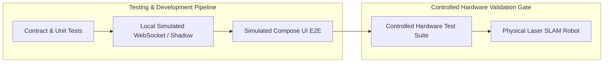

# Product Mission & Scope — WeBack Android Project

**Document ID:** SPEC-MISS-01  
**Version:** 1.0.0 (Proposed Baseline)  
**Effective Date:** 2026-11-24  
**Author:** Product Discovery Agent & Principal Android Architect  
**Approved by:** Product Owner (Pending Formal Baseline Sign-off)  

---

## 1. Product Mission

The mission of **WeBack Android** is to deliver a reliable, secure, responsive, and privacy-first Android client application for controlling intelligent robotic vacuum cleaners, starting with Laser SLAM models.

The product replaces the legacy, proprietary WeBack 6.1.7 application with a modern, maintainable codebase that eliminates legacy security vulnerabilities (unencrypted Wi-Fi credential transmission, MD5 password hashing), removes bloated third-party tracking, and provides real-time, deterministic control and map visualization.

---

## 2. Target Users & Core Problems Solved

### 2.1 Target Users
1. **Smart Home Homeowners:** Users who own a WeBack-compatible Laser SLAM robot vacuum and require a dependable, easy-to-use mobile interface for daily cleaning management.
2. **Privacy-Conscious Consumers:** Users who reject excessive telemetry, intrusive device fingerprinting, and insecure cleartext Wi-Fi provisioning.
3. **Product Engineering & Compatibility Testers:** Maintainers requiring deterministic verification and reproducible compatibility testing on physical hardware.

### 2.2 Core Problems Solved
- **Reliability:** Replacing brittle EventBus-entangled God-Activities with deterministic StateFlow-driven MVI state machines.
- **Security:** Eliminating cleartext credential leaks during setup and encrypting all sensitive device identifiers.
- **Performance:** Rendering real-time SLAM occupancy grids smoothly via Declarative Jetpack Compose Canvas rather than heavy, blocking legacy Views.
- **Maintainability:** Complete clean-room separation between domain business logic, network protocols, and UI rendering.

---

## 3. Scope Definition

### 3.1 MVP In-Scope (Phase 1)
- **Target Device Class:** Laser SLAM robotic vacuum cleaners (specifically prioritizing the physical test model available to the Product Owner).
- **Core Connectivity:**
  - Real-time cloud control via AWS IoT WebSocket Gateway (`PROT-WS-01`).
  - Device Shadow state synchronization (`PROT-SHADOW-01`) with flat outbound state semantics.
  - Offline local simulation backend (`Simulator First`) enabling 100% automated test coverage without external dependencies.
- **Primary Control Features:**
  - Real-time command dispatch: Start Cleaning (`Clean`), Pause (`Pause`), Return to Dock (`GoHome`).
  - Suction power adjustment (`wind_power`: Gentle, Standard, Strong).
  - Water tank flow rate control (`water_level`: 1, 2, 3).
  - Device status telemetry (Battery percentage, operational status, fault codes).
- **Map Ingestion & Canvas Display:**
  - ZLIB decompression of binary map packets.
  - Affine coordinate transform (handling inverted Canvas Y-axis).
  - 2D occupancy grid rendering (explored free space, obstacles, unexplored areas).
- **Security & Privacy:**
  - Android Keystore-backed storage for authentication tokens.
  - Zero telemetry or advertising SDKs.
  - Enforced TLS 1.3/1.2; global cleartext HTTP strictly denied.

### 3.2 Long-Term Scope (Future Phases)
- Capability-based expansion to Gyro robot vacuums (no SLAM map).
- Virtual forbidden walls and restricted cleaning zone editing.
- Room partition selection and custom spot cleaning.
- Scheduled cleaning automation via REST API countdowns.
- Multi-floor map management and history log review.
- BLE GATT and SoftAP Wi-Fi provisioning (re-architected for security).
- Legacy robot support (Smack XMPP).

### 3.3 Explicit Non-Goals (Strictly Prohibited from MVP)
- **Peripheral Smart Devices (`CAT-04`):** Smart sockets, air purifiers, humidifiers, smart door locks, and thermostats are strictly excluded.
- **Proprietary Multimedia (`CAT-03`):** ThroughTek live camera video streaming, P2P NAT hole punching, and two-way voice intercom are excluded. No proprietary `.so` libraries will be bundled.
- **Firmware & SLAM Reverse Engineering:** Modifying or reconstructing robot MCU firmware (STM32/GD32) or onboard embedded Linux SLAM point-cloud generation is out of scope.
- **Automatic Production Cloud Access:** Automated test suites must never connect to live production AWS IoT Core servers.

---

## 4. Simulator-First Strategy & Real-Device Compatibility

To achieve rigorous Verification-First engineering while guaranteeing real-world compatibility:

1. **Development & Verification Lane:** 100% of automated testing executes against synthetic fixtures, simulated WebSocket endpoints, and mock shadow states.
2. **Compatibility Assurance:** The protocol serializers and state machines strictly adhere to the bytecode-grounded schemas recorded in `docs/reference/RE_BASELINE.md`.
3. **Controlled Hardware Gate:** Direct testing against physical robot vacuums requires separate authorization (Milestone FCT-005) and operates under a dedicated test protocol.
