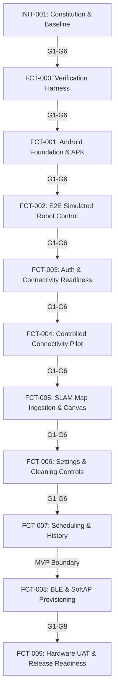

# Engineering Roadmap — WeBack Android Project

**Document ID:** SPEC-ROAD-01  
**Version:** 1.1.0 (Proposed Calibrated Baseline)  
**Effective Date:** 2026-11-24  
**Author:** Principal Android Architect  
**Governance Authority:** Product Owner & Lead Maintainer  
**Status:** PROPOSED BASELINE (Awaiting Formal Human Review & Approval)  

---

## 1. Roadmap Architecture & Milestone Progression

The engineering roadmap follows strict **Verification-First Spec-Driven Development 2.0**.
Milestones are structured as incremental, vertical slices delivering verifiable outcomes. No milestone begins before its predecessor passes its designated Quality Gates.

> [!IMPORTANT]
> **Governance Invariant:** An automated verification pass (**Gate G4 PASS**) alone does **NOT** authorize advancing or skipping subsequent gates. Every milestone requires independent multi-perspective review (**Gate G5**) and explicit human merge/advancement authorization (**Gate G6/G7**).

---

## 2. MVP Boundary vs. Future Capabilities

- **MVP Target (Milestones INIT-001 through FCT-007):**
  - Robust, simulator-first verification baseline and Android application foundation.
  - Full simulated and verified AWS IoT WebSocket/Shadow communication.
  - Early risk-reduction connectivity pilot on physical hardware (FCT-004).
  - SLAM occupancy grid map decompression and Compose Canvas rendering.
  - Essential cleaning operations (`Clean`, `Pause`, `GoHome`), suction power, water level, and basic scheduling.
- **Future Post-MVP Scope (Milestones FCT-008, FCT-009 & beyond):**
  - In-app BLE GATT and SoftAP Wi-Fi provisioning (FCT-008).
  - Virtual walls, forbidden zones, and multi-room partition cleaning.
  - Production Google Play release qualification and broad fleet hardware UAT (FCT-009).
  - Legacy Smack XMPP protocol bridge.

---

## 3. Milestone Specifications

### Milestone INIT-001: Repository Bootstrap & Engineering Constitution
- **Status:** `PROPOSED CALIBRATED BASELINE (Awaiting Formal PO & Lead Sign-off)`
- **Observable Outcome:** A clean, initialized Git repository containing the complete engineering constitution, architecture rules, frozen RE baseline, governance policies, and toolchain readiness audit.
- **Risk Tier:** `T4 (Critical - Governance & Verification Assets)`
- **Scope:** Governance documents, constitutions, architecture specifications, risk policies, quality gates, `.gitignore`, and agent charter (`AGENTS.md`).
- **Non-Goals:** Production code, Android Gradle configuration, SDK downloads, live network interaction.
- **Applicable Gates:** `Gate G0 (Scope Ready)`, `Gate G1 (Spec Approved)`, `Gate G2 (Design Ready)`.
- **Required Verification:** Manual document review, link and anchor audits, cryptographic hash verification of reference RE package (`fd34a...`).
- **External Dependencies:** None (Self-contained in repository).
- **Approval Authority:** Product Owner (G0, G1) and Lead Maintainer (G2).

---

### Milestone FCT-000: Minimum Viable Verification Harness
- **Status:** `SPECIFICATION STAGE (Authorized for Spec Engineering)`
- **Observable Outcome:** A standalone, standard-library Python verification harness (`verification/run.py`), declarative check registry (`policies/checks.json`), machine-readable evidence schema, self-testing suite, and defect-to-regression mechanism.
- **Risk Tier:** `T4 (Critical - Verification Trust Boundary & Policy Assets per POL-RISK-01)`
- **Scope:** `verification/`, `policies/checks.json`, `skills/defect-to-regression/`, and `.github/workflows/ci.yml`.
- **Non-Goals:** Android SDK installation, Gradle module configuration, application code authoring.
- **Applicable Gates:** `Gate G0` through `Gate G6`.
- **Required Verification:** 100% PASS on runner selftests across clean checkout verification, process-tree timeout handling, intentional failure propagation, schema validation, and mutation tests in isolated temporary git repositories.
- **External Dependencies:** Python 3.12+ and Git 2.43+ (Verified host ready). Zero cloud or external dependencies.
- **Approval Authority:** Product Owner (G0, G1) and Lead Maintainer (G2, G3, G6). Dual human sign-off required.

---

### Milestone FCT-001: Android Foundation & First Runnable Debug APK
- **Status:** `PLANNED`
- **Observable Outcome:** Provisioned Android SDK (compileSdk 35), Gradle wrapper 8.10.2, minimal Kotlin 2.0 / Compose skeleton compiling deterministically into a signed Debug APK (`app-debug.apk`) with verified SHA-256 sidecar.
- **Risk Tier:** `T2 (Medium Risk - Build & Toolchain Scaffolding)`
- **Scope:** `app/build.gradle.kts`, `settings.gradle.kts`, `gradle/libs.versions.toml`, `gradle/wrapper/`, `app/src/main/AndroidManifest.xml`, entry `MainActivity.kt`.
- **Non-Goals:** Protocol implementation, domain logic, UI screens, network calls.
- **Applicable Gates:** `Gate G0` through `Gate G6`.
- **Required Verification:** Deterministic compilation, zero lint errors, verified APK hash sidecar, clean verification harness execution.
- **External Dependencies:** Google Maven / Maven Central dependency resolution (requires human authorization for toolchain provisioning).
- **Approval Authority:** Lead Maintainer.

---

### Milestone FCT-002: End-to-End Simulated Robot Control
- **Status:** `PLANNED`
- **Observable Outcome:** First complete vertical slice: Domain entity `RobotInfo`, MVI state machine, local MockWebServer/WebSocket simulated robot endpoint, and Jetpack Compose dashboard allowing a user to toggle `Clean`, `Pause`, and `GoHome` commands with instant UI state feedback.
- **Risk Tier:** `T2 (Medium Risk - Core Domain & UI Flow)`
- **Scope:** `com.weback.robot.domain`, `com.weback.robot.protocol` (simulated adapter), `com.weback.robot.ui`, unit and contract test suites.
- **Non-Goals:** Live cloud networking, physical device connection, map rendering.
- **Applicable Gates:** `Gate G0` through `Gate G6`.
- **Required Verification:** 100% offline contract tests, MVI state transition unit tests, Compose UI tests.
- **External Dependencies:** None (In-process simulated transport).
- **Approval Authority:** Product Owner & Lead Maintainer.

---

### Milestone FCT-003: Authentication, Device Inventory and Connectivity Readiness
- **Status:** `PLANNED`
- **Observable Outcome:** Approved Threat Model & Security ADR for credential storage; clean-room implementation of AWS Cognito token acquisition/refresh flow, device inventory REST client, and production-ready `OkHttpWebSocketAdapter` with automated log scrubbing.
- **Risk Tier:** `T3 (High Risk - Auth, Tokens & Network Security)`
- **Scope:** Authentication use cases, Keystore-backed token repository per approved ADR, Cognito REST adapter, device inventory repository.
- **Non-Goals:** Cleartext HTTP, unredacted logging, direct physical robot pairing.
- **Applicable Gates:** `Gate G0` through `Gate G6`.
- **Required Verification:** Contract tests with synthetic JWTs, security linting, log redaction validator, fault injection for token expiration.
- **External Dependencies:** None for automated tests (MockWebServer with synthetic Cognito endpoints).
- **Approval Authority:** Product Owner & Lead Maintainer.

---

### Milestone FCT-004: Controlled Connectivity Pilot
- **Status:** `PLANNED (Early Compatibility Risk-Reduction Gate)`
- **Observable Outcome:** Verification of real-time cloud connectivity and live device shadow synchronization against the Product Owner's physical Laser SLAM robot vacuum in an isolated test environment.
- **Risk Tier:** `T4 (Critical - Live Transport & Hardware Interaction)`
- **Scope:** Live WebSocket and Device Shadow synchronization under human-operated supervision.
- **Non-Goals:** Production release, automated regression on live cloud, unredacted packet trace sharing.
- **Applicable Gates:** `Gate G0` through `Gate G6`. *Note: FCT-004 is strictly an early risk-reduction milestone, NOT a production release authorization.*
- **Required Verification:** Live telemetry handshake audit, shadow schema verification, scrubbed session packet logs.
- **External Dependencies & Blocked Handling:**
  - *Dependency:* Access to physical Laser SLAM robot and test cloud account credentials.
  - *Blocked Condition:* If physical hardware or cloud access is unavailable, this milestone is marked `BLOCKED`. Offline development on FCT-005 (Map Ingestion) and FCT-006 (Controls) shall proceed in parallel upon explicit Product Owner approval.
- **Approval Authority:** Product Owner (Mandatory sign-off).

---

### Milestone FCT-005: SLAM Map Ingestion and Rendering
- **Status:** `PLANNED`
- **Observable Outcome:** Pure Kotlin ZLIB decompression engine decoding binary occupancy grid packets into matrix models, applying the forward/backward affine coordinate transform, and rendering the floor map smoothly on a Compose `Canvas`.
- **Risk Tier:** `T2 (Medium Risk - Binary Processing & Canvas Rendering)`
- **Scope:** ZLIB map decoder, coordinate transformer, `MapCanvas` composable, golden map fixture tests.
- **Non-Goals:** Virtual wall editing, room splitting, multi-floor map cloud management.
- **Applicable Gates:** `Gate G0` through `Gate G6`.
- **Required Verification:** Golden test assertions comparing decoded grid bytes and rendered canvas points against verified reverse-engineering fixtures; zero coordinate inversion drift.
- **External Dependencies:** None (Synthetic binary map fixtures).
- **Approval Authority:** Lead Maintainer.

---

### Milestone FCT-006: Robot Settings and Cleaning Controls
- **Status:** `PLANNED`
- **Observable Outcome:** Suction power regulation (`wind_power`), water level control (`water_level`), cleaning mode selection, and device fault code mapping with user alerts.
- **Risk Tier:** `T2 (Medium Risk - Device Configuration Logic)`
- **Scope:** Settings domain use cases, UI controls, protocol payload serializers.
- **Non-Goals:** Complex timer schedules, third-party voice assistant integration.
- **Applicable Gates:** `Gate G0` through `Gate G6`.
- **Required Verification:** Serializer contract tests, UI interaction tests, FSM fault state transitions.
- **External Dependencies:** None (Simulated backend).
- **Approval Authority:** Product Owner & Lead Maintainer.

---

### Milestone FCT-007: Scheduling and History
- **Status:** `PLANNED (MVP Scope Conclusion)`
- **Observable Outcome:** Local and cloud-synchronized cleaning countdowns/schedules adhering to REST shadow duality (`thing_shadow.state.desired` per `REG-01`), and historical cleaning records view.
- **Risk Tier:** `T2 (Medium Risk - Automation & History Persistence)`
- **Scope:** Countdown timers, schedule repositories, history list UI.
- **Non-Goals:** Advanced AI cleaning analytics.
- **Applicable Gates:** `Gate G0` through `Gate G6`.
- **Required Verification:** Wire format duality tests (`REG-01`), timer edge cases, local storage migrations.
- **External Dependencies:** None (Simulated REST backend).
- **Approval Authority:** Product Owner & Lead Maintainer.

---

### Milestone FCT-008: BLE and SoftAP Provisioning
- **Status:** `FUTURE / POST-MVP`
- **Observable Outcome:** Clean-room Bluetooth Low Energy (BLE) scanning, GATT service connection, fixed 86-character slicing fragmentation (`REG-03`), and fallback SoftAP HTTP setup on `192.168.4.1` with encrypted Wi-Fi credential transmission.
- **Risk Tier:** `T3 (High Risk - Peripheral Hardware & Local Subnets)`
- **Scope:** BLE GATT manager, Wi-Fi credential serializer, SoftAP HTTP client.
- **Non-Goals:** Proprietary smart sockets or door lock BLE protocols.
- **Applicable Gates:** `Gate G0` through `Gate G6`.
- **Required Verification:** BLE packet fragmentation unit tests, wire byte length verification, SoftAP scoped network security test.
- **External Dependencies:** Physical test phone with Bluetooth/Wi-Fi and physical robot in pairing mode.
- **Approval Authority:** Product Owner & Lead Maintainer.

---

### Milestone FCT-009: Hardware UAT and Release Readiness
- **Status:** `FUTURE / POST-MVP (Release Qualification)`
- **Observable Outcome:** Production-ready release APK/AAB package, complete manual UAT on target hardware, verified bit-for-bit build reproducibility, signed checksum manifests, and zero open P0/P1 issues.
- **Risk Tier:** `T4 (Critical - Production Distribution)`
- **Scope:** Release signing pipeline, release qualification audits, field smoke testing, documentation freeze.
- **Non-Goals:** Feature additions or architectural alterations.
- **Applicable Gates:** `Gate G7 (Release Authorized)` and `Gate G8 (Release Verified)`.
- **Required Verification:** Full verification harness suite in release mode, bit-for-bit reproducibility audit, physical robot acceptance checklist.
- **External Dependencies:** Physical robot, dedicated release signing keys.
- **Approval Authority:** Product Owner & Lead Maintainer (Joint final authorization).
